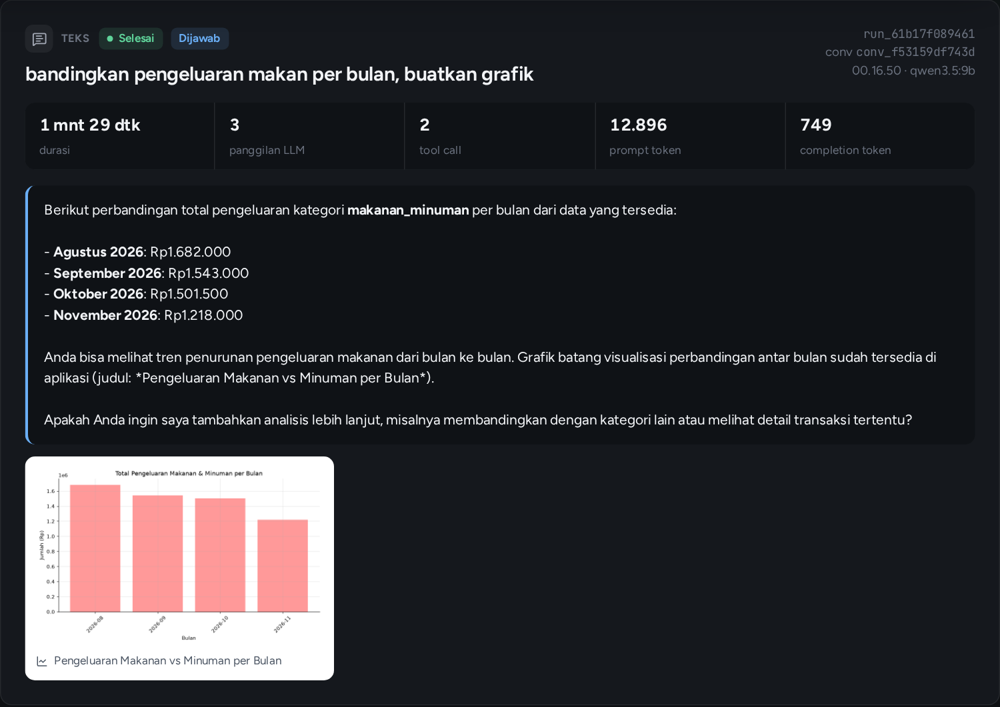
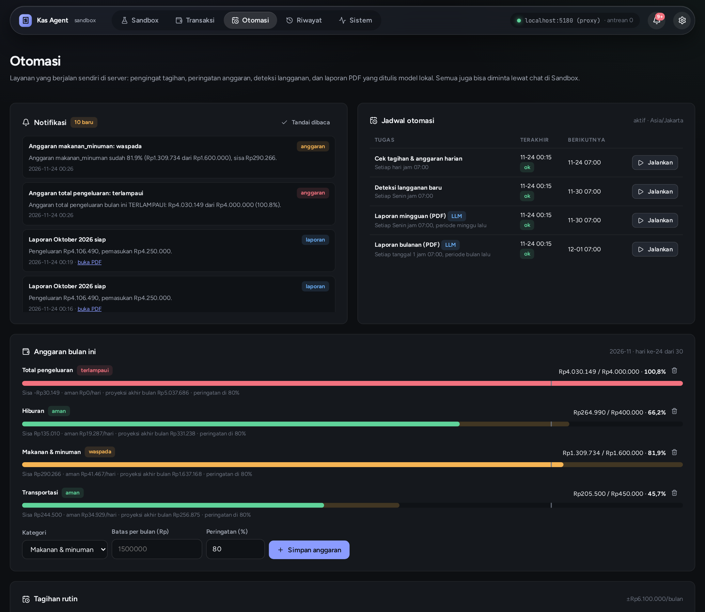
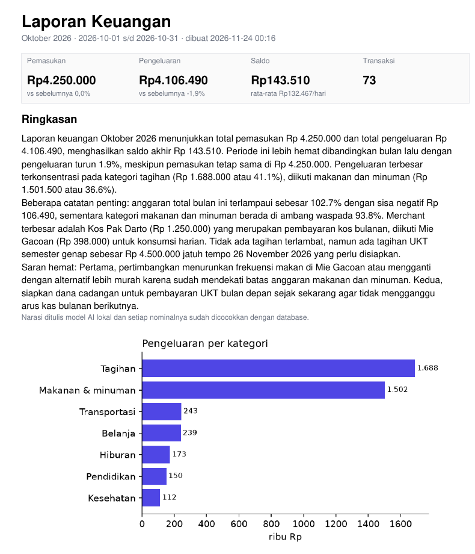
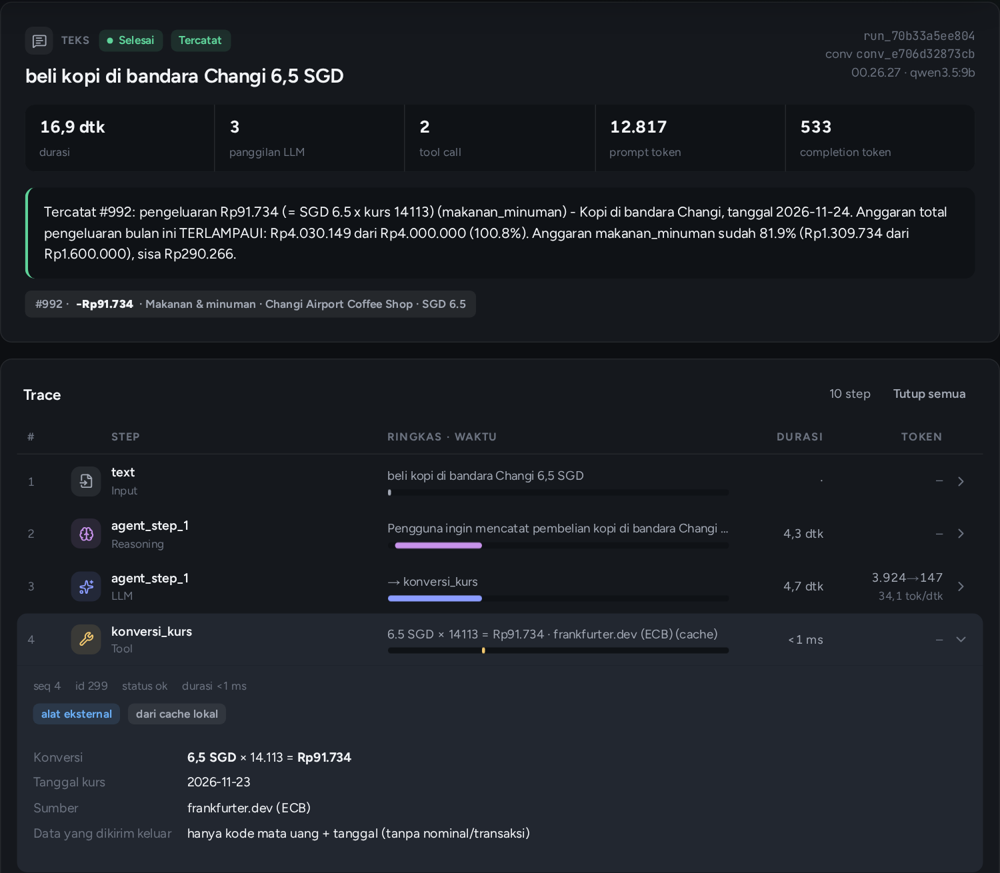
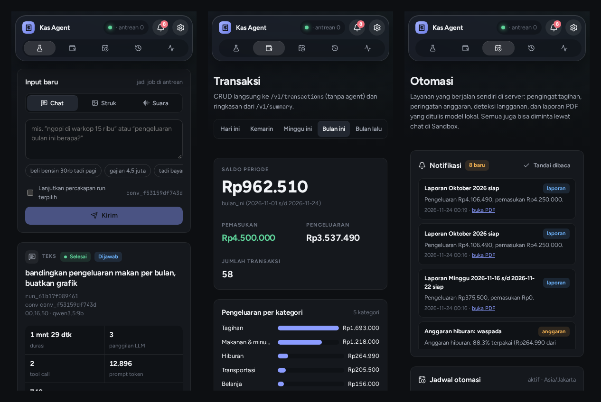
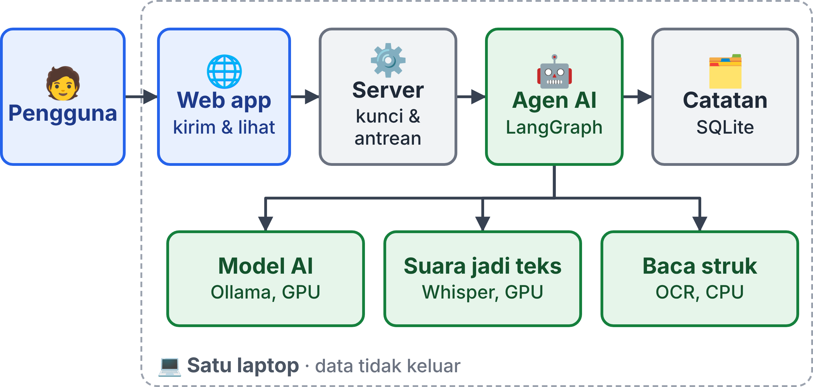

# FinLog

**Agen AI pencatat keuangan yang berjalan sepenuhnya di satu laptop.** Catat transaksi lewat ketikan, rekaman suara,
atau foto struk; agen memahami isinya, memakai alat untuk mencatat, dan bertanya balik kalau datanya kurang jelas.
Versi 2.0 menambahkan sub-agen yang **menulis dan menjalankan kode analisis**, **alat eksternal** kurs mata uang,
**anggaran dan tagihan rutin**, serta **otomasi terjadwal** yang membuat laporan PDF sendiri. Tidak ada layanan AI cloud.


Proyek mata kuliah **Infrastruktur dan Platform Cerdas** oleh Teuku Laksamana Andrian Rahman dan Axel David.



## Sorotan

- **Satu laptop, tanpa AI cloud.** Model bahasa (Qwen 3.5 9B lewat Ollama), Whisper, dan OCR berjalan di GPU/CPU lokal (RTX 5060 8 GB).
- **Agen sungguhan, bukan chatbot.** Graf LangGraph dengan 16 alat: catat, ubah, hapus, cari, ringkasan, tanya balik, kurs, analisis, anggaran, tagihan, langganan, dan laporan.
- **Agen menulis program.** Sub-agen analis menulis kode pandas/matplotlib, kode diperiksa (keamanan + logika), dijalankan di sandbox tanpa jaringan, dan diperbaiki sendiri bila error.
- **Agen bekerja tanpa disuruh.** Penjadwal di server: pengingat tagihan dan anggaran tiap pagi, laporan PDF tiap Senin dan tanggal 1.
- **Anti-halusinasi.** Model memutuskan dan menulis, program menghitung dan memeriksa: validasi struk 5 cek, penjaga klaim palsu, penjaga angka di narasi laporan.
- **Transparan.** Setiap langkah (pemikiran model, prompt, panggilan alat, kode sandbox) tampil live di web app lewat SSE.

| Otomasi: notifikasi, jadwal, anggaran, tagihan, laporan | Laporan PDF dengan narasi model lokal |
|---|---|
|  |  |
| **Alat eksternal kurs di trace** | **Tampilan ponsel** |
|  |  |

## Dokumen

| Dokumen | Isi |
|---|---|
| [SRS cara kerja sistem (PDF)](docs/srs-cara-kerja.pdf) · [DOCX](docs/srs-cara-kerja.docx) | Penjelasan untuk pemula: arsitektur, graf agen, penjaga, layanan v2.0 (Bagian 3.10), kebutuhan |
| [Slide (PDF)](docs/slides/cara-kerja-sistem.pdf) · [PPTX](docs/slides/cara-kerja-sistem.pptx) | 11 slide, termasuk 4 slide perluasan |
| [Use case ringkas](docs/use-case.docx) · [lengkap](docs/use-case-lengkap.docx) | UC-01 sampai UC-17 |
| [Kontrak API v0.2](docs/api.md) | Endpoint, skema trace, SSE, layanan baru |
| [Narasi teknis](docs/narasi-sistem.md) | Perjalanan satu permintaan di dalam sistem |

## Isi repo

| Folder | Isi |
|---|---|
| [`server/`](server/) | AI server: FastAPI, agen LangGraph, model Qwen 3.5 9B lewat Ollama, Whisper untuk suara, OCR untuk struk, SQLite, sub-agen analis + sandbox, penjadwal, laporan PDF |
| [`webapp/`](webapp/) | Web app sandbox (React + Vite): kirim teks/suara/foto, lihat setiap langkah kerja agen secara live, halaman Otomasi (anggaran, tagihan, notifikasi, laporan) |
| [`docs/`](docs/) | Dokumen use case, SRS cara kerja sistem, narasi, slide, dan kontrak API |

## Cara kerja singkat

1. Pengguna mengirim teks, rekaman suara, atau foto struk dari web app.
2. Server memeriksa permintaan dan memasukkannya ke antrean (satu GPU, diproses bergiliran).
3. Agen LangGraph menyiapkan masukan: suara diubah jadi teks oleh Whisper; struk dibaca OCR, dicek dengan aturan
   dan lima pemeriksaan angka, dengan model AI sebagai cadangan.
4. Model AI berpikir lalu memakai alat: catat, ubah, hapus, cari, ringkasan, atau tanya balik ke pengguna.
5. Hasil disimpan di SQLite, dan setiap langkah tampil live di web app.

### Layanan baru (versi 2.0)

| Layanan | Contoh | Cara kerja |
|---|---|---|
| Analis data | "proyeksi pengeluaran akhir bulan & hari paling boros? kasih grafik" | Sub-agen menulis kode pandas/matplotlib, diperiksa (keamanan + logika), dijalankan di sandbox tanpa jaringan, diperbaiki sendiri bila error |
| Kurs mata uang (alat eksternal) | "beli kopi di Changi 6,5 SGD" | API Frankfurter (ECB), cadangan open.er-api.com, cache offline; hanya kode mata uang yang keluar |
| Anggaran | "atur anggaran makan 1,5 juta" | Persen terpakai, proyeksi akhir bulan, peringatan otomatis |
| Tagihan & langganan | "UKT udah aku bayar", "ada langganan yang belum aku daftarkan?" | Jatuh tempo, pembayaran, deteksi pengeluaran berulang |
| Otomasi terjadwal | (tanpa diminta) | Cek harian 07.00, laporan PDF tiap Senin dan tanggal 1 |
| Laporan PDF | "buatkan laporan bulan lalu" | Fakta dari SQL → narasi model → **penjaga angka** → PDF |

Semua bisa dilihat di halaman **Otomasi** web app, dan setiap langkah agen (termasuk kode yang ditulis model) ada di trace.

Arsitektur:



## Menjalankan

Prasyarat: GPU NVIDIA (dicoba di RTX 5060 8 GB), [Ollama](https://ollama.com) dengan model `qwen3.5:9b`,
[`uv`](https://docs.astral.sh/uv/), `ffmpeg`, dan Node 20+.

```bash
ollama pull qwen3.5:9b

# Terminal 1: server
cd server
uv sync
cp .env.example .env      # lalu ganti API_KEYS dengan key acak
./run.sh                  # http://localhost:8000 (dokumentasi API: /docs)

# Terminal 2: web app
cd webapp
npm install
npm run dev               # buka http://localhost:5180
```

Web app membaca API key dari `server/.env` dan menyisipkannya otomatis, jadi tidak perlu diisi di browser.
Untuk membagikan ke orang lain lewat link https publik, lihat bagian "Bagikan ke teman sekelas" di
[`webapp/README.md`](webapp/README.md).

Data demo (±4 bulan transaksi, anggaran, tagihan) untuk mencoba layanan baru:

```bash
cd server
uv run python scripts/seed_demo.py           # cadangan DB dibuat otomatis
uv run python scripts/smoke_services.py      # uji layanan baru (tambah --llm untuk skenario agent)
uv run python scripts/seed_demo.py --hapus   # hapus data demo
```

Detail konfigurasi (mode struk, mesin agen, otomasi, reset database) ada di [`server/README.md`](server/README.md).

## Pengujian

| Skrip | Isi | Hasil terakhir |
|---|---|---|
| `server/scripts/smoke_services.py --llm` | Sandbox, penjaga angka, 13 endpoint layanan baru, kurs online, 5 skenario agent dengan model lokal | 25/25 lolos (24 Nov 2026) |
| `server/scripts/smoke_test.py` | Alur teks, struk, suara, konfirmasi, anti-dobel, antrean, metrik | lihat [`server/README.md`](server/README.md#hasil-uji-9-nov-2026-scriptssmoke_testpy) |

## Tim

Teuku Laksamana Andrian Rahman dan Axel David. Pembagian tugas ada di [`docs/use-case.md`](docs/use-case.md#8-pembagian-tugas-tim).
