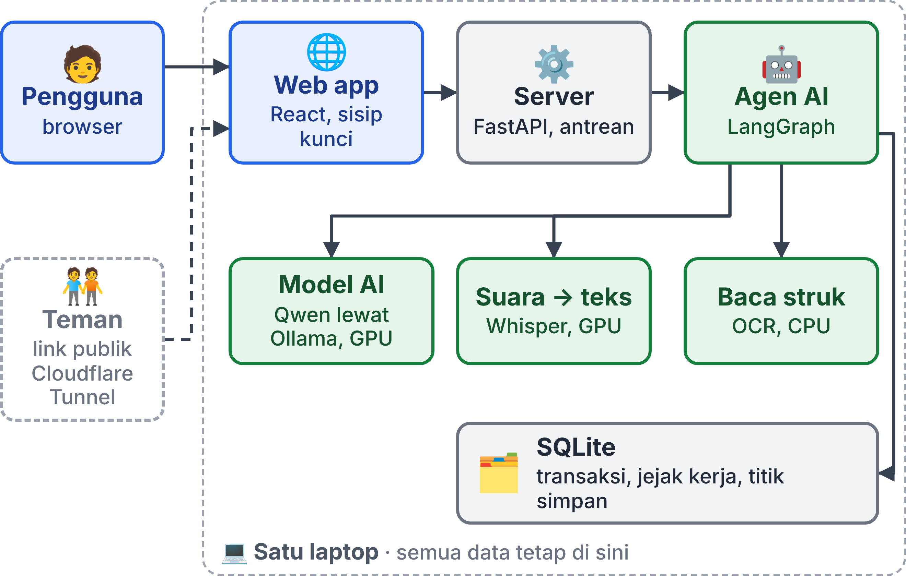
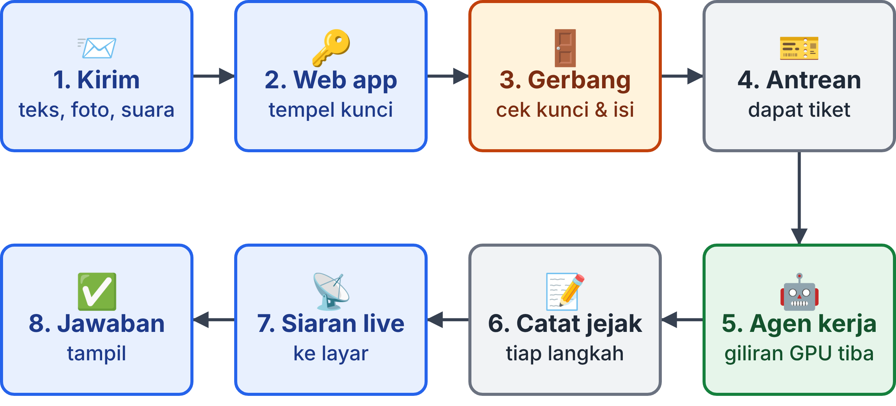
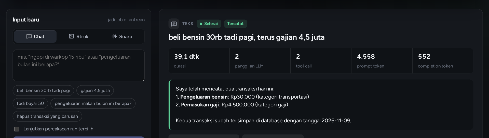
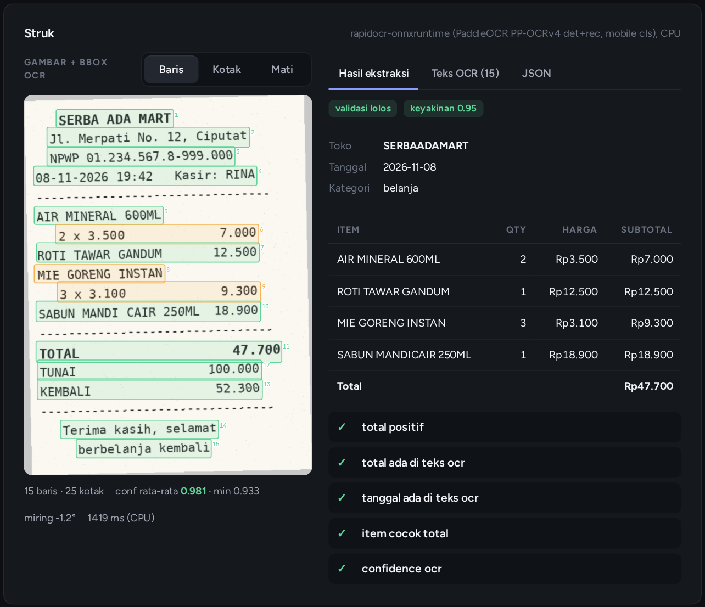
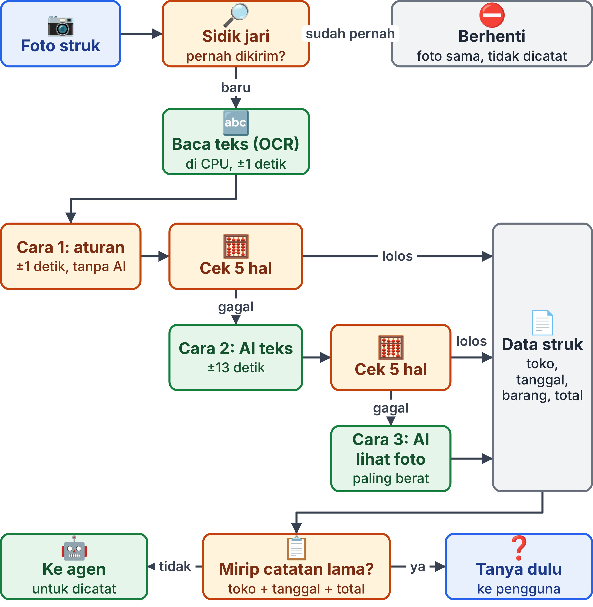
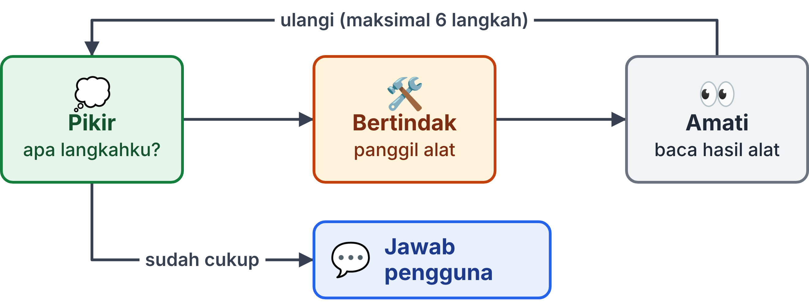
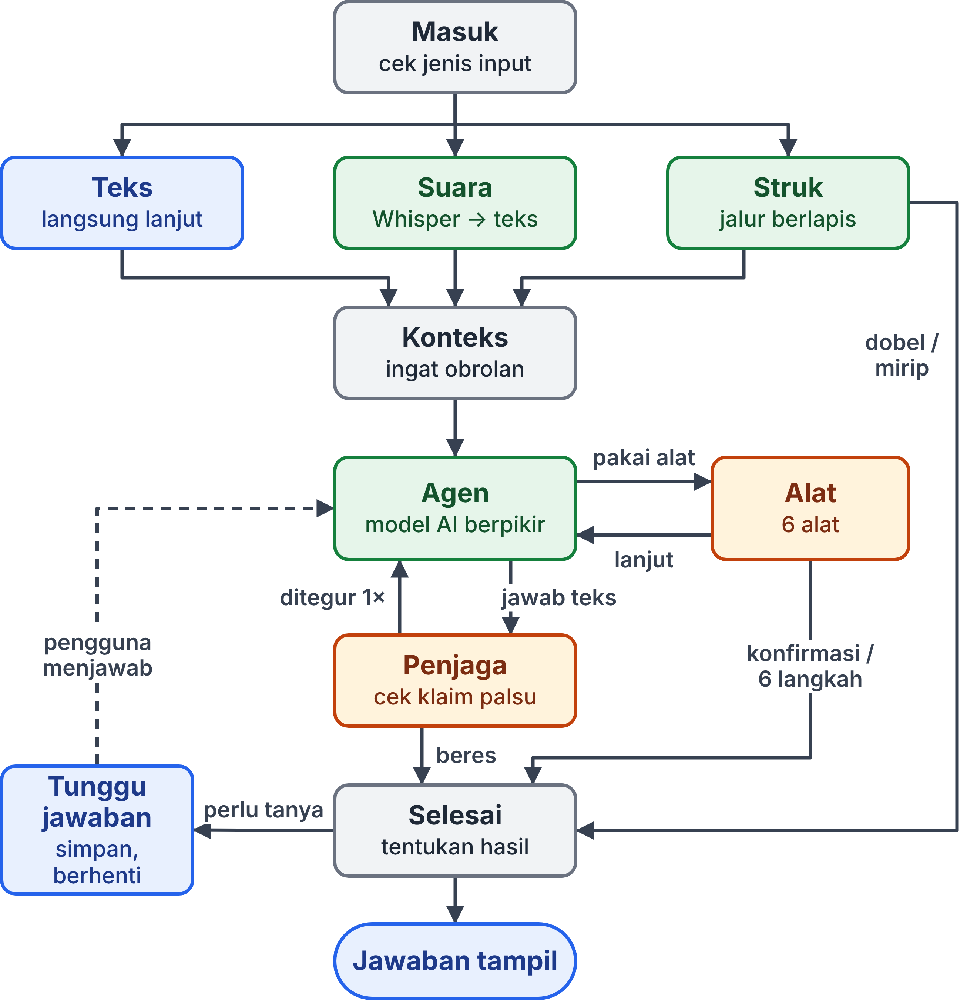
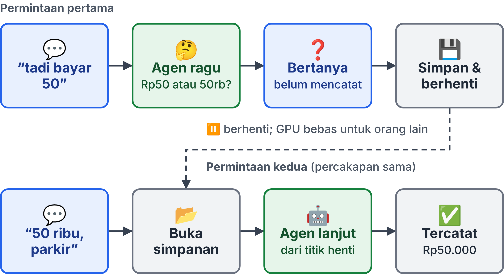
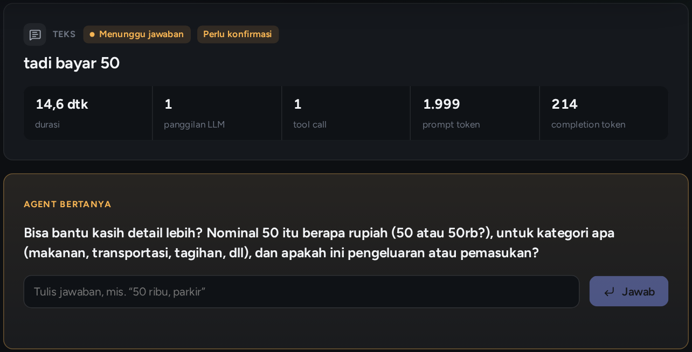

<!-- build: body=11 table=9 spacing=1.08 -->
# Cara Kerja Sistem Agen AI Pencatat Keuangan Pribadi

Dokumen cara kerja sistem dengan susunan ala SRS (Software Requirements Specification), ditulis untuk pemula yang sedang belajar AI agent.

| | |
|---|---|
| Proyek | Agen AI Pencatat Keuangan Pribadi Berbasis Local AI Server |
| Mata kuliah | Infrastruktur dan Platform Cerdas |
| Anggota | Teuku Laksamana Andrian Rahman Axel David |
| Versi dokumen | 1.0, 10 November 2026 |
| Pembaca sasaran | Mahasiswa yang baru mengenal istilah LLM, tool, dan agent |
| Isi | Cara kerja sistem, kebutuhan, dan batasan (tanpa kode program) |

## 1 Pendahuluan

### 1.1 Tujuan Dokumen

Dokumen ini menjelaskan cara kerja sebuah agen AI pencatat keuangan. Kamu tidak perlu bisa membaca kode untuk memahaminya. Setiap istilah teknis dijelaskan saat pertama kali muncul, dan semua istilah juga dikumpulkan di Glosarium (Lampiran A).

Setelah membaca dokumen ini, kamu diharapkan bisa:

1. Menjelaskan apa itu agen AI dan bedanya dengan chatbot biasa.
2. Mengikuti perjalanan satu permintaan, dari tombol Kirim sampai jawaban muncul di layar.
3. Memahami mengapa sistem ini memeriksa ulang hasil AI dengan program biasa.
4. Membaca diagram alur kerja agen (graf) dan memahami percabangannya.

Susunannya mengikuti SRS, dokumen standar rekayasa perangkat lunak yang menjelaskan apa yang dikerjakan sistem dan syarat yang harus dipenuhinya. Bedanya, bab "Cara Kerja Sistem" dijadikan inti, karena tujuannya belajar.

### 1.2 Ruang Lingkup Produk

Sistem ini adalah **asisten pencatat keuangan pribadi**. Pengguna cukup bercerita, misalnya "beli bensin 30rb tadi pagi". Sistem lalu mencatatnya sebagai pengeluaran Rp30.000, kategori transportasi, dengan tanggal hari ini.

Ada tiga cara memberi masukan:

- **Teks:** mengetik kalimat biasa.
- **Foto struk:** mengunggah foto struk belanja.
- **Suara:** merekam atau mengunggah pesan suara.

Sistem juga bisa menjawab pertanyaan ("pengeluaran bulan ini berapa?"), mengubah, dan menghapus catatan. Dua hal membuatnya istimewa. Pertama, **semuanya berjalan di satu laptop**: tidak ada layanan AI di internet (cloud), jadi foto dan suara tidak keluar dari laptop. Kedua, **setiap langkah kerja AI ditampilkan**: apa yang dipikirkan, alat apa yang dipakai, dan berapa lama.

Yang **tidak** termasuk ruang lingkup: akun per pengguna, sinkronisasi dengan bank, dan aplikasi ponsel khusus.

### 1.3 Definisi dan Istilah Penting

Lima istilah ini dipakai di hampir setiap halaman. Pahami dulu sebelum lanjut.

| Istilah | Arti sederhana | Analogi |
|---|---|---|
| LLM (Large Language Model) | Model AI yang dilatih dengan sangat banyak teks sehingga bisa memahami dan menulis bahasa manusia | Orang yang sudah membaca jutaan buku, tetapi tidak bisa menyentuh apa pun |
| Tool (alat) | Fungsi program biasa yang boleh dipanggil oleh AI, misalnya "simpan transaksi" | Tombol-tombol di meja kerja |
| Agen AI (AI agent) | LLM yang diberi alat dan dibiarkan memutuskan sendiri alat mana yang dipakai, langkah demi langkah | Asisten yang boleh menekan tombol-tombol itu |
| Graf | Peta langkah kerja: kotak-kotak (langkah) yang dihubungkan panah (urutan) | Peta jalur bus beserta persimpangannya |
| Trace (jejak) | Catatan setiap langkah yang dikerjakan agen | Kotak hitam pesawat |

Istilah lain (OCR, checkpoint, interrupt, token, dan seterusnya) dijelaskan di bagian yang memakainya.

### 1.4 Gambaran Isi Dokumen

Bab 2 menjelaskan sistem secara umum. **Bab 3 adalah inti dokumen**: cara kerja sistem dari ujung ke ujung. Bab 4 sampai 6 berisi kebutuhan fungsional, antarmuka, dan non-fungsional. Bab 7 berisi batasan dan rencana pengembangan. Lampiran berisi glosarium dan ringkasan alur dalam satu halaman.

## 2 Deskripsi Umum

### 2.1 Perspektif Produk

Sistem ini adalah **local AI server**: server AI yang berjalan di komputer sendiri, bukan di pusat data perusahaan lain. Pada chatbot di internet, setiap foto dan pesan dikirim ke server mereka. Di sini, model AI ikut berjalan di laptop.

Sistem terdiri dari dua bagian di laptop yang sama: **web app** (halaman web tempat pengguna mengetik, mengunggah foto, dan merekam suara) dan **server AI** (program yang menerima permintaan, menjalankan agen, dan menyimpan data). Teman sekelas bisa ikut mencoba lewat **link publik** Cloudflare Tunnel (Bagian 5.2), tetapi pemrosesan tetap terjadi di laptop yang sama.

### 2.2 Fungsi Utama

Fungsinya: mencatat dari teks, foto struk, dan suara; menjawab pertanyaan ringkasan; bertanya balik bila ragu; mengubah dan menghapus catatan; menolak catatan dobel; menampilkan langkah kerja AI; dan memantau laptop. Rinciannya ada di Bab 4.

Transaksi dikelompokkan ke dalam **12 kategori** tetap:

| Jenis | Kategori |
|---|---|
| Pengeluaran (9) | Makanan dan minuman, transportasi, belanja, tagihan, kesehatan, pendidikan, hiburan, transfer keluar, lainnya |
| Pemasukan (3) | Gaji, transfer masuk, lainnya |

### 2.3 Karakteristik Pengguna

- **Pengguna:** pemilik laptop atau teman yang mencoba. Tidak perlu paham AI; cukup bisa mengetik, memotret, atau merekam.
- **Admin:** pemilik laptop. Menyalakan server, mengatur kunci akses, memantau GPU, dan membagikan link publik.
- **Pembelajar:** mahasiswa yang membuka trace untuk melihat cara agen berpikir dan bertindak.

### 2.4 Lingkungan Operasi

Semua komponen berjalan di **satu laptop**: GPU NVIDIA RTX 5060 Laptop dengan memori 8 GB, RAM 30 GB, sistem operasi Linux, dan browser modern (Chrome, Firefox, atau Edge) untuk membuka web app.

**GPU** adalah prosesor yang mengerjakan ribuan hitungan kecil sekaligus, sehingga jauh lebih cepat daripada CPU untuk model AI. Memorinya disebut **VRAM**. Model bahasa butuh sekitar 5,7 GB dan pengubah suara ke teks sekitar 0,5 GB, jadi VRAM 8 GB hampir penuh. Ini alasan beberapa keputusan desain di Bab 3.

### 2.5 Batasan Desain

1. **Satu GPU, satu pekerjaan.** Permintaan dikerjakan bergiliran, tidak bersamaan.
2. **Tanpa cloud.** Model AI, data, dan file unggahan tidak boleh dikirim ke layanan di internet.
3. **Model berukuran sedang.** Model bahasa yang muat di 8 GB berukuran sekitar 9 miliar parameter (parameter adalah "angka pengetahuan" di dalam model). Model sebesar ini cukup pintar, tetapi kadang keliru. Karena itu sistem menambahkan pemeriksaan oleh program biasa.
4. **Buku kas bersama.** Belum ada akun per orang. Semua pengguna melihat catatan yang sama.

### 2.6 Asumsi dan Ketergantungan

- Laptop menyala, tidak tertidur, dan GPU tidak dipakai aplikasi berat lain. Ollama beserta model Qwen, Whisper, dan pembaca struk sudah terpasang.
- Link publik butuh internet dan bergantung pada layanan Cloudflare.
- Pengguna menulis bahasa Indonesia sehari-hari, termasuk singkatan seperti "rb" dan "jt".

## 3 Cara Kerja Sistem

### 3.1 Arsitektur Sistem

Arsitektur adalah susunan bagian-bagian sistem dan cara mereka saling terhubung. Gambar di bawah memakai warna yang konsisten: **biru** untuk pengguna dan web app, **hijau** untuk komponen AI, **abu-abu** untuk server dan penyimpanan, dan **oranye** untuk pemeriksaan oleh program biasa.

| Bagian | Tugas | Teknologi |
|---|---|---|
| Web app | Tempat pengguna mengirim masukan dan melihat hasil serta langkah kerja AI | React, kerangka kerja untuk membuat halaman web interaktif |
| Server | Penjaga pintu: memeriksa kunci akses, memeriksa isi, dan mengantrekan pekerjaan | FastAPI, kerangka kerja Python untuk membuat server |
| Agen AI | Mengatur urutan langkah kerja: membaca masukan, berpikir, memakai alat, bertanya | LangGraph, kerangka kerja untuk menyusun agen sebagai graf |
| Model AI | Memahami bahasa, bernalar, dan bisa membaca gambar | Qwen 3.5 (9 miliar parameter), dijalankan oleh Ollama di GPU |
| Suara jadi teks | Mengubah rekaman suara menjadi tulisan | Whisper, model pengenal ucapan, di GPU |
| Pembaca struk | Membaca huruf dan angka dari foto (OCR) | PaddleOCR yang dijalankan lewat RapidOCR, di CPU |
| Penyimpanan | Menyimpan transaksi, jejak kerja, dan titik simpan percakapan | SQLite, database berupa satu berkas, tanpa server terpisah |

**Ollama** adalah program yang "melayani" model bahasa. Analoginya seperti mesin pemutar: Ollama memuat model ke GPU lalu menerima pertanyaan dari program lain.

### 3.2 Perjalanan Satu Permintaan

Cara terbaik memahami sistem adalah mengikuti satu permintaan. Misalnya pengguna mengetik "beli bensin 30rb tadi pagi" lalu menekan **Kirim**.

1. **Kirim.** Browser mengirim pesan ke web app, bukan langsung ke server AI.
2. **Web app menempelkan kunci akses.** Server hanya melayani permintaan yang membawa **kunci akses** (API key), semacam kata sandi untuk program. Web app bekerja sebagai **proxy** (perantara) yang menempelkan kunci dari sisi laptop. Kunci tidak pernah sampai ke browser, jadi pengguna tidak perlu mengisinya dan kunci tidak bisa dicuri dari halaman.
3. **Gerbang server.** Server memeriksa tiga hal. Pertama, kuncinya cocok atau tidak. Kedua, isinya masuk akal atau tidak (pesan kosong ditolak, file dicek jenis dan ukurannya). Ketiga, batas laju: paling banyak 30 pekerjaan per menit, supaya GPU tidak dibanjiri.
4. **Antrean.** Permintaan yang lolos diberi **nomor tiket** dan masuk antrean. Server langsung membalas dengan nomor itu tanpa menunggu AI selesai. Cara ini disebut **asinkron**, seperti di restoran cepat saji: terima nomor, lalu duduk menunggu dipanggil.
5. **Agen bekerja.** Saat giliran tiba, agen menjalankan graf langkah kerjanya (Bagian 3.6). Karena GPU hanya satu, pekerjaan dikerjakan satu per satu.
6. **Jejak dicatat.** Setiap langkah dicatat ke database: jenis, masukan, keluaran, durasi, dan jumlah **token** (potongan kata yang dibaca dan ditulis model).
7. **Siaran langsung.** Web app membuka saluran **Server-Sent Events (SSE)**, sambungan satu arah yang dibiarkan terbuka agar server bisa terus mengirim kabar. Pemikiran AI muncul di layar kata demi kata.
8. **Jawaban tampil.** Jawaban akhir, kartu transaksi yang tercatat, dan tabel jejak lengkap muncul di web app.

{w=14}

### 3.3 Tiga Jalur Masukan

Model bahasa hanya memahami teks. Karena itu foto dan suara harus diubah dulu menjadi teks. Setiap jenis masukan punya jalurnya sendiri.

**Jalur teks.** Tidak ada persiapan. Kalimat pengguna langsung diteruskan ke agen.

**Jalur suara.** Rekaman diubah menjadi tulisan oleh **Whisper**, model pengenal ucapan (speech-to-text). Whisper berjalan di GPU dan otomatis pindah ke CPU bila GPU tidak tersedia. Hasilnya diberi label "hasil transkripsi otomatis, bisa ada salah dengar" sebelum diteruskan. Label ini penting. Ia membuat model lebih memilih bertanya daripada menebak bila ada kata yang aneh.

**Jalur foto struk.** Jalur ini paling rumit, jadi dibahas tersendiri di bagian berikut.

### 3.4 Pipeline Struk Berlapis

**Pipeline** adalah rangkaian langkah yang dikerjakan berurutan, seperti ban berjalan di pabrik. Pipeline struk dirancang dengan prinsip **"murah dulu, mahal belakangan"**. Cara yang cepat dicoba lebih dulu. Cara yang berat hanya dipakai bila cara sebelumnya gagal. Diagram di akhir bagian ini merangkum langkah-langkahnya.

1. **Sidik jari anti-dobel.** Isi file foto diubah menjadi **hash**, yaitu kode unik yang dihitung dari isi file, seperti sidik jari. Foto yang sama persis selalu menghasilkan sidik jari yang sama. Bila sidik jari ini pernah tercatat, proses langsung berhenti dalam sekejap, tanpa memanggil AI.
2. **Membaca teks (OCR).** OCR (Optical Character Recognition) adalah teknologi yang membaca huruf dan angka dari gambar. Hasilnya berupa baris-baris teks beserta koordinat kotaknya (bounding box) dan tingkat keyakinan. OCR sengaja dijalankan di **CPU**, supaya tidak berebut VRAM dengan model bahasa. Prosesnya sekitar satu detik.
3. **Cara 1: aturan.** Teks hasil OCR diproses dengan aturan pola tulisan. Contohnya: pola angka rupiah dianggap nominal, pola tanggal dianggap tanggal, dan baris dengan kata "TOTAL" dianggap kandidat total. Cara ini tidak memakai AI dan selesai dalam kurang dari satu detik. Untuk struk yang rapi, cara ini sudah cukup.
4. **Cek 5 hal.** Hasil dari cara mana pun diperiksa oleh program biasa:
   1. Total lebih dari nol.
   2. Angka total benar-benar tertulis di teks struk.
   3. Tanggal benar-benar tertulis di teks struk.
   4. Jumlah harga barang, dikurangi diskon dan ditambah pajak, sama dengan total (toleransi 1%, minimal Rp100).
   5. Keyakinan OCR rata-rata minimal 0,80, dengan sedikitnya tiga baris terbaca.
5. **Cara 2: AI membaca teks.** Bila aturan gagal, teks OCR diberikan ke model bahasa. Model diminta mengisi formulir data yang bentuknya sudah ditentukan (toko, tanggal, barang, diskon, pajak, total, kategori). Hasilnya diperiksa lagi dengan 5 hal yang sama. Waktunya sekitar 13 detik.
6. **Cara 3: AI melihat foto.** Bila masih gagal, foto dikirim langsung ke model dalam mode **vision**, yaitu kemampuan model untuk melihat gambar. Cara ini paling teliti, tetapi juga paling berat. Cara ini juga dipakai bila OCR sendiri gagal berjalan.
7. **Cek struk serupa.** Ada kasus yang lolos dari sidik jari: dua foto berbeda dari struk yang sama, misalnya difoto ulang. Karena itu sistem memeriksa catatan lama dengan toko, tanggal, dan total yang sama. Bila ada, pengguna ditanya dulu apakah ini memang pembelian yang berbeda.

Mengapa diperiksa? Model AI kadang **berhalusinasi**: mengarang jawaban yang meyakinkan tetapi salah, misalnya "membaca" angka yang tidak ada di struk. Prinsipnya: **hasil AI tidak pernah diterima tanpa diperiksa program biasa.**

{w=9.5}

### 3.5 Apa Itu Agen dan Tool Calling

**Chatbot biasa** hanya menjawab dengan kata-kata. **Agen** diberi daftar alat dan memutuskan sendiri kapan memakai alat mana. Kemampuan model untuk "meminta alat dijalankan" disebut **tool calling**. Saat dipanggil, model menerima tiga hal:

1. **Instruksi kerja** (system prompt): teks panjang yang menjelaskan tugasnya. Isinya antara lain tanggal hari ini, aturan nominal ("30rb" = 30.000, "4,5 juta" = 4.500.000), aturan tanggal relatif ("kemarin", "tadi pagi"), daftar 12 kategori, dan aturan perilaku.
2. **Riwayat percakapan** dan pesan pengguna.
3. **Daftar alat**, masing-masing dengan nama, kegunaan, dan isian yang dibutuhkan.

Model lalu menjawab dengan teks biasa, atau dengan **permintaan memakai alat** beserta isiannya, misalnya "pakai Catat Transaksi: pengeluaran, 30.000, transportasi". Model **tidak menjalankan** alat itu; program biasa yang menjalankannya.

Agen ini punya **6 alat**:

| Alat | Kegunaan |
|---|---|
| Catat transaksi | Menyimpan satu pemasukan atau pengeluaran baru |
| Ubah transaksi | Mengoreksi catatan yang sudah ada |
| Hapus transaksi | Menandai catatan sebagai terhapus |
| Cari transaksi | Mencari catatan, misalnya untuk menemukan yang mau diubah |
| Ringkasan | Menghitung total per periode dan per kategori |
| Minta konfirmasi | Bertanya balik ke pengguna bila ada yang kurang jelas |

Dua aturan perilaku paling penting di instruksi kerja adalah: **data hanya tersimpan lewat alat**, dan **kalau ragu, wajib bertanya**.

**Pola ReAct.** Agen bekerja dalam putaran yang disebut ReAct (Reasoning + Acting, bernalar lalu bertindak).

Contohnya untuk pesan "hapus catatan ngopi tadi":

1. **Pikir:** "Aku harus tahu dulu catatan mana yang dimaksud."
2. **Bertindak:** memakai alat Cari Transaksi.
3. **Amati:** ditemukan catatan "ngopi di warkop Rp15.000".
4. **Pikir lagi:** "Sekarang aku tahu catatannya."
5. **Bertindak:** memakai alat Hapus Transaksi.
6. **Amati:** penghapusan berhasil. Agen lalu menjawab pengguna.

Putaran dibatasi **maksimal 6 langkah**, dan satu pekerjaan dibatasi 10 menit, agar agen yang bingung tidak berputar tanpa akhir.

**Pemikiran yang terlihat.** Mode berpikir (thinking) dinyalakan: model menulis penalarannya sebelum menjawab. Penalaran ini disimpan di jejak dan dialirkan langsung ke layar, sehingga kamu bisa membaca "isi kepala" agen.

**Program yang memutuskan.** Model hanya **mengusulkan** isian alat; program biasa yang **memutuskan** apakah isian itu sah. Nominal diubah ulang menjadi angka bulat, tanggal dirapikan, dan kategori dicocokkan dengan daftar resmi. Bila tidak sah, alat mengembalikan pesan gagal ke model. Penghapusan hanya menandai catatan (soft delete), jadi jejaknya tetap ada. Pertanyaan ringkasan dijawab dengan angka dari database, bukan dari ingatan model.

### 3.6 Graf LangGraph: Peta Langkah Kerja Agen

Semua langkah di atas disusun dengan **LangGraph** sebagai sebuah graf. Ada empat konsep yang perlu kamu kenal.

| Konsep | Arti | Analogi |
|---|---|---|
| Node (simpul) | Satu langkah kerja dengan satu tugas, misalnya "baca struk" atau "jalankan alat" | Halte bus |
| Edge (sisi) | Panah yang menentukan langkah berikutnya | Rute antarhalte |
| Edge bersyarat | Panah bercabang. Sebuah pemeriksa kecil (router) melihat keadaan saat itu, lalu memilih cabang | Persimpangan dengan petunjuk arah |
| State (keadaan) | Satu "map dokumen" bersama yang dibawa dari node ke node: jenis masukan, isi pesan, riwayat, hasil struk, nomor langkah, jawaban | Map berkas yang diestafetkan |

Setiap node membaca state, mengerjakan tugasnya, lalu menuliskan perubahan ke state. Graf lengkapnya berisi 17 node. Gambar berikut adalah versi sederhana: seluruh pipeline struk diringkas menjadi satu kotak.

Kotak **Konteks** memuat riwayat obrolan agar agen paham bila pengguna berkata "yang tadi". **Penjaga** memeriksa jawaban akhir agen (Bagian 3.7), dan **Tunggu jawaban** menghentikan graf sementara saat agen bertanya (Bagian 3.8). Graf ini punya **10 percabangan** (edge bersyarat). Tabel berikut menjelaskan semuanya.

| No | Dari langkah | Yang diperiksa | Ke mana |
|---|---|---|---|
| 1 | Masuk | Jenis masukan | Jalur teks, jalur suara, atau jalur struk |
| 2 | Sidik jari foto | Pernah dikirim? Mode baca struk? | Selesai (dobel), langsung ke AI lihat foto (bila sistem diatur memakai mode vision), atau ke OCR |
| 3 | OCR | Mode kerja dan apakah OCR berhasil | Aturan (mode "aturan dulu"), AI baca teks, atau AI lihat foto (bila OCR gagal) |
| 4 | Aturan | Lolos cek 5 hal? | Data struk siap (lolos) atau AI baca teks (gagal) |
| 5 | Cek hasil AI baca teks | Lolos cek 5 hal? | Data struk siap (lolos) atau AI lihat foto (gagal) |
| 6 | Cek struk serupa | Ada catatan lama yang mirip? | Selesai dan tanya dulu (ada) atau Konteks (tidak ada) |
| 7 | Agen | Model meminta alat? | Alat (ya) atau Penjaga (tidak, model menjawab teks) |
| 8 | Alat | Perlu bertanya, atau batas 6 langkah tercapai? | Selesai (ya) atau kembali ke Agen (lanjut) |
| 9 | Penjaga | Ada klaim palsu? | Kembali ke Agen, ditegur sekali (ya), atau Selesai (tidak) |
| 10 | Selesai | Sedang menunggu jawaban pengguna? | Tunggu jawaban (ya) atau akhir (tidak) |

Putaran **Agen → Alat → Agen** pada percabangan 7 dan 8 adalah pola ReAct dari Bagian 3.5.

### 3.7 Penjaga: Mengoreksi Kebiasaan Buruk Model

Model berukuran 9 miliar parameter kadang berperilaku keliru. Penjaga menangani dua kasus yang paling sering.

1. **Klaim palsu.** Model menulis "sudah dicatat" padahal tidak ada alat simpan yang berhasil dijalankan. Penjaga mengenali kalimat seperti itu, lalu mengirim teguran ke model ("kamu belum memanggil alat") dan mengembalikan alur ke Agen. Teguran hanya diberikan **sekali** agar tidak berputar terus.
2. **Jawaban kosong.** Model selesai berpikir tetapi tidak menulis jawaban. Penjaga lalu menyusun jawaban otomatis dari hasil alat yang sudah berhasil.

Setiap tindakan penjaga juga dicatat di jejak, jadi terlihat kapan dan mengapa koreksi terjadi.

### 3.8 Konfirmasi: Berhenti, Simpan, Lanjut

Bagaimana agen bertanya lalu menunggu jawaban tanpa memblokir GPU? Sistem memakai dua fitur LangGraph:

- **Interrupt:** perintah untuk menghentikan graf sementara di tengah jalan.
- **Checkpoint (titik simpan):** salinan lengkap state yang disimpan ke database SQLite. Analoginya seperti fitur *save game*: permainan bisa dimatikan, lalu dilanjutkan tepat dari titik yang sama.

Contohnya, pengguna menulis "tadi bayar 50". Agen ragu (Rp50 atau Rp50.000? untuk apa?), lalu memakai alat Minta Konfirmasi. Graf menuju **Tunggu jawaban**, menyimpan state, dan berhenti. Pekerjaan pertama ditutup dengan status "menunggu jawaban", dan GPU bebas untuk orang lain. Saat pengguna menjawab "50 ribu, parkir" di percakapan yang sama, server membuka titik simpan dan graf **melanjutkan dari titik berhenti**, bukan dari awal. Agen kini mencatat Rp50.000 kategori transportasi. Kedua pekerjaan saling ditautkan, sehingga web app menampilkannya sebagai satu rangkaian.

{w=10.5}

### 3.9 Hasil Akhir, Trace, dan Siaran Langsung

Setiap pekerjaan berakhir dengan dua label. **Status** menjelaskan keadaan pekerjaan (selesai, menunggu jawaban, selesai dengan peringatan, atau galat). **Hasil** menjelaskan apa yang terjadi pada data (tercatat, diubah, hanya dijawab, ditolak karena dobel, atau mungkin dobel).

**Trace** (jejak) adalah daftar semua langkah satu pekerjaan. Setiap baris berisi jenis langkah (masukan, OCR, pemikiran, panggilan model, alat, penjaga, konfirmasi, hasil akhir), durasi, dan jumlah token. Setiap baris bisa dibuka untuk melihat instruksi yang dikirim ke model, pemikirannya, dan isian serta hasil alat. Jejak inilah yang membuat sistem **transparan**: bila agen salah mencatat, kita bisa menelusuri di langkah mana kesalahan terjadi.

**Siaran langsung** memakai SSE (Bagian 3.2): potongan pemikiran dikirim ke layar kira-kira setiap 0,15 detik. Lewat link publik Cloudflare, SSE tidak didukung, jadi web app otomatis beralih ke **polling** (bertanya berkala "ada langkah baru?"). Langkah tetap muncul, tetapi per langkah, bukan per kata.

## 4 Kebutuhan Fungsional

Kebutuhan fungsional adalah daftar hal yang **harus bisa dilakukan** sistem: masukan (1 sampai 4), pencatatan (5 sampai 10), pertanyaan dan konfirmasi (11 sampai 15), anti-dobel (16 dan 17), serta transparansi (18 sampai 21).

1. Sistem harus menerima masukan berupa teks bebas berbahasa Indonesia.
2. Sistem harus menerima foto struk dan rekaman suara dari web app.
3. Sistem harus mengubah rekaman suara menjadi teks sebelum dipahami agen.
4. Sistem harus membaca toko, tanggal, daftar barang, dan total dari foto struk.

5. Sistem harus mengenali jenis transaksi (pemasukan atau pengeluaran), nominal, tanggal, dan salah satu dari 12 kategori.
6. Sistem harus memahami penulisan nominal sehari-hari, seperti "30rb", "4,5 juta", dan "1.250.000".
7. Sistem harus memahami tanggal relatif, seperti "kemarin" dan "tadi pagi".
8. Sistem harus bisa mencatat beberapa transaksi dari satu pesan.
9. Sistem harus menyimpan transaksi hanya lewat alat, setelah isiannya diperiksa oleh program.
10. Sistem harus memeriksa hasil pembacaan struk dengan 5 cek sebelum dipakai, dan mencoba cara berikutnya bila gagal.

11. Sistem harus menjawab pertanyaan ringkasan dengan angka dari database.
12. Sistem harus bisa mengubah dan menghapus transaksi atas permintaan pengguna. Penghapusan hanya menandai catatan sebagai terhapus.
13. Sistem harus bertanya balik bila nominal, jenis, atau transaksi yang dimaksud tidak jelas, dan tidak mencatat sebelum dijawab.
14. Sistem harus melanjutkan pekerjaan dari titik berhenti setelah pengguna menjawab pertanyaan.
15. Sistem harus memahami pesan lanjutan dalam percakapan yang sama.

16. Sistem harus menolak foto struk yang sama persis tanpa memanggil AI.
17. Sistem harus bertanya dulu bila struk baru mirip catatan lama (toko, tanggal, dan total sama).

18. Sistem harus mencatat setiap langkah kerja agen beserta durasi dan jumlah tokennya.
19. Sistem harus menyiarkan langkah dan pemikiran agen ke web app selama pekerjaan berjalan.
20. Sistem harus menampilkan status antrean, pemakaian memori GPU, dan kecepatan model.
21. Sistem harus membatasi putaran agen maksimal 6 langkah per pekerjaan.

## 5 Kebutuhan Antarmuka

### 5.1 Antarmuka Pengguna (Web App)

Web app punya empat halaman: **Sandbox** (masukan, jawaban, konfirmasi, panel struk, jejak), **Transaksi** (saldo, grafik per kategori, tabel dengan tambah, ubah, hapus), **Riwayat** (antrean dan pekerjaan sebelumnya), dan **Sistem** (memori GPU, kecepatan model, daftar alat). Kebutuhannya:

1. Pengguna tidak perlu mengisi kunci akses; web app menempelkannya otomatis.
2. Pertanyaan konfirmasi tampil sebagai kotak tersendiri dengan kolom jawaban, dan setiap langkah jejak bisa dibuka rinciannya.
3. Rekaman suara di browser hanya diizinkan lewat https atau dari laptop itu sendiri; bila tidak bisa, pengguna mengunggah file audio.
4. Pengunjung lewat link publik melihat peringatan "data bersama untuk demo, jangan masukkan data keuangan asli".

### 5.2 Antarmuka Antar-Perangkat Lunak

| Dari | Ke | Cara berkomunikasi |
|---|---|---|
| Browser | Web app | Halaman web biasa (HTTP) |
| Web app | Server | Permintaan HTTP lewat proxy, dengan kunci akses ditempelkan |
| Server | Browser | Saluran siaran langsung (SSE), atau polling lewat link publik |
| Agen | Model bahasa | Lewat Ollama, di laptop sendiri |
| Agen | Database | SQLite, berkas di laptop sendiri |
| Teman | Web app | Link https dari Cloudflare Tunnel |

Server menyediakan **API** (Application Programming Interface), semacam "menu pesanan" untuk program lain: "kirim pesan", "lihat jejak", "daftar transaksi". **Cloudflare Tunnel** membuat terowongan dari laptop ke internet berupa satu link https acak, tanpa membuka port jaringan. Yang terbuka hanya web app; server AI tetap tertutup di balik proxy. Link mati begitu terowongan dimatikan.

### 5.3 Antarmuka Perangkat Keras

1. **GPU:** model bahasa dan Whisper berbagi VRAM 8 GB. Puncak pemakaian yang terukur sekitar 7,7 GB.
2. **CPU:** OCR sengaja berjalan di CPU agar tidak menambah beban VRAM.
3. **Mikrofon dan kamera:** dipakai lewat browser pengguna untuk merekam suara dan memotret struk.
4. **Penyimpanan:** database dan file unggahan disimpan di disk laptop.

## 6 Kebutuhan Non-Fungsional

Kebutuhan non-fungsional menjelaskan **seberapa baik** sistem bekerja, bukan apa yang dikerjakannya.

### 6.1 Privasi dan Data Lokal

1. Semua model AI berjalan di laptop. Tidak ada layanan AI cloud yang dipanggil.
2. Fitur telemetri (pengiriman data pemakaian ke layanan pemantau di internet) dimatikan secara paksa. Server hanya berbicara dengan Ollama di laptop sendiri.
3. Foto, suara, transaksi, dan jejak disimpan di disk laptop.

### 6.2 Keamanan Kunci Akses

1. Setiap permintaan wajib membawa kunci akses yang cocok; bila tidak, ditolak. Batas laju 30 pekerjaan per menit mencegah GPU dibanjiri.
2. Kunci hanya ada di pengaturan server dan proses web app di laptop: tidak dikirim ke browser, tidak masuk alamat link, dan tidak ditulis ke log.
3. Konsekuensi yang perlu disadari: siapa pun yang memegang link publik bisa memakai sistem. Link dibagikan hanya ke kelas dan dimatikan setelah sesi.

### 6.3 Kinerja

Model berpikir dulu sebelum menjawab, jadi sistem ini tidak secepat chatbot di internet. Kisaran waktu satu pekerjaan saat model berjalan di GPU dan GPU tidak dipakai aplikasi lain:

| Masukan | Perkiraan waktu |
|---|---|
| Teks | Sekitar 7 sampai 25 detik (pesan sederhana sekitar 7 detik) |
| Foto struk | Sekitar 35 sampai 50 detik. Membaca struknya sendiri hanya sekitar 1 detik bila aturan berhasil; sisanya waktu agen berpikir |
| Suara | Sekitar 18 sampai 35 detik (pernah sampai sekitar 87 detik saat model berpikir panjang) |
| Foto struk dobel | Seketika, karena AI tidak dipanggil |
| Teks dengan mode berpikir dimatikan | Sekitar 9 detik |

Waktu ini bervariasi karena lamanya model berpikir berbeda-beda untuk setiap pesan. Kecepatan model sekitar 15 sampai 26 token per detik. Bila banyak orang mengirim bersamaan, pekerjaan menunggu giliran. Orang kesepuluh bisa menunggu beberapa menit.

### 6.4 Keandalan dan Cadangan

1. **Cadangan pembaca struk:** aturan, lalu AI baca teks, lalu AI lihat foto.
2. **Cadangan pengenal suara:** Whisper pindah ke CPU bila GPU tidak tersedia.
3. **Cadangan mesin agen:** sebelum LangGraph, tim membuat mesin agen sendiri berupa putaran sederhana (loop). Mesin lama ini tetap disimpan dan bisa diaktifkan lewat satu baris pengaturan, tanpa mengubah web app maupun database.
4. **Penjaga** memperbaiki klaim palsu dan jawaban kosong.
5. **Batas langkah dan waktu** mencegah agen berputar tanpa akhir.
6. **Titik simpan** menjaga percakapan konfirmasi tetap bisa dilanjutkan.

### 6.5 Keterlacakan dan Pemeliharaan

1. Setiap langkah tersimpan beserta masukan, keluaran, durasi, dan token; setiap koreksi penjaga terlihat di jejak.
2. Setiap transaksi menyimpan asal-usulnya (teks, struk, suara, atau manual) dan pekerjaan yang membuatnya. Transaksi terhapus tetap tersimpan dengan tanda terhapus.
3. Setiap node graf punya satu tugas, sehingga mudah diuji dan diganti satu per satu. Pengaturan penting (mode berpikir, mode baca struk, mesin agen) diubah lewat berkas pengaturan, tanpa mengubah program.
4. Web app punya **mode contoh** (mock) dengan data rekaman, sehingga tampilan bisa dikembangkan tanpa menyalakan server AI.

## 7 Batasan dan Pengembangan Lanjutan

### 7.1 Batasan Saat Ini

1. **Model kadang keliru.** Model 9 miliar parameter kadang lupa memanggil alat, bertanya lewat teks biasa alih-alih alat konfirmasi, atau berhenti tanpa jawaban. Penjaga mengurangi masalah ini, tetapi tidak menghilangkannya.
2. **Lambat dan bergiliran.** Satu pesan butuh beberapa detik sampai sekitar satu menit, tergantung lama model berpikir, dan dengan satu GPU, pengguna banyak berarti antrean panjang.
3. **Tanpa akun.** Semua pengguna berbagi satu buku kas dan bisa mengubah catatan orang lain.
4. **Link publik sementara.** Link berubah setiap kali dibuat, tanpa jaminan selalu aktif, dan tanpa siaran pemikiran per kata.
5. **Uji struk terbatas.** Pengujian sebagian besar memakai struk contoh buatan, belum banyak struk asli yang kusut atau buram.

### 7.2 Pengembangan Lanjutan

1. Akun per pengguna dengan buku kas masing-masing.
2. Pengujian dengan lebih banyak struk asli, lalu penyempurnaan aturan pembaca struk.
3. Mencoba model lain yang lebih cepat atau lebih tepat memanggil alat.
4. Ekspor laporan bulanan dan anggaran per kategori dengan peringatan bila melebihi batas.
5. Paket kontainer (Docker) agar mudah dipasang di laptop lain; sudah disiapkan tetapi belum diuji.

## Lampiran A Glosarium

Lima istilah inti (LLM, tool, agen AI, graf, trace) ada di Bagian 1.3, dan konsep graf (node, edge, edge bersyarat, state) ada di Bagian 3.6.

| Istilah | Penjelasan | Istilah | Penjelasan |
|---|---|---|---|
| **API** | Daftar layanan yang disediakan server untuk program lain, seperti menu pesanan | **Parameter** | "Angka pengetahuan" di dalam model; makin banyak, biasanya makin pintar dan makin berat |
| **Asinkron** | Cara kerja "terima tiket dulu, hasil menyusul", sehingga pengguna tidak menunggu di tempat | **Polling** | Bertanya berkala ke server apakah ada kabar baru |
| **Batas laju (rate limit)** | Batas jumlah permintaan per menit | **Proxy** | Perantara yang meneruskan permintaan, di sini sambil menempelkan kunci akses |
| **Bounding box** | Kotak koordinat yang menandai letak teks di gambar | **Qwen** | Keluarga model bahasa; yang dipakai adalah Qwen 3.5 dengan 9 miliar parameter |
| **Checkpoint (titik simpan)** | Salinan lengkap state yang disimpan agar graf bisa dilanjutkan nanti | **ReAct** | Pola kerja agen: pikir, bertindak, amati, ulangi |
| **Cloudflare Tunnel** | Layanan yang membuat link https publik ke aplikasi di laptop tanpa membuka port | **React** | Kerangka kerja untuk membuat halaman web interaktif (berbeda dengan ReAct) |
| **GPU** | Prosesor grafis yang sangat cepat untuk menjalankan model AI | **Router** | Pemeriksa kecil yang memilih cabang pada edge bersyarat |
| **Guard (penjaga)** | Langkah yang memeriksa dan mengoreksi jawaban akhir model | **Soft delete** | Menghapus dengan menandai, bukan membuang data |
| **Halusinasi** | Jawaban AI yang terdengar meyakinkan tetapi dikarang | **SQLite** | Database berupa satu berkas, tanpa server terpisah |
| **Hash (sidik jari)** | Kode unik yang dihitung dari isi file. File sama, kode sama | **SSE (Server-Sent Events)** | Sambungan satu arah agar server bisa terus mengirim kabar ke browser |
| **Instruksi kerja (system prompt)** | Teks petunjuk yang selalu diberikan ke model sebelum pesan pengguna | **Thinking (mode berpikir)** | Model menulis penalaran sebelum menjawab |
| **Interrupt** | Perintah menghentikan graf sementara untuk menunggu jawaban | **Token** | Potongan kata yang dibaca dan ditulis model |
| **Kunci akses (API key)** | Kata sandi khusus untuk program yang ingin memakai server | **Tool calling** | Kemampuan model meminta alat dijalankan beserta isiannya |
| **LangGraph** | Kerangka kerja untuk menyusun agen sebagai graf, lengkap dengan titik simpan | **Validasi** | Pemeriksaan hasil oleh program biasa, misalnya cek 5 hal pada struk |
| **OCR** | Teknologi membaca huruf dan angka dari gambar | **Vision** | Kemampuan model untuk membaca gambar |
| **Ollama** | Program yang memuat dan melayani model bahasa di komputer sendiri | **VRAM** | Memori milik GPU |
| **PaddleOCR / RapidOCR** | Model OCR (PaddleOCR) dan cara ringan menjalankannya di CPU (RapidOCR) | **Whisper** | Model AI yang mengubah suara menjadi teks |

## Lampiran B Ringkasan Alur dalam Satu Halaman

| No | Langkah | Yang terjadi |
|---|---|---|
| 1 | Kirim | Mengetik, memotret struk, atau merekam suara di web app |
| 2 | Tempel kunci | Meneruskan permintaan ke server sambil menempelkan kunci akses |
| 3 | Gerbang | Memeriksa kunci, isi, dan batas laju |
| 4 | Antrean | Memberi nomor tiket, lalu menunggu giliran GPU |
| 5 | Pilih jalur | Teks langsung lanjut; suara diubah Whisper; struk masuk pipeline berlapis |
| 6 | Struk | Sidik jari, OCR, aturan, cek 5 hal, AI teks, AI lihat foto, cek struk serupa |
| 7 | Ingat obrolan | Memuat riwayat percakapan |
| 8 | Pikir dan bertindak | Putaran ReAct, maksimal 6 langkah; program memeriksa setiap isian alat |
| 9 | Periksa | Menegur klaim palsu sekali; melengkapi jawaban kosong |
| 10 | Tanya bila ragu | Berhenti, simpan, lalu lanjut saat pengguna menjawab |
| 11 | Catat jejak | Setiap langkah disimpan dan disiarkan langsung ke layar |
| 12 | Selesai | Jawaban, transaksi, dan jejak lengkap tampil |

Tiga prinsip yang perlu diingat:

1. **AI mengusulkan, program memutuskan.** Setiap angka diperiksa sebelum disimpan.
2. **Murah dulu, mahal belakangan.** AI berat hanya cadangan.
3. **Kalau ragu, tanya.** Bertanya sekali lebih baik daripada salah catat.
