# Dokumen Use Case: Agen AI Pencatat Keuangan Pribadi Multimodal Berbasis Local AI Server

| | |
|---|---|
| Mata kuliah | Infrastruktur dan Platform Cerdas |
| Tim | 2 orang: pemilik server (sisi server) dan pengembang web app sandbox (sisi client) |
| Versi / tanggal | 0.5 / 9 November 2026 |
| Pengumpulan dan demo | 10 November 2026 |
| Sumber | `docs/spec-ringkas.md`, `docs/api.md` (kontrak API final), `server/README.md`, kode `server/app/`, hasil uji `server/data/smoke_output.txt`, benchmark struk `server/data/bench_receipt.md`, dan `webapp/README.md` beserta hasil uji live web app (`webapp/screenshots/live-e2e-hasil.json`) |

> **Catatan status.** Dokumen ini disinkronkan dengan **prototipe server final dan web app sandbox** pada
> 9 November 2026. Uji otomatis server (`smoke_test.py`) lolos **62 dari 62 pemeriksaan (0 WARN, 0 FAIL)**
> dengan konfigurasi final. Web app sandbox sudah **diuji live end-to-end terhadap server sungguhan** di satu
> laptop (`localhost`): **19 dari 19 alur lolos lewat antarmuka** (empat jenis masukan, konfirmasi, ubah dan
> hapus transaksi, SSE), tanpa galat JavaScript di konsol. Semua tangkapan layar di dokumen ini berasal dari
> web app **mode live**. Endpoint, skema SSE/trace, skema data, dan nilai batas diambil dari `docs/api.md`
> dan kode server. Angka performa berasal dari beberapa putaran uji bersampel kecil dengan data fiktif, bukan
> benchmark statistik. Hal yang **belum diuji** (foto struk asli, IMAP sungguhan, Docker, dan uji jaringan
> dua laptop lewat hotspot) diberi tanda *belum diuji*. Rincian ada di [Bagian 9](#9-hasil-pengujian-prototipe).

---

## Daftar Isi

1. [Pendahuluan](#1-pendahuluan)
2. [Aktor dan Diagram Use Case](#2-aktor-dan-diagram-use-case)
3. [Spesifikasi Use Case](#3-spesifikasi-use-case)
4. [Arsitektur Sistem](#4-arsitektur-sistem)
5. [Infrastruktur dan Platform](#5-infrastruktur-dan-platform)
6. [Kebutuhan Fungsional dan Non-Fungsional](#6-kebutuhan-fungsional-dan-non-fungsional)
7. [Pembagian Tugas, Pengujian, Risiko, dan Rencana Demo](#7-pembagian-tugas-pengujian-risiko-dan-rencana-demo)
8. [Penutup](#8-penutup)
9. [Hasil Pengujian Prototipe](#9-hasil-pengujian-prototipe)

---

## 1. Pendahuluan

### 1.1 Latar Belakang

Mencatat pemasukan dan pengeluaran adalah kebiasaan yang bermanfaat, tetapi jarang bertahan lama.
Penyebabnya sederhana: pencatatan manual itu merepotkan. Struk menumpuk di dompet, notifikasi transfer
terkubur di kotak masuk, dan transaksi kecil seperti parkir atau jajan sering terlupa.

Perkembangan model bahasa besar (*large language model*, LLM) membuka kemungkinan baru. Pengguna cukup
menyampaikan transaksinya dengan cara yang paling alami: mengetik kalimat singkat, memotret struk,
merekam suara, atau membiarkan sistem membaca email notifikasi bank. Agen AI kemudian mengubah
masukan yang tidak terstruktur itu menjadi catatan transaksi yang rapi.

Namun, ada satu hal yang membuat banyak orang ragu: **data keuangan sangat sensitif**. Layanan AI
berbasis cloud mengharuskan struk, isi email bank, dan rekaman suara dikirim ke pihak ketiga. Proyek
ini mengambil jalan lain. Seluruh inferensi dijalankan pada *local AI server*, yaitu sebuah laptop
berGPU milik anggota tim, sehingga data keuangan tidak keluar dari jaringan pemilik.

Dari sudut pandang mata kuliah Infrastruktur dan Platform Cerdas, proyek ini juga menjadi wahana
mempelajari persoalan nyata dalam menyediakan layanan AI: keterbatasan memori GPU (8 GB), antrean
beban kerja pada satu GPU, pemilihan dan penggabungan beberapa model (LLM, OCR, *vision*, *speech-to-text*),
autentikasi, jaringan, pemantauan, dan pengemasan layanan. Sisi client dibuat sebagai **web app sandbox**
yang menampilkan seluruh proses internal agen, sehingga perilaku sistem dapat diamati, bukan sekadar
dipercaya.

### 1.2 Rumusan Masalah

1. Bagaimana merancang agen AI yang dapat mengubah empat jenis masukan (teks, foto struk, voice note,
   dan email) menjadi transaksi keuangan yang terstruktur?
2. Bagaimana menyediakan layanan AI tersebut pada satu laptop dengan GPU 8 GB VRAM sehingga beberapa
   model dan beberapa permintaan dapat dilayani secara tertib?
3. Bagaimana menjaga privasi data keuangan serta mengamankan akses ke server melalui jaringan lokal?
4. Bagaimana membuat proses penalaran dan pemanggilan *tool* oleh agen dapat diamati dan ditelusuri
   (*traceable*) oleh pengguna maupun pengembang?
5. Bagaimana menangani data yang ambigu atau berkepercayaan rendah agar catatan keuangan tetap dapat
   diandalkan?

### 1.3 Tujuan

1. Membangun agen pencatat keuangan yang menerima masukan teks, struk, suara, dan email.
2. Membangun *local AI server* (FastAPI, Ollama, faster-whisper, SQLite) yang dapat diakses client
   melalui HTTP REST dan SSE dengan autentikasi API key.
3. Menyediakan mekanisme antrean job pada GPU tunggal serta endpoint metrik untuk pemantauan.
   Bacaan struk memakai OCR di CPU agar tidak menambah beban VRAM.
4. Membangun web app sandbox yang menampilkan setiap langkah agen: prompt, output, tool call,
   durasi, dan jumlah token.
5. Mendokumentasikan dan menguji sistem, termasuk risiko dan batasannya, secara jujur.

### 1.4 Manfaat

| Bagi | Manfaat |
|---|---|
| Pengguna | Pencatatan keuangan jadi cepat dan hampir tanpa usaha. Data tetap di perangkat sendiri. Jawaban atas pertanyaan keuangan dapat diperoleh dengan bahasa sehari-hari. |
| Tim (akademik) | Pengalaman praktis mengelola infrastruktur AI lokal: model, VRAM, antrean, jaringan, keamanan, dan observabilitas. |
| Pembelajaran umum | Contoh nyata agen berbasis LLM dengan *tool calling* yang prosesnya transparan dan dapat diaudit. |

### 1.5 Ruang Lingkup dan Batasan

**Dalam lingkup:**

- Satu buku kas (satu pengguna) dengan satu atau beberapa API key untuk client.
- Empat jenis masukan: teks, foto/scan struk, voice note, dan email (berkas `.eml` atau IMAP).
- Pertanyaan dan ringkasan keuangan, konfirmasi data ambigu, serta koreksi transaksi.
- Web app sandbox sebagai client utama, termasuk penampil trace dan halaman kesehatan server.

**Di luar lingkup (untuk saat ini):**

- Integrasi langsung ke rekening bank atau API e-wallet.
- Banyak pengguna dengan pemisahan data antarakun (prototipe memakai satu buku kas bersama).
- Akses dari internet publik tanpa VPN.
- Aplikasi mobile native.
- Mata uang selain rupiah.

---

## 2. Aktor dan Diagram Use Case

### 2.1 Aktor

| Aktor | Jenis | Peran |
|---|---|---|
| **Pengguna** | Primer | Pemilik data keuangan. Mengirim masukan (teks, struk, suara, email), bertanya, menjawab konfirmasi, mengoreksi transaksi, dan melihat trace melalui web app sandbox. |
| **Admin / Pemilik Server** | Primer | Pemilik laptop. Menjalankan dan memantau server, mengatur API key dan akun IMAP (lewat berkas konfigurasi `.env`), serta memeriksa kesehatan layanan. Pada proyek ini, satu orang bisa merangkap Pengguna dan Admin. |
| **Email / IMAP** | Sistem eksternal | Penyedia kotak surat (mis. Gmail atau layanan email kampus) yang diakses server lewat protokol IMAP untuk mengambil email notifikasi. Hanya dibaca, tidak diubah. |
| **Ollama** | Sistem eksternal (berjalan di mesin yang sama) | Menyediakan inferensi LLM dan *vision* (model `qwen3.5:9b`). Dipanggil oleh server melalui HTTP lokal. |

faster-whisper (speech-to-text) tidak dimodelkan sebagai aktor karena dijalankan sebagai pustaka di
dalam proses server, sehingga menjadi komponen internal.

### 2.2 Diagram Use Case

Mermaid tidak memiliki tipe diagram use case bawaan, sehingga diagram digambar dengan *flowchart*.
Garis lurus menunjukkan asosiasi aktor dan use case. Garis putus-putus menunjukkan relasi
*include* (selalu memanggil) atau *extend* (hanya pada kondisi tertentu).

Cara membaca diagram:

- **UC-01 sampai UC-04** dikelompokkan sebagai "Pencatatan transaksi". Kelompok ini, juga UC-05 dan
  UC-07, selalu memakai **UC-11** (*include*). UC-11 adalah use case internal yang dipakai bersama:
  tiap masukan pada akhirnya menjadi satu *run agent* (loop LLM + tools) yang dikerjakan lewat
  Ollama. UC-08 membaca hasil rekaman run ini.
- **UC-06** hanya terjadi bila agen menemukan data ambigu atau berkepercayaan rendah pada salah satu
  UC-01 sampai UC-04, sehingga berstatus *extend*.
- **UC-04** melibatkan Email/IMAP sebagai sumber data. Selain mengambil dari IMAP, pengguna dapat
  mengunggah berkas `.eml` secara manual.

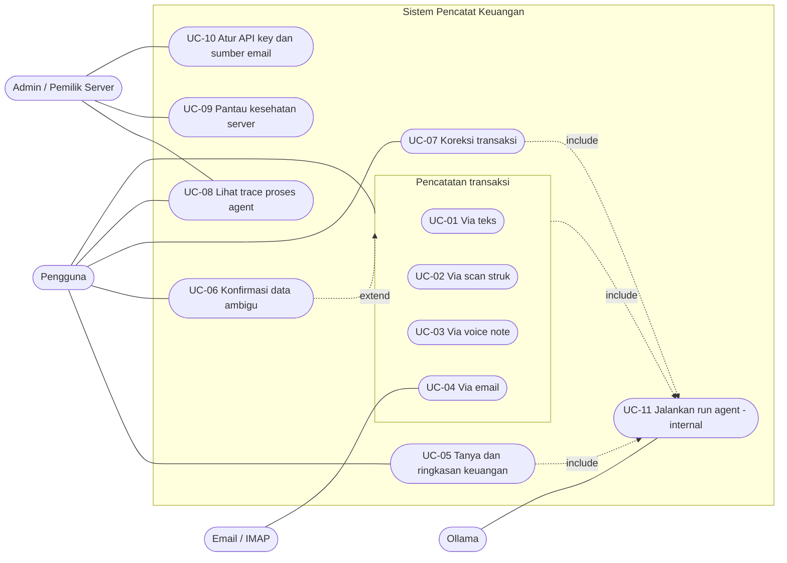

---

## 3. Spesifikasi Use Case

### 3.1 Ringkasan

| ID | Nama | Aktor | Ringkas |
|---|---|---|---|
| UC-01 | Catat transaksi via teks | Pengguna | Kalimat bebas diubah menjadi transaksi. |
| UC-02 | Catat transaksi via scan struk | Pengguna | Foto struk dibaca OCR dan LLM, divalidasi, lalu dicatat. |
| UC-03 | Catat transaksi via voice note | Pengguna | Suara ditranskripsi, lalu diproses seperti teks. |
| UC-04 | Catat transaksi via email | Pengguna, Email/IMAP | Email notifikasi/invoice diekstrak menjadi transaksi. |
| UC-05 | Tanya dan ringkasan keuangan | Pengguna | Pertanyaan dijawab dari data transaksi. |
| UC-06 | Konfirmasi data ambigu | Pengguna | Agen bertanya balik sebelum menyimpan. |
| UC-07 | Koreksi transaksi | Pengguna | Ubah atau hapus transaksi yang sudah tercatat. |
| UC-08 | Lihat trace proses agent | Pengguna, Admin | Telusuri tiap langkah run di web app sandbox. |
| UC-09 | Pantau kesehatan server | Admin | Lihat status layanan, antrean, dan penggunaan GPU. |
| UC-10 | Atur API key dan sumber email | Admin | Atur API key dan akun IMAP lewat konfigurasi server. |
| UC-11 | Jalankan run agent (internal) | Ollama | Loop LLM + tools yang dipakai bersama. |

**Konvensi umum** (dari `docs/api.md`) yang berlaku untuk semua use case yang melibatkan client:

- Semua endpoint, kecuali `/health`, membawa API key di header `X-API-Key`. Untuk `EventSource` (SSE),
  ``, dan `<audio>` yang tidak dapat mengatur header, key dikirim lewat query `?api_key=` (alias
  `?key=`). Tanpa key yang valid, server menjawab `401`.
- Setiap masukan menjadi satu **job** di antrean dan satu **run** agen. Respons awal memuat `job.id` dan
  `job.run_id`, lalu client membuka stream SSE `/v1/runs/{run_id}/stream`. Alternatifnya, parameter
  `?wait=true` membuat server menunggu sampai run selesai (berguna untuk `curl`; batas tunggu bawaan
  600 detik).
- Status job: `queued`, `running`, `done`, `error`. Status run (proses): `queued`, `running`, `done`,
  `awaiting_confirmation`, `done_with_warnings`, `error`. Selain itu tiap run punya **`outcome`** (hasil
  untuk UI): `recorded` (transaksi baru tercatat), `modified` (ubah/hapus), `answered` (pertanyaan
  dijawab), `not_transaction` (email/struk dibaca tetapi bukan transaksi, mis. email promo), `duplicate`
  (ditolak anti-dobel), `possible_duplicate` (struk serupa, menunggu konfirmasi), `needs_confirmation`
  (agen bertanya balik), dan `error`.
- Nominal disimpan sebagai bilangan bulat rupiah. Tanggal transaksi berformat `YYYY-MM-DD` dalam zona
  waktu Asia/Jakarta.
- Pembatasan laju: 30 job per menit per API key (`RATE_LIMIT_PER_MINUTE`), hanya untuk endpoint
  pembuat job. Melebihi batas menghasilkan `429`.
- **Thinking aktif** untuk agen (`LLM_THINK=true`): model berpikir dulu, sehingga satu run teks memakan
  sekitar 15 sampai 40 detik. Teks pemikiran masuk trace sebagai langkah `reasoning` dan di-*stream* live
  lewat event `llm_delta`. Satu run dibatasi `AGENT_RUN_TIMEOUT_S` (600 detik).

---

### UC-01 Catat Transaksi via Teks

| Elemen | Isi |
|---|---|
| **ID** | UC-01 |
| **Nama** | Catat transaksi via teks |
| **Aktor** | Pengguna (primer), Ollama (pendukung) |
| **Prasyarat** | Server berjalan dan Ollama aktif dengan model `qwen3.5:9b`. Client memiliki API key yang valid. Teks 1 sampai 4.000 karakter. |
| **Pascakondisi (sukses)** | Satu atau lebih transaksi tersimpan di basis data dengan jenis, nominal, kategori, tanggal, merchant, dan keterangan. Run berstatus `done` dengan `outcome = recorded`, tercatat lengkap dengan trace-nya (termasuk pemikiran model). Pengguna menerima jawaban singkat yang menyebut nominal yang dicatat. |
| **Pascakondisi (gagal)** | Tidak ada transaksi tersimpan (atau run berstatus `awaiting_confirmation`). Run berstatus `error` atau `done_with_warnings` dengan alasan yang terbaca di trace. |

**Alur utama** (endpoint `POST /v1/chat`)

1. Pengguna mengetik kalimat, mis. "beli bensin 30rb" atau "gajian 4,5 juta", lalu mengirimkannya.
2. Client mengirim teks ke server beserta API key. Server membuat job dan run, lalu menaruh job di
   antrean.
3. Server membalas dengan `job.id`, `job.run_id`, dan `conversation_id`. Client membuka stream SSE untuk
   run tersebut.
4. Worker mengambil job dari antrean dan menjalankan agen (UC-11). LLM **berpikir** (teks pemikiran
   mengalir ke client lewat `llm_delta`, lalu tersimpan sebagai langkah `reasoning`) dan mengurai kalimat.
5. LLM mengubah nominal dan tanggal ke format baku (mis. "30rb" menjadi 30000, "4,5 juta" menjadi
   4500000, "kemarin" menjadi tanggal konkret) dan menentukan jenis serta kategori dari 12 kategori
   yang tersedia (mis. bensin menjadi `transportasi`).
6. LLM memanggil tool `catat_transaksi`. Server memvalidasi argumen (jumlah harus lebih dari 0, jenis
   dinormalisasi) lalu menyimpan transaksi.
7. LLM menyusun jawaban akhir ("Dicatat: pengeluaran Rp30.000, transportasi"). Stream SSE mengirim
   event `run_finished`.
8. Client menampilkan hasil dan memperbarui daftar transaksi.

**Alur alternatif / eksepsi**

| Kode | Kondisi | Penanganan |
|---|---|---|
| A1 | Satu kalimat memuat beberapa transaksi ("beli bensin 30rb, gajian 4,5 juta") | LLM memanggil `catat_transaksi` sekali per transaksi. Teruji: kedua transaksi tersimpan. |
| A2 | Nominal, jenis, atau transaksi yang dimaksud tidak jelas ("tadi bayar 50") | LLM memanggil `minta_konfirmasi`. Beralih ke UC-06. Transaksi belum disimpan. Teruji. |
| A3 | Kalimat bukan transaksi | LLM menjawab seperlunya (`outcome = answered`). Bila jawabannya berupa pertanyaan dan tidak ada tool yang berhasil, run ditandai `awaiting_confirmation` (heuristik server). |
| A4 | Model mengaku sudah mencatat tanpa memanggil tool | *Guard* `klaim_tanpa_tool`: server menyisipkan pesan sistem yang meminta model memanggil tool. Terlihat sebagai langkah `guard` di trace. |
| A5 | Dengan thinking aktif, model menutup giliran hanya dengan pemikiran, tanpa teks jawaban | *Guard* `jawaban_kosong`: jawaban dibuat otomatis dari hasil tool tulis (mis. "Transaksi #1 diubah: ..."). Teruji (muncul pada uji email dan ubah/hapus). |
| E1 | API key tidak valid atau tidak ada | Server menolak (`401`). Tidak ada run dibuat. Teruji. |
| E2 | Teks kosong atau lebih dari 4.000 karakter | Server menolak (`422`). |
| E3 | Tool gagal (argumen tidak valid) | Hasil tool berisi `ok:false` dan instruksi agar model memperbaiki argumen atau melaporkan kegagalan. Bila ada tool tulis yang gagal dan tidak ada yang berhasil, run berstatus `done_with_warnings`. |
| E4 | Batas 6 langkah agen atau batas waktu run (600 detik) tercapai | Batas langkah: jawaban "batas langkah agent tercapai". Batas waktu: run berstatus `error` dengan pesan `timeout`. |
| E5 | Ollama tidak merespons atau mengembalikan kesalahan | Run berstatus `error` dan job `error`. Tidak ada percobaan ulang otomatis. *Belum diuji.* |
| E6 | Melebihi 30 job per menit per key | Server menolak (`429`). |

---

### UC-02 Catat Transaksi via Scan Struk

| Elemen | Isi |
|---|---|
| **ID** | UC-02 |
| **Nama** | Catat transaksi via scan struk |
| **Aktor** | Pengguna (primer), Ollama (pendukung) |
| **Prasyarat** | Seperti UC-01. Pengguna memiliki foto struk berformat JPG, PNG, atau WebP dengan ukuran paling besar 10 MB. |
| **Pascakondisi (sukses)** | Satu transaksi (toko, tanggal struk, total, kategori) tersimpan, dengan rincian item pada kolom `items`. `outcome = recorded`. Gambar asli tersimpan di `server/data/uploads/` dan dapat diambil lewat `GET /v1/runs/{run_id}/image`. Trace menyimpan hasil OCR (teks, kotak, *confidence*), hasil validasi, dan sumber ekstraksi. |
| **Pascakondisi (gagal)** | Tidak ada transaksi tersimpan. Run berstatus `error`, `awaiting_confirmation` (`possible_duplicate` atau `needs_confirmation`), atau `done_with_warnings`. |

**Alur utama** (endpoint `POST /v1/receipt`, multipart, field `file`; mode bawaan `RECEIPT_MODE=ocr_llm`)

1. Pengguna memilih atau memotret struk, lalu mengunggahnya melalui web app.
2. Client mengirim gambar ke server. Server memeriksa API key dan ukuran berkas (maks. 10 MB, kelebihan
   dijawab `413`), menyimpannya, lalu membuat job dan run.
3. **Anti-dobel tahap 1** (langkah `dedup/cek_duplikat`): bila SHA-256 gambar sama dengan struk yang
   pernah diproses, run langsung berakhir `outcome = duplicate` tanpa memanggil model (kurang dari 5 ms).
4. **OCR di CPU** (langkah `ocr/ocr_struk`): RapidOCR dengan model PaddleOCR PP-OCRv4 membaca teks. Hasilnya
   berupa baris teks, kotak pembatas (*bounding box*) dalam koordinat gambar asli, dan *confidence* per
   baris. OCR berjalan di CPU sehingga tidak memakan VRAM.
5. **LLM teks** (langkah `llm/ekstrak_struk_ocr_llm`): `qwen3.5:9b` **tanpa gambar dan tanpa thinking**
   menyusun JSON (toko, tanggal, item, total, diskon, pajak/layanan, metode bayar, kategori, keyakinan)
   dari teks OCR.
6. **Validasi** (langkah `validation/validasi_struk`), lolos bila keempat cek terpenuhi:
   (a) total lebih dari 0 dan angka total benar-benar muncul di teks OCR; (b) tanggal muncul di teks OCR;
   (c) jumlah subtotal item dikurangi diskon ditambah pajak/layanan sama dengan total (toleransi 1% atau
   Rp100); (d) rata-rata *confidence* OCR paling sedikit 0,80 dengan minimal 3 baris.
7. **Fallback vision** bila validasi gagal (langkah `fallback/fallback_vision`): struk dibaca ulang oleh
   model vision, tetap tanpa thinking. Sumber ekstraksi dicatat (`ocr_llm`, `ocr_rules`, `ocr_only`,
   `vision`, atau `vision_fallback`).
8. **Anti-dobel tahap 2** (langkah `dedup/cek_struk_serupa`): bila toko, tanggal, dan total sama dengan
   transaksi struk yang sudah ada (file berbeda), agen meminta konfirmasi (`possible_duplicate`, UC-06).
9. **Loop agen** (dengan thinking): JSON struk diberikan ke agen dengan instruksi mencatat satu transaksi
   sebesar total struk. Agen memanggil `catat_transaksi`. Tanggal bawaan adalah tanggal pada struk, dan
   item struk ikut tersimpan.
10. Client menampilkan transaksi, gambar struk dengan kotak OCR, dan hasil validasi.

Dua mode lain tersedia lewat `RECEIPT_MODE`: `ocr_only` (OCR dan aturan/regex, tanpa LLM) dan `vision`
(model vision membaca gambar langsung). Opsi `RECEIPT_RULES_FIRST=true` mencoba parser aturan lebih dulu dan
hanya memanggil LLM bila validasi gagal. Perbandingan ketiganya ada di Bagian 9.5.

**Alur alternatif / eksepsi**

| Kode | Kondisi | Penanganan |
|---|---|---|
| A1 | `keyakinan` kurang dari 0,6, total 0, atau `cek_konsistensi` tidak cocok | Agen memanggil `minta_konfirmasi` (UC-06). Pada mode `ocr_only`, validasi yang gagal menurunkan `keyakinan` menjadi paling tinggi 0,5 sehingga agen bertanya. Aturan 0,6 ada di instruksi agen, jadi ditegakkan oleh model, bukan oleh kode. |
| A2 | Hasil OCR meragukan (validasi gagal) | Fallback ke model vision (langkah 7). Teruji pada benchmark: 1 dari 8 struk memicu fallback (restoran dengan pajak dan service). |
| A3 | Struk berisi banyak item | Dicatat sebagai **satu** transaksi sebesar total, dengan rincian item disimpan. Pemecahan per kategori belum ada (lihat 7.5). |
| A4 | Struk yang sama diunggah dua kali | File sama (hash sama): `duplicate`, ditolak tanpa model. Foto lain dari struk yang sama: `possible_duplicate`, agen bertanya "ya, catat" atau "tidak". Teruji. |
| E1 | Gambar bukan struk atau sangat buram | Keyakinan dan validasi diharapkan gagal sehingga memicu A1 atau A2. *Belum diuji.* |
| E2 | Berkas lebih dari 10 MB | Server menolak (`413`). |
| E3 | Berkas bukan gambar | Tidak ditolak di awal. Run gagal pada tahap praproses dengan status `error`. *Belum diuji.* |

> **Status pengujian.** Seluruh uji memakai struk **sintetis** (gambar teks yang dirender oleh skrip) dan
> satu foto kedua dari struk contoh. **Foto struk asli** (kertas termal, cahaya, perspektif) *belum diuji*.

---

### UC-03 Catat Transaksi via Voice Note

| Elemen | Isi |
|---|---|
| **ID** | UC-03 |
| **Nama** | Catat transaksi via voice note |
| **Aktor** | Pengguna (primer), Ollama (pendukung) |
| **Prasyarat** | Seperti UC-01, ditambah `ffmpeg` terpasang di server dan faster-whisper dapat dimuat. Berkas audio berformat ogg, opus, m4a, mp3, wav, atau webm, paling besar 25 MB. Browser pengguna mengizinkan akses mikrofon bila merekam langsung. |
| **Pascakondisi (sukses)** | Transkrip (beserta bahasa, probabilitas bahasa, dan segmen berskor) tersimpan di trace. Audio asli dapat diputar ulang lewat `GET /v1/runs/{run_id}/audio`. Transaksi hasil pemrosesan transkrip tersimpan seperti UC-01, dengan sumber `voice`. |
| **Pascakondisi (gagal)** | Tidak ada transaksi tersimpan. Transkrip (bila sempat dibuat) tetap tersedia di trace untuk diagnosis. |

**Alur utama** (endpoint `POST /v1/voice`, multipart, field `file`)

1. Pengguna merekam suara di web app ("tadi beli kopi dua puluh ribu") atau mengunggah berkas audio.
2. Client mengirim audio ke server. Server memvalidasi key dan ukuran berkas (kelebihan dijawab `413`),
   lalu membuat job dan run.
3. Praproses `transkripsi_suara`: `ffmpeg` mengubah audio menjadi 16 kHz mono, lalu faster-whisper
   model `small` di GPU (`int8_float16`, bahasa `id`, penyaring suara aktif, dengan *prompt* awal
   kosakata keuangan) menghasilkan teks. Bila GPU tidak dapat dipakai, server beralih otomatis ke CPU.
4. Transkrip diberikan ke agen dengan penanda bahwa teks berasal dari transkripsi otomatis dan "bisa
   ada salah dengar". Selanjutnya sama dengan UC-01 (langkah 4 dan seterusnya).
5. Client menampilkan transkrip dan transaksi yang dicatat, sehingga pengguna dapat memeriksa bila
   transkripsi keliru.

**Alur alternatif / eksepsi**

| Kode | Kondisi | Penanganan |
|---|---|---|
| A1 | Transkripsi meragukan | Agen dapat meminta konfirmasi lewat UC-06. Pada audio uji, "bakso" terdengar sebagai "makso". Pada uji awal (thinking mati) agen meminta konfirmasi, sedangkan pada uji final (thinking aktif) agen langsung mencatat Rp25.000 (deskripsi mengikuti transkrip, "makso"). Jadi pembersihan salah dengar tidak dijamin. |
| A2 | Audio kosong atau hanya derau | Transkrip kosong. Agen menerima pesan "voice note kosong / tidak terdengar ucapan" dan tidak mencatat transaksi. *Belum diuji.* |
| A3 | Audio berisi banyak transaksi | Seperti UC-01 A1. |
| E1 | Berkas lebih dari 25 MB | Server menolak (`413`). Batas durasi audio tidak ada, hanya batas ukuran berkas. |
| E2 | GPU tidak dapat dipakai untuk Whisper | Fallback ke CPU (`int8`), tercatat di `fallback_errors` pada metrik. *Belum diuji.* |

> **Catatan pengujian.** Audio uji dibuat dengan `espeak-ng` (suara robot). Suara manusia asli
> *belum diuji*. Latensi voice note sangat bervariasi pada uji (18 sampai 87 detik) karena panjang
> pemikiran model berbeda-beda. Transkripsi sendiri hanya 0,3 detik untuk audio 4,8 detik.

---

### UC-04 Catat Transaksi via Email

| Elemen | Isi |
|---|---|
| **ID** | UC-04 |
| **Nama** | Catat transaksi via email |
| **Aktor** | Pengguna (primer), Email/IMAP (pendukung), Ollama (pendukung); Admin untuk konfigurasi awal |
| **Prasyarat** | Salah satu: (a) akun IMAP sudah diisi Admin di `.env` (`IMAP_HOST`, `IMAP_USER`, `IMAP_PASSWORD`; untuk Gmail memakai *app password*), atau (b) pengguna memiliki berkas `.eml` (maks. 5 MB). |
| **Pascakondisi (sukses)** | Email yang berisi transaksi menghasilkan transaksi dengan sumber `email` (`outcome = recorded`). Email non-transaksi menghasilkan `outcome = not_transaction`. Pada IMAP, isi kotak surat tidak diubah (folder dibuka *read-only*, memakai `BODY.PEEK`). |
| **Pascakondisi (gagal)** | Kegagalan tercatat di trace atau respons `502` (IMAP). Tidak ada transaksi tersimpan. |

**Alur utama (jalur unggah `.eml`, endpoint `POST /v1/email`)**

1. Pengguna mengunggah berkas `.eml` (mis. notifikasi transfer masuk).
2. Server memvalidasi key dan ukuran, lalu membuat job dan run.
3. Praproses `baca_email` dan **anti-dobel** (langkah `dedup/cek_duplikat`): kunci email adalah `Message-ID`
   (cadangan: SHA-256 isi mentah). Email yang kuncinya sudah pernah diproses berakhir `outcome = duplicate`
   tanpa memanggil LLM. Pengurai email: pengurai email (pustaka standar Python) mengambil pengirim, penerima,
   subjek, tanggal, `Message-ID`, isi teks (dari HTML bila perlu), dan daftar lampiran. Isi dipotong
   hingga 4.000 karakter (`body_truncated` menandai pemotongan).
4. Agen menerima isi email dan mengekstrak transaksi. Tanggal bawaan adalah tanggal email.
5. Agen memanggil `catat_transaksi`. Client menampilkan transaksi beserta sumbernya ("email").

**Alur alternatif: jalur IMAP**

1. Pengguna atau Admin memicu `POST /v1/email/imap/fetch`.
2. Server terhubung ke IMAP, membuka folder `INBOX` read-only, mencari email `UNSEEN`, dan mengambil
   paling banyak 10 email terbaru per pemanggilan.
3. Email yang `Message-ID`-nya sudah pernah diproses dilewati (dilaporkan di `skipped_duplicates`). Tiap
   email baru menjadi satu job (langkah 3 sampai 5 jalur unggah).

| Kode | Kondisi | Penanganan |
|---|---|---|
| A1 | Email bukan transaksi (promosi, newsletter) | Agen tidak mencatat dan menjelaskan alasannya. Run berstatus `done` dengan `outcome = not_transaction`. Teruji (email promo). |
| A2 | Tagihan yang belum dibayar | Instruksi agen: tanyakan dulu lewat `minta_konfirmasi` apakah sudah dibayar. *Belum diuji.* |
| A3 | Email yang sama diproses dua kali (unggah ulang, atau pemicu IMAP dipanggil lagi) | Ditolak oleh anti-dobel: `duplicate`, tidak dicatat ulang, LLM tidak dipanggil, dan jawaban menyebut run serta transaksi sebelumnya. Teruji untuk unggah ulang `.eml`. Jalur IMAP memakai kunci yang sama, tetapi *belum diuji* dengan server IMAP sungguhan. |
| A4 | Tidak ada daftar pengirim yang diizinkan | Semua email `UNSEEN` di folder terpilih diproses. Penyaringan pengirim belum ada. |
| E1 | IMAP belum dikonfigurasi | Server menjawab `400`. |
| E2 | Kredensial IMAP salah atau koneksi gagal | Server menjawab `502` ("IMAP gagal"). |
| E3 | Isi email memuat instruksi yang mencoba mengarahkan agen | **Belum ada pertahanan khusus** selain batas langkah agen, penghapusan lunak (*soft delete*), dan trace yang dapat diaudit. *Belum diuji.* Lihat risiko R-06. |

> **Status pengujian.** Jalur unggah `.eml` teruji dengan 4 email fiktif (transfer masuk, e-wallet,
> invoice belanja, promo). **Jalur IMAP belum diuji dengan server IMAP sungguhan.**

---

### UC-05 Tanya dan Ringkasan Keuangan

| Elemen | Isi |
|---|---|
| **ID** | UC-05 |
| **Nama** | Tanya dan ringkasan keuangan |
| **Aktor** | Pengguna (primer), Ollama (pendukung) |
| **Prasyarat** | Seperti UC-01. Sudah ada transaksi untuk dijawab (jika kosong, agen menjawab bahwa belum ada data). |
| **Pascakondisi (sukses)** | Pengguna menerima jawaban atau ringkasan yang bersumber dari basis data. Tidak ada transaksi diubah. |
| **Pascakondisi (gagal)** | Pengguna menerima pesan bahwa pertanyaan tidak dapat dijawab, disertai alasan. |

**Alur utama** (endpoint `POST /v1/chat`)

1. Pengguna menulis pertanyaan, mis. "pengeluaran bulan ini berapa?" atau "buat ringkasan Oktober".
2. Server membuat run. Agen menafsirkan periode dan kategori.
3. Agen memanggil tool baca-saja: `ringkasan` (total pemasukan, pengeluaran, saldo, dan total per
   kategori, dihitung oleh SQL) dan/atau `cari_transaksi` (filter kata kunci, jenis, kategori, periode).
   Nilai `periode`: `hari_ini`, `kemarin`, `minggu_ini`, `bulan_ini`, `bulan_lalu`, `tahun_ini`, `semua`.
4. LLM menyusun jawaban dalam bahasa alami berdasarkan hasil tool.
5. Client menampilkan jawaban. Data yang sama juga tersedia lewat `GET /v1/summary` dan
   `GET /v1/transactions` untuk tabel atau grafik.

**Alur alternatif / eksepsi**

| Kode | Kondisi | Penanganan |
|---|---|---|
| A1 | Pertanyaan tanpa periode ("berapa pengeluaran saya?") | Tool `ringkasan` memakai bawaan `bulan_ini`. |
| A2 | Pertanyaan di luar domain keuangan | Agen diinstruksikan hanya melayani pencatatan dan analisis keuangan. *Belum diuji.* |
| E1 | Hasil tool kosong | Agen diinstruksikan tidak mengarang angka. *Belum diuji.* |

> **Prinsip desain:** angka selalu dihitung oleh kode (SQL), lalu LLM hanya merangkainya menjadi
> kalimat. Teruji: jawaban agen untuk total pengeluaran bulan ini (Rp376.700) sama dengan hasil
> `GET /v1/summary`. Run berstatus `done` dengan `outcome = answered`.

---

### UC-06 Konfirmasi Data Ambigu

| Elemen | Isi |
|---|---|
| **ID** | UC-06 |
| **Nama** | Konfirmasi data ambigu |
| **Aktor** | Pengguna (primer) |
| **Prasyarat** | Sebuah run (UC-01 sampai UC-04) berstatus `awaiting_confirmation`, dengan `outcome` `needs_confirmation` (agen bertanya) atau `possible_duplicate` (struk serupa). |
| **Pascakondisi (sukses)** | Transaksi tersimpan dengan data yang sudah dikonfirmasi, tercatat dalam **run baru** pada `conversation_id` yang sama. Pertanyaan dan jawaban tercatat di trace kedua run. Run pertanyaan tetap berstatus `awaiting_confirmation`, tetapi `answered_by_run_id` kini menunjuk run jawaban dan run jawaban memiliki `answers_run_id`, sehingga UI dapat menandai pertanyaan "sudah dijawab". |
| **Pascakondisi (gagal)** | Bila pengguna tidak menjawab, tidak ada transaksi tersimpan. Run asal tetap berstatus `awaiting_confirmation` tanpa batas waktu. |

**Alur utama** (diagram urutan pada Bagian 4.4)

1. Agen mendeteksi masalah: nominal hilang atau tidak konsisten, jenis tidak jelas, keyakinan
   ekstraksi struk kurang dari 0,6, total tidak cocok dengan jumlah item, atau transkrip meragukan.
2. Agen memanggil tool `minta_konfirmasi` dengan `pertanyaan`, `opsi` (pilihan jawaban, opsional), dan
   `draf_transaksi` (opsional). Draf hanya dicatat di trace (langkah `confirmation`). Draf **tidak**
   disimpan sebagai transaksi. Untuk struk serupa, langkah `confirmation/konfirmasi_duplikat` dibuat oleh
   server sendiri (tanpa LLM) dengan pertanyaan "ya, catat" atau "tidak".
3. Run berakhir dengan status `awaiting_confirmation`. `final_answer` berisi pertanyaan. Worker
   langsung bebas untuk job lain, jadi GPU tidak ditahan selama menunggu pengguna.
4. Client menampilkan pertanyaan dan, bila ada `opsi`, menampilkannya sebagai tombol.
5. Pengguna menjawab. Client mengirim `POST /v1/chat` dengan teks jawaban dan `conversation_id` run
   sebelumnya.
6. Server membuat job dan run baru. Langkah `context/lanjutan_konfirmasi` mencatat bahwa run ini
   melanjutkan run sebelumnya: transaksi mewarisi **sumber asli** (`voice`, `receipt`, `email`), item
   struk, dan tanggal bawaan dari run asal. Agen memuat riwayat percakapan (maksimal 30 pesan terakhir)
   dan memanggil `catat_transaksi`.
7. Run baru selesai dengan status `done`. Client menampilkan hasil akhir.

**Alur alternatif / eksepsi**

| Kode | Kondisi | Penanganan |
|---|---|---|
| A1 | Agen bertanya lewat teks biasa, bukan lewat tool | Bila jawaban memuat tanda tanya dan tidak ada tool yang berhasil, server tetap menandai `awaiting_confirmation` (langkah `confirmation/pertanyaan_teks`). Heuristik ini dapat keliru (lihat 9.6). |
| A2 | Jawaban pengguna masih ambigu | Agen dapat bertanya lagi. Tidak ada batas jumlah putaran selain batas 6 langkah agen per run. |
| A3 | Pengguna ingin membatalkan | Tidak ada status "dibatalkan". Pengguna menjawab "tidak" atau "batal". Teruji untuk struk serupa: setelah dijawab "tidak", jumlah transaksi tetap. |
| E1 | Pengguna tidak menjawab | Tidak ada kedaluwarsa otomatis. Run tetap `awaiting_confirmation`. |
| E2 | Server dimulai ulang saat menunggu | Riwayat percakapan tersimpan di SQLite (`runs.messages_json`), sehingga jawaban tetap dapat dikirim setelah server hidup kembali. *Belum diuji.* |

---

### UC-07 Koreksi Transaksi

| Elemen | Isi |
|---|---|
| **ID** | UC-07 |
| **Nama** | Koreksi transaksi (ubah / hapus) |
| **Aktor** | Pengguna (primer), Ollama (pendukung bila lewat bahasa alami) |
| **Prasyarat** | Transaksi yang dikoreksi sudah ada. |
| **Pascakondisi (sukses)** | Transaksi berubah (kolom `updated_at` diperbarui) atau ditandai terhapus (`deleted = 1`, penghapusan lunak). Run berakhir `outcome = modified`. Nilai sebelum dan sesudah tercatat pada hasil tool di trace. |
| **Pascakondisi (gagal)** | Transaksi tidak berubah. |

**Alur utama (lewat bahasa alami, `POST /v1/chat`)**

1. Pengguna menulis koreksi, mis. "yang bensin tadi harusnya 35rb" atau "hapus catatan parkir kemarin".
2. Agen memanggil `cari_transaksi` untuk menemukan kandidat dan mengambil `id`.
3. Bila tepat satu kandidat, agen memanggil `ubah_transaksi` (hanya field yang berubah) atau
   `hapus_transaksi`. Bila kandidat tidak jelas, agen memanggil `minta_konfirmasi` (UC-06).
4. Server menyimpan perubahan. Hasil tool memuat `sebelum` dan `sesudah` (ubah) atau `dihapus` (hapus).
5. Client memperbarui tampilan.

**Alur alternatif / eksepsi**

| Kode | Kondisi | Penanganan |
|---|---|---|
| A1 | Pengguna mengedit langsung lewat formulir | Client memanggil `PATCH /v1/transactions/{id}` atau `DELETE /v1/transactions/{id}` tanpa agen. Respons PATCH memuat `sebelum` dan `sesudah`. |
| A2 | Lebih dari satu kandidat | Agen bertanya lewat UC-06. |
| A3 | Pengguna ingin mengurungkan penghapusan | **Belum ada** endpoint pemulihan. Data tidak benar-benar hilang (hanya ditandai `deleted`), tetapi pemulihan harus lewat basis data. |
| A4 | Tidak ada tabel riwayat perubahan khusus | Jejak perubahan berada di trace (langkah `tool` pada run yang melakukan koreksi). Koreksi lewat REST langsung tidak tercatat di trace. |
| E1 | Tidak ada kandidat | Tool mengembalikan hasil kosong atau kesalahan "transaksi tidak ditemukan". Agen menyampaikannya. REST: `PATCH`/`GET` pada id yang tidak ada dijawab `404` (teruji). |

> **Status pengujian.** Teruji pada uji final: REST `POST`, `PATCH`, `DELETE`, dan `404`; agen mengubah
> nominal bensin dari Rp30.000 menjadi Rp35.000 (`cari_transaksi` lalu `ubah_transaksi`); agen menghapus
> transaksi "ngopi" (`cari_transaksi` lalu `hapus_transaksi`). Pada putaran terbaru keduanya selesai dalam 13 sampai 16
> detik (putaran sebelumnya 18 sampai 22 detik). Lewat REST, `PATCH` dengan kategori tak dikenal atau yang tidak cocok
> dengan jenis ditolak (`400`) dan data tidak berubah; jalur agen tetap longgar (kategori tak dikenal dipetakan ke
> `lainnya_masuk` atau `lainnya_keluar`).
> Konfirmasi sebelum menghapus hanya berupa instruksi pada agen (tidak ditegakkan oleh kode): pada uji,
> agen langsung menghapus karena permintaan pengguna jelas. Pemulihan penghapusan *belum ada*.

---

### UC-08 Melihat Trace Proses Agent di Web App Sandbox

| Elemen | Isi |
|---|---|
| **ID** | UC-08 |
| **Nama** | Melihat trace proses agent |
| **Aktor** | Pengguna, Admin |
| **Prasyarat** | Minimal satu run pernah dijalankan (atau sedang berjalan). Client memiliki API key. |
| **Pascakondisi (sukses)** | Pengguna dapat membaca seluruh langkah run. Tidak ada data diubah. |
| **Pascakondisi (gagal)** | Pesan kesalahan jelas (`404`) bila run tidak ditemukan, atau stream terputus. |

**Alur utama**

1. Pengguna membuka halaman "Riwayat Run" di web app sandbox. Client memanggil
   `GET /v1/runs?input_type=&status=&conversation_id=&limit=&offset=` untuk daftar run (status, jenis
   masukan, durasi, total token, jumlah panggilan LLM dan tool).
2. Pengguna memilih satu run. Client memanggil `GET /v1/runs/{run_id}` (opsional
   `?include_messages=true` untuk riwayat percakapan) dan mendapat ringkasan run beserta daftar `steps`.
   Untuk run struk, client juga memuat gambar asli lewat `GET /v1/runs/{run_id}/image`, dan untuk voice
   note memutar audio lewat `GET /v1/runs/{run_id}/audio`.
3. Web app menampilkan **linimasa langkah** yang berurutan. Tiap *step* memuat `seq`, `type`, `name`,
   `status` (`ok`/`error`/`warning`), `input`, `output`, `started_at`, `duration_ms`, dan (untuk langkah
   LLM) `prompt_tokens`, `completion_tokens`, `tokens_per_second`. Jenis langkah:

   | `type` | Isi |
   |---|---|
   | `input` | Payload asli (teks, nama dan ukuran berkas). |
   | `preprocess` | `transkripsi_suara`, `ekstrak_struk`, atau `baca_email` beserta hasilnya (transkrip dan segmen, JSON struk, isi email terurai). Untuk struk, langkah ini ditutup setelah langkah `ocr`, `llm`, `validation`, dan `fallback`. |
   | `ocr` | `ocr_struk`: baris teks, kotak pembatas (dalam piksel gambar asli), dan *confidence*, sehingga kotak dapat digambar langsung di atas gambar struk. |
   | `rules`, `validation`, `fallback` | Parser aturan, empat cek validasi struk (beserta angkanya), dan pembacaan ulang oleh model vision bila validasi gagal. |
   | `dedup` | `cek_duplikat` (kunci email atau hash gambar) dan `cek_struk_serupa` (toko, tanggal, total). |
   | `reasoning` | `agent_step_N`: teks pemikiran model (`thinking`), jumlah karakter, dan waktu sampai token pertama. Dibuat sebelum langkah `llm` yang sama. |
   | `llm` | `agent_step_N`: **prompt lengkap** (pesan sistem, riwayat, pesan pengguna, hasil tool sebelumnya), keluaran model, tool call, dan rincian waktu (muat, evaluasi prompt, token pertama, pemikiran, generasi). |
   | `tool` | Nama tool, argumen dari LLM, dan hasil. |
   | `context` | `lanjutan_konfirmasi`: run ini menjawab konfirmasi dari run sebelumnya. |
   | `guard` | `klaim_tanpa_tool` (model diminta mengulang karena mengaku mencatat tanpa tool) atau `jawaban_kosong` (jawaban dibuat dari hasil tool). |
   | `confirmation` | Pertanyaan konfirmasi (`minta_konfirmasi`, `pertanyaan_teks`, atau `konfirmasi_duplikat`). |
   | `final` | Status akhir, `outcome`, jawaban, dan peringatan. |
   | `error` | Nama dan pesan *exception*. |

4. Untuk run yang sedang berjalan, client berlangganan SSE `GET /v1/runs/{run_id}/stream`. Server
   mengirim ulang langkah yang sudah ada, lalu langkah baru secara langsung, dan menutup stream setelah
   `run_finished`. Event `step_started` memungkinkan indikator "sedang bekerja", dan event `llm_delta`
   (potongan pemikiran atau jawaban tiap sekitar 150 ms) membuat teks pemikiran model **mengalir live**.
   Potongan `llm_delta` tidak disimpan: klien yang tersambung belakangan hanya menerima langkah `reasoning`
   dan `llm` yang sudah lengkap.
5. Untuk dasbor langsung lintas run, client memakai `GET /v1/events` (semua event dari semua run).

**Alur alternatif / eksepsi**

| Kode | Kondisi | Penanganan |
|---|---|---|
| A1 | Pengguna menjalankan masukan langsung dari halaman sandbox | Sandbox menyediakan form untuk keempat jenis masukan (`/v1/chat`, `/v1/receipt`, `/v1/voice`, `/v1/email`). Hasilnya tampil sebagai trace langsung (lihat 4.7). |
| A2 | Run berstatus `error` atau `done_with_warnings` | Langkah `error` atau peringatan pada langkah `final` ditampilkan. |
| E1 | Stream SSE terputus | Karena server mengirim ulang semua langkah tersimpan saat stream dibuka kembali, client dapat tersambung ulang tanpa kehilangan urutan langkah (potongan `llm_delta` yang terlewat tidak diulang). *Pemulihan koneksi belum diuji.* |
| E2 | Prompt atau trace sangat besar | Tampilan memuat potongan awal dengan opsi "tampilkan semua" (perilaku sisi client). Gambar tidak disimpan di trace, diganti dengan keterangan ukuran base64. |

> **Catatan privasi.** Trace memuat prompt dan data keuangan mentah. Karena itu trace hanya dapat
> dibaca dengan API key yang sah dan tidak pernah dikirim ke luar jaringan lokal. Teks pemikiran model
> (langkah `reasoning`) juga tersimpan di trace. Pada "mode demo cepat" (`LLM_THINK=false`) langkah
> `reasoning` tidak ada.

---

### UC-09 Memantau Kesehatan Server

| Elemen | Isi |
|---|---|
| **ID** | UC-09 |
| **Nama** | Memantau kesehatan server |
| **Aktor** | Admin (primer), Pengguna (hanya status ringkas) |
| **Prasyarat** | Server berjalan. Untuk `/v1/system` dan `/v1/metrics`, client memiliki API key. |
| **Pascakondisi (sukses)** | Admin mengetahui kondisi layanan dan dapat memutuskan tindakan (mis. memulai ulang Ollama). |
| **Pascakondisi (gagal)** | Bila server tidak dapat dijangkau, client menampilkan "server tidak terjangkau". |

**Alur utama**

1. Admin membuka halaman "Kesehatan Server" di web app (atau memanggil endpoint langsung).
2. Client memanggil `GET /health` (tanpa API key): `status`, waktu, dan panjang antrean.
3. Client memanggil `GET /v1/system`: model dan kapabilitasnya dari Ollama (`completion`, `vision`,
   `tools`, `thinking`), status thinking (`think`, `vision_think`), mode struk (`receipt_mode`,
   `receipt_fallback_vision`, `receipt_rules_first`), model Whisper, definisi tools, daftar kategori, dan
   status IMAP.
4. Client memanggil `GET /v1/metrics?window=200`: panjang antrean dan job aktif, jumlah run per status,
   latensi per jenis masukan (rata-rata, p50, p95, maks, rata-rata waktu tunggu antrean), statistik LLM
   (jumlah panggilan, token per detik, total token), statistik speech-to-text (model, perangkat, waktu
   muat), model yang sedang dimuat di Ollama beserta ukuran VRAM-nya, dan GPU (utilisasi, VRAM
   terpakai/total, suhu, daya) dari `nvidia-smi`, termasuk daftar **proses lain yang memakai GPU**
   (`gpu.processes`).
5. Halaman "Sistem" menyegarkan diri tiap detik dan menampilkan grafik kecil VRAM, token per detik,
   utilisasi GPU, dan antrean (lihat 4.7).

**Alur alternatif / eksepsi**

| Kode | Kondisi | Penanganan |
|---|---|---|
| A1 | Admin ingin metrik mentah | Endpoint metrik berformat JSON, dapat dibaca langsung. Format Prometheus belum tersedia. |
| E1 | Driver GPU / `nvidia-smi` tidak tersedia | Metrik GPU ditandai tidak tersedia (`gpu.available:false`). Metrik lain tetap tampil. |
| E2 | Ollama tidak terjangkau | Daftar model yang dimuat kosong dan run baru berakhir `error`. Pemeriksaan kesehatan khusus untuk Ollama belum ada. *Belum diuji.* |

---

### UC-10 Mengatur API Key dan Sumber Email

| Elemen | Isi |
|---|---|
| **ID** | UC-10 |
| **Nama** | Mengatur API key dan sumber email |
| **Aktor** | Admin |
| **Prasyarat** | Admin memiliki akses ke berkas konfigurasi `server/.env` di laptop server. |
| **Pascakondisi (sukses)** | API key dan/atau akun IMAP aktif setelah server dimulai ulang. |

**Alur utama**

1. Admin menyalin `.env.example` menjadi `.env`.
2. Admin mengisi `API_KEYS` dengan satu atau beberapa key acak yang dipisah koma (mis. satu untuk web
   app sandbox, satu untuk uji). Nilai key tidak boleh dimasukkan ke dokumen atau repositori.
3. Admin dapat mengatur `CORS_ORIGINS` ke asal web app, `RATE_LIMIT_PER_MINUTE`, serta konfigurasi
   IMAP: `IMAP_HOST`, `IMAP_PORT`, `IMAP_USER`, `IMAP_PASSWORD`, `IMAP_FOLDER`, `IMAP_SEARCH`,
   `IMAP_MAX_MESSAGES`.
4. Admin memulai ulang server (`./run.sh`). Key baru langsung berlaku. Key yang dihapus dari `API_KEYS`
   tidak berlaku lagi.

**Eksepsi dan batasan**

| Kode | Kondisi | Penanganan |
|---|---|---|
| E1 | Key bocor | Hapus dari `API_KEYS` dan mulai ulang server. Tidak ada endpoint admin untuk mencabut key saat server berjalan. |
| E2 | Konfigurasi IMAP salah | Terlihat sebagai `502` pada pemicu IMAP. Konfigurasi tidak diuji otomatis. |
| B1 | Penyimpanan key | Key disimpan apa adanya di `.env`, **tidak** di-*hash*. Berkas `.env` harus dijaga. |

---

### UC-11 Menjalankan Run Agent (Internal)

| Elemen | Isi |
|---|---|
| **ID** | UC-11 |
| **Nama** | Menjalankan run agent |
| **Aktor** | Ollama (pendukung). Dipicu oleh UC-01 sampai UC-07. |
| **Prasyarat** | Job ada di antrean. Worker bebas (satu job pada satu waktu). |
| **Pascakondisi** | Run berakhir pada salah satu status: `done`, `awaiting_confirmation`, `done_with_warnings`, atau `error`. Seluruh langkah tersimpan di trace. |

**Alur utama:** lihat [4.5 Cara Kerja Agent](#45-cara-kerja-agent-loop-llm--tools).

---

## 4. Arsitektur Sistem

### 4.1 Gambaran Umum (Server-Client)

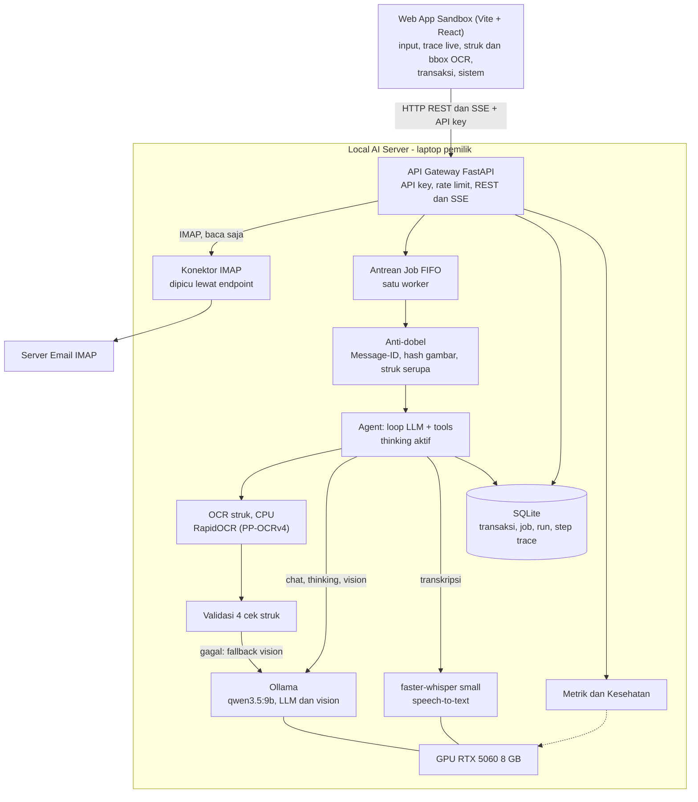

### 4.2 Komponen

| Komponen | Teknologi | Tanggung jawab |
|---|---|---|
| **Web App Sandbox** | Vite + React + TypeScript, `EventSource` untuk SSE, grafik SVG sendiri (`webapp/`) | Form masukan (teks, unggah struk, rekam suara, unggah `.eml`), penampil trace live, panel struk dengan kotak OCR, transaksi, riwayat dan antrean, halaman sistem. Rincian di 4.7. |
| **API Gateway** | FastAPI + Uvicorn (`app/main.py`), Python 3.12 (venv `uv`) | Autentikasi API key, validasi masukan, rate limit, pembuatan job/run, penyajian REST dan SSE, dokumentasi interaktif (`/docs`). |
| **Antrean Job** | Antrean `asyncio` dalam proses, satu worker (`app/jobqueue.py`) | Mengurutkan job secara FIFO. Hanya satu job memakai GPU pada satu waktu. Status job disimpan di SQLite. |
| **Agent** | Python (`app/agent.py`) | Praproses masukan (suara, struk, email), anti-dobel, lalu loop LLM (thinking aktif) dan tool calling. Mencatat tiap langkah ke trace. |
| **OCR struk** | RapidOCR + onnxruntime, model PaddleOCR PP-OCRv4, **CPU** (`app/inputs/ocr.py`) | Membaca teks struk beserta kotak dan *confidence*, tanpa memakai VRAM. |
| **Pipeline struk** | Python (`app/inputs/receipt.py`, `receipt_rules.py`) | Tiga mode (`ocr_llm`, `ocr_only`, `vision`), parser aturan, validasi empat cek, dan fallback vision. Rincian di 4.8. |
| **Tools** | Fungsi Python bertipe (`app/tools.py`) | `catat_transaksi`, `ubah_transaksi`, `hapus_transaksi`, `cari_transaksi`, `ringkasan`, `minta_konfirmasi`. |
| **Ollama** | Ollama (terpasang) | Menyajikan `qwen3.5:9b` untuk LLM agen (dengan thinking), LLM teks untuk ekstraksi struk, dan vision (fallback). |
| **Speech-to-text** | faster-whisper `small` di GPU (`app/inputs/stt.py`) | Mengubah audio menjadi teks, fallback ke CPU. |
| **Konektor Email** | `imaplib` + pengurai `.eml` (`app/inputs/email_in.py`) | Mengurai `.eml` dan mengambil email dari IMAP (read-only) bila dipicu. |
| **Basis Data** | SQLite mode WAL (`data/finance.db`) | Menyimpan kategori, transaksi, job, run, dan langkah trace. |
| **Trace dan Event Bus** | `app/trace.py` | Merekam *step* dan menyiarkannya ke pelanggan SSE. |
| **Metrik** | `app/metrics.py` | Menghitung latensi, token per detik, antrean, dan membaca status GPU. |

### 4.3 Model Data

Skema mengikuti `server/app/db.py`. Diagram hanya menampilkan kolom utama. Kolom `outcome` dan `dedup_key`
pada `RUNS` menyimpan hasil run dan kunci anti-dobel (`email:msgid:...`, `receipt:sha256:...`). Kolom lain, misalnya
`description`, `created_at`, `updated_at`, `payload_json`, `error`, `model`, `llm_calls`, `tool_calls`, `status`
pada `STEPS`, dan stempel waktu, tersedia di basis data. Basis data tidak memiliki tabel riwayat
perubahan atau tabel email yang sudah diproses.

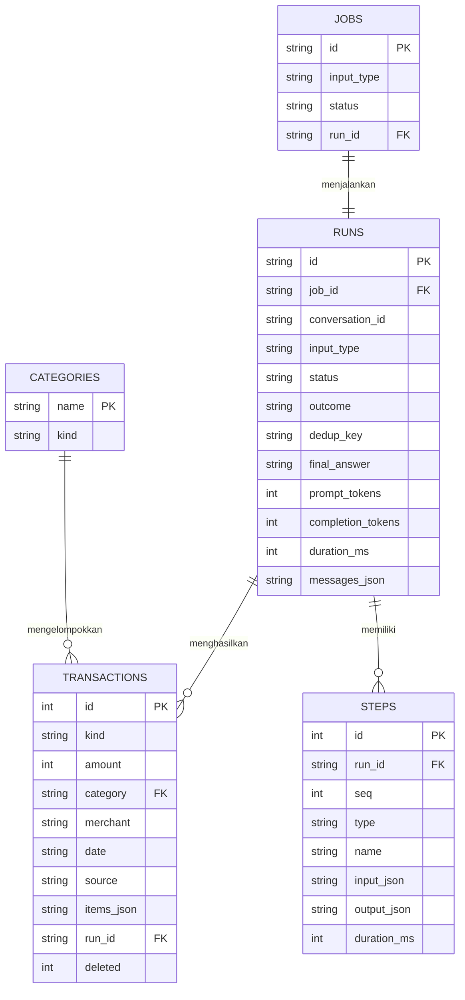

Keterangan:

- `kind` bernilai `pemasukan` atau `pengeluaran`. `source` bernilai `text`, `receipt`, `voice`, `email`,
  atau `manual`. `deleted = 1` menandai penghapusan lunak.
- Ada 12 kategori tetap. **Pengeluaran:** `makanan_minuman`, `transportasi`, `belanja`, `tagihan`,
  `kesehatan`, `pendidikan`, `hiburan`, `transfer_keluar`, `lainnya_keluar`. **Pemasukan:** `gaji`,
  `transfer_masuk`, `lainnya_masuk`.
- `items_json` menyimpan rincian item struk (nama, qty, harga satuan, subtotal).
- `messages_json` pada `RUNS` menyimpan riwayat percakapan, dipakai agen untuk melanjutkan percakapan
  yang sama (maksimal 30 pesan terakhir).
- Saat server dimulai, job dan run yang masih `queued` atau `running` ditandai `error` dengan alasan
  "server restart".
- `answered_by_run_id` dan `answers_run_id` pada ringkasan run menghubungkan run pertanyaan konfirmasi
  dengan run jawabannya.

### 4.4 Alur Data Tiap Jenis Input

| Input | Endpoint | Jalur singkat | Titik yang mungkin memerlukan konfirmasi |
|---|---|---|---|
| **Teks** | `POST /v1/chat` | Client → antrean → agen → LLM → `catat_transaksi` | Jenis, nominal, atau transaksi tidak jelas. |
| **Struk** | `POST /v1/receipt` | Client (gambar) → antrean → anti-dobel → OCR CPU → LLM teks (JSON) → validasi → [fallback vision] → anti-dobel serupa → agen → `catat_transaksi` | Keyakinan kurang dari 0,6, total 0, total tidak cocok, atau struk serupa sudah tercatat. |
| **Voice note** | `POST /v1/voice` | Client (audio) → antrean → praproses faster-whisper (teks) → agen | Transkrip meragukan. |
| **Email** | `POST /v1/email`, `POST /v1/email/imap/fetch` | `.eml` atau IMAP → antrean → pengurai email → anti-dobel (`Message-ID`) → agen | Tagihan belum dibayar, data tidak lengkap. |
| **Pertanyaan** | `POST /v1/chat` | Client → antrean → agen → `ringkasan`/`cari_transaksi` → LLM merangkai jawaban | Periode atau kategori ambigu. |

#### Sequence diagram: email (UC-04)

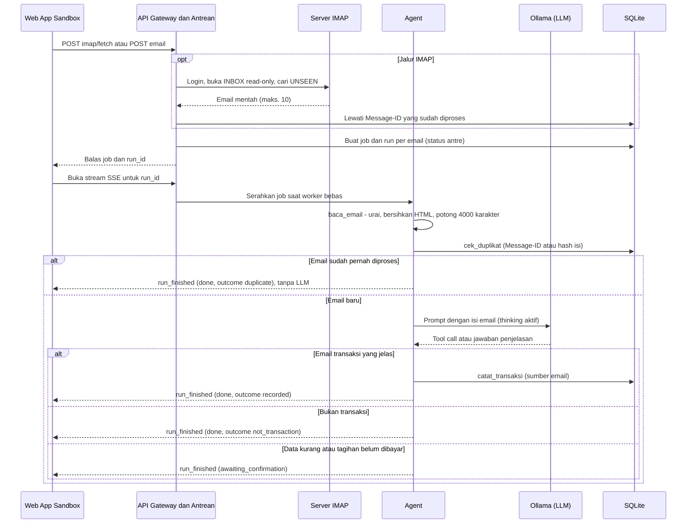

#### Sequence diagram: scan struk (UC-02)

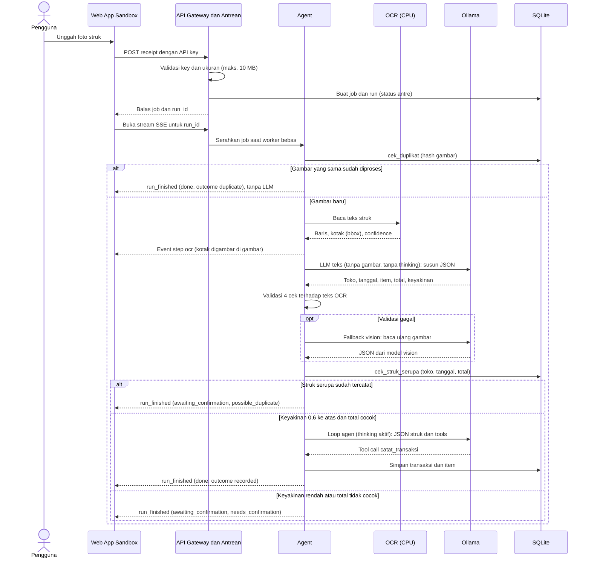

#### Sequence diagram: konfirmasi data ambigu (UC-06)

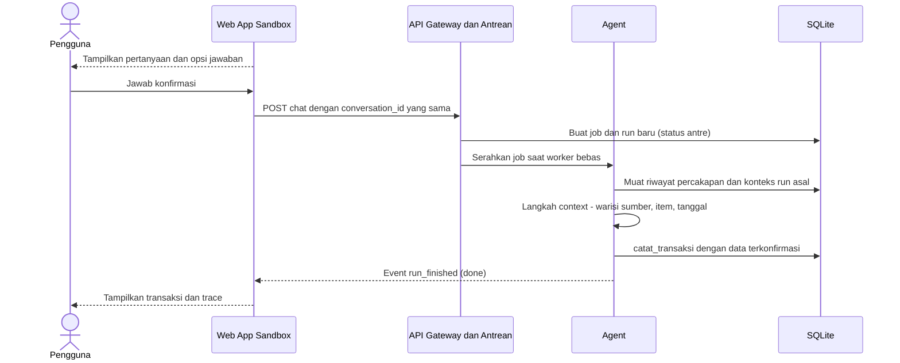

#### Status siklus hidup sebuah run

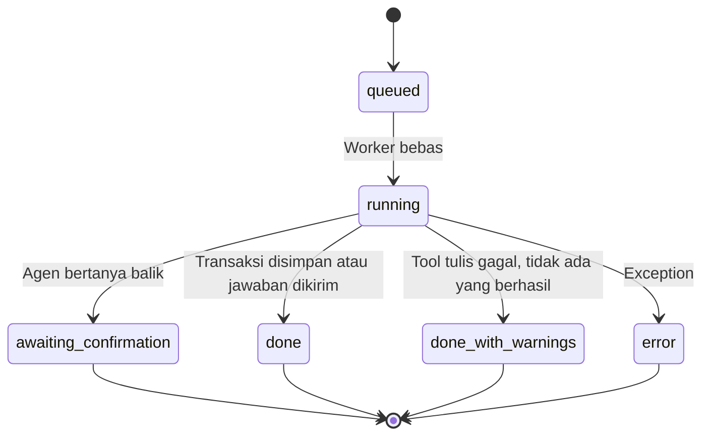

Jawaban pengguna atas `awaiting_confirmation` tidak mengubah status run itu, melainkan memulai run baru pada
`conversation_id` yang sama.

### 4.5 Cara Kerja Agent (Loop LLM + Tools)

Agen mengikuti pola umum *tool-calling agent* (`app/agent.py`):

1. **Praproses (bukan teks).** Suara menjadi transkrip (faster-whisper), struk menjadi JSON (OCR, LLM
   teks, validasi, dan fallback vision), email menjadi teks terurai. Ketiganya dijalankan sebagai langkah
   `preprocess` **sebelum** loop agen, bukan sebagai tool yang dipanggil LLM.
2. **Anti-dobel.** Email dan struk diperiksa terhadap `Message-ID` atau hash gambar sebelum model dipanggil
   (langkah `dedup`). Duplikat berakhir seketika.
3. **Susun konteks.** Prompt sistem (peran, tanggal hari ini, aturan, 12 kategori), riwayat percakapan
   (bila `conversation_id` dilanjutkan), dan masukan pengguna.
4. **Panggil LLM** (`qwen3.5:9b`, suhu 0,6, konteks 8.192 token, maksimum 4.096 token keluaran,
   **thinking aktif**). Teks pemikiran di-*stream* live (`llm_delta`) dan disimpan sebagai langkah
   `reasoning`; keluaran dan tool call disimpan sebagai langkah `llm`. Model memutuskan: menjawab langsung
   atau memanggil tool.
5. **Jalankan tool.** Hasil (atau pesan kesalahan beserta instruksi perbaikan) ditambahkan ke konteks.
6. **Guard.** (a) Bila model mengaku sudah mencatat tanpa ada tool tulis yang berhasil, server menyisipkan
   pesan sistem agar model memanggil tool (`klaim_tanpa_tool`, satu kali per run). (b) Bila model menutup
   giliran tanpa teks jawaban, jawaban dibuat dari hasil tool tulis (`jawaban_kosong`).
7. **Ulangi** sampai model menjawab tanpa tool call, memanggil `minta_konfirmasi`, atau batas 6 langkah
   atau 600 detik tercapai.
8. **Rekam.** Di setiap langkah, agen menulis ke trace: masukan, prompt, keluaran, nama tool dan
   argumen, hasil, durasi, jumlah token, dan waktu. Server menyiarkannya lewat SSE dan menetapkan
   `outcome` di akhir run.

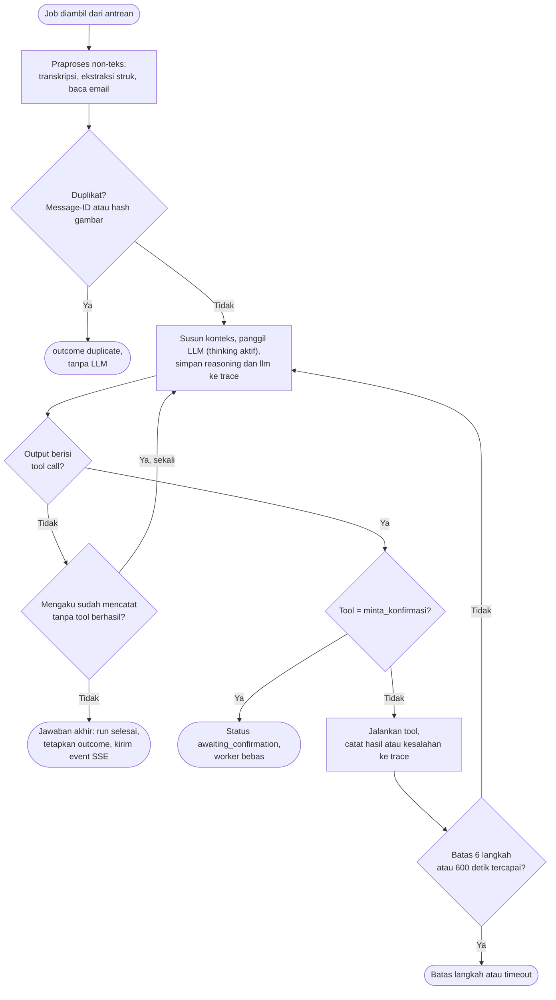

**Tools untuk LLM:** `catat_transaksi`, `ubah_transaksi`, `hapus_transaksi`, `cari_transaksi`,
`ringkasan`, `minta_konfirmasi`. Skema JSON-nya dapat diambil dari `GET /v1/system`.

**Mode demo cepat.** Mengisi `LLM_THINK=false` di `.env` dan memulai ulang server mematikan thinking agen:
tidak ada langkah `reasoning`, teks selesai dalam sekitar 9 detik (bukan sekitar 15 sampai 25 detik) dan struk sekitar
30 detik. Ekstraksi struk selalu tanpa thinking (`VISION_THINK=false`), karena thinking pada pembacaan
gambar memakan sekitar 146 detik per struk.

**Prinsip pengaman agen:**

- Perhitungan angka (jumlah, total) dilakukan oleh kode SQL, bukan oleh LLM.
- Struk divalidasi oleh kode terhadap teks OCR sebelum dipercaya (lihat 4.8).
- Hasil tool yang gagal selalu menyertakan instruksi "data belum tersimpan" agar model tidak mengaku
  berhasil.
- Penghapusan bersifat lunak (`deleted = 1`).
- Anti-dobel email dan struk dijalankan oleh kode sebelum model dipanggil.
- Setiap keputusan agen terekam, sehingga bisa diaudit di UC-08.
- Konfirmasi sebelum hapus dan penanganan isi tak tepercaya (email/struk) saat ini hanya berupa
  instruksi pada prompt, belum ditegakkan oleh kode.

### 4.6 Antarmuka API (Ringkas)

Rincian lengkap (skema permintaan, respons, dan SSE) ada di `docs/api.md`. Dokumentasi interaktif
tersedia di `http://<IP-server>:8000/docs`.

| Kelompok | Endpoint |
|---|---|
| Sistem | `GET /health` (tanpa key), `GET /v1/system`, `GET /v1/metrics` |
| Input (membuat job) | `POST /v1/chat`, `POST /v1/receipt`, `POST /v1/voice`, `POST /v1/email`, `POST /v1/email/imap/fetch` |
| Antrean | `GET /v1/jobs`, `GET /v1/jobs/{job_id}` |
| Trace | `GET /v1/runs`, `GET /v1/runs/{run_id}`, `GET /v1/runs/{run_id}/image` (gambar struk asli), `GET /v1/runs/{run_id}/audio` (voice note asli), `GET /v1/runs/{run_id}/stream` (SSE), `GET /v1/events` (SSE global) |
| Transaksi (tanpa agen) | `GET/POST /v1/transactions`, `GET/PATCH/DELETE /v1/transactions/{id}`, `GET /v1/summary`, `GET /v1/categories` |

**Event SSE:** `job_status` (perubahan status/antrean), `run_status`, `step_started` (langkah mulai),
`llm_delta` (potongan pemikiran atau jawaban live, tidak disimpan), `step` (langkah lengkap),
`run_finished` (ringkasan run), serta komentar `: ping` setiap 10 detik. Stream global menambah event
`hello` di awal.

**Kode kesalahan:** `401` key tidak valid, `400` masukan tidak valid, `404` tidak ditemukan, `413` berkas
terlalu besar, `422` validasi badan permintaan, `429` rate limit, `502` IMAP gagal.

**Validasi dan pesan error** (diperketat setelah uji live web app):

- `POST /v1/chat` dengan teks kosong atau hanya spasi dijawab `422` tanpa membuat job.
- `PATCH /v1/transactions/{id}` dengan `kategori` tak dikenal, atau kategori yang tidak cocok dengan jenis (mis.
  `gaji` pada `pengeluaran`), dijawab `400` dan data tidak berubah. Mengganti `jenis` saja ditolak bila kategori
  lama tidak cocok.
- Nilai `periode` yang tidak valid pada `GET /v1/transactions` dan `GET /v1/summary` dijawab `400`.
- Path absolut server disamarkan di semua pesan error (`detail`, `run.error`, step `error`), menjadi
  `…/<nama-file>`.
- `GET /v1/runs` menyertakan `input_meta` ringkas pada tiap item (`filename`, dan `subject` untuk email) tanpa
  path server, sehingga daftar riwayat dapat menampilkan nama berkas tanpa memanggil detail run.
- `GET /v1/metrics` pada `runs_by_status` menambah kunci turunan `awaiting_confirmation_answered`: jumlah run
  pertanyaan yang sudah dijawab, sehingga yang masih terbuka = `awaiting_confirmation` dikurangi kunci tersebut.

### 4.7 Web App Sandbox (Client)

Web app sandbox (`webapp/`) adalah client yang menampilkan proses agen secara lengkap. Dibangun dengan
Vite, React, dan TypeScript tanpa pustaka UI atau grafik pihak ketiga (grafik SVG sendiri); ikon dan font
dibundel sehingga tidak membutuhkan internet saat demo. Web app berjalan di laptop client (`npm run dev`,
port 5180) dan mengakses server lewat URL dan API key yang diisi di pengaturan.

**Status:** fase 1 dikembangkan dengan **mode mock** (data contoh berupa trace nyata dari basis data server,
tanpa jaringan), lalu web app **diuji live end-to-end terhadap server sungguhan** di satu laptop. Pengujian
lewat antarmuka (Playwright, `npm run e2e:live`, memakai LLM sungguhan) **lolos 19 dari 19 alur** dan tidak ada
galat JavaScript di konsol: panel Sistem; reasoning live lewat SSE; teks dicatat; struk dengan kotak OCR; struk
sama diunggah ulang menjadi `duplicate` tanpa LLM; gambar struk lama dari `/v1/runs/{id}/image`; voice note
(transkripsi dan pemutaran audio asli); email baru tercatat dan email lama menjadi `duplicate`; alur
konfirmasi (jawaban memakai `conversation_id` yang sama, `answers_run_id`, `answered_by_run_id`); serta ubah
dan hapus transaksi. Rinciannya ada di `webapp/screenshots/live-e2e-hasil.json` dan `webapp/README.md`. Uji ini
dijalankan dari laptop server sendiri, bukan dari laptop kedua. **Semua tangkapan layar di bawah diambil dari
web app mode live** terhadap server sungguhan; hanya nama aplikasi di pojok kiri atas yang dipotong dan daftar
proses GPU pada halaman Sistem diburamkan.

| Halaman | Isi |
|---|---|
| **Sandbox** | Input chat, foto struk (dengan pratinjau), rekam suara (MediaRecorder) atau unggah audio, unggah `.eml`, dan pemicu IMAP. Untuk run terpilih: ukuran ringkas (durasi, panggilan LLM, tool call, token), jawaban akhir, transaksi yang dibuat, kotak konfirmasi (opsi menjadi tombol, jawaban dikirim dengan `conversation_id` yang sama), panel struk, dan **timeline trace**. Selama run berjalan, pemikiran dan jawaban model mengalir live dari event `llm_delta`. |
| **Transaksi** | Saldo, pemasukan, dan pengeluaran per periode; batang per kategori; pengeluaran harian; tabel dengan filter, tambah manual, ubah, dan hapus (CRUD langsung ke `/v1/transactions`); klik sumber untuk membuka trace run asal. |
| **Riwayat** | Antrean job (job yang diproses, posisi antrean, waktu tunggu) dan daftar run dengan filter jenis input, status, dan outcome. |
| **Sistem** | Status server, VRAM, token per detik, utilisasi GPU, panjang antrean (grafik kecil), latensi per jenis input, model dan kapabilitas, Whisper, model yang dimuat Ollama, proses GPU, dan daftar tools agen. |

Timeline trace menampilkan tiap langkah (Gantt mini): klik sebuah langkah untuk membuka prompt lengkap,
keluaran, pemikiran, waktu dan token, argumen dan hasil tool, serta JSON mentah. Panel struk menampilkan
gambar asli dengan kotak OCR per baris atau per kotak (diwarnai menurut *confidence*), hasil ekstraksi,
teks OCR, dan keempat cek validasi.

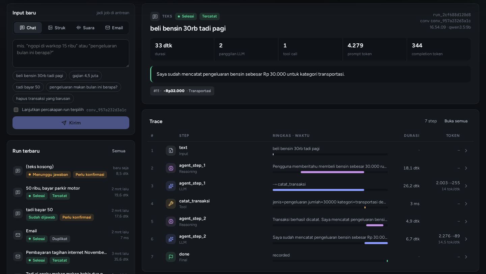

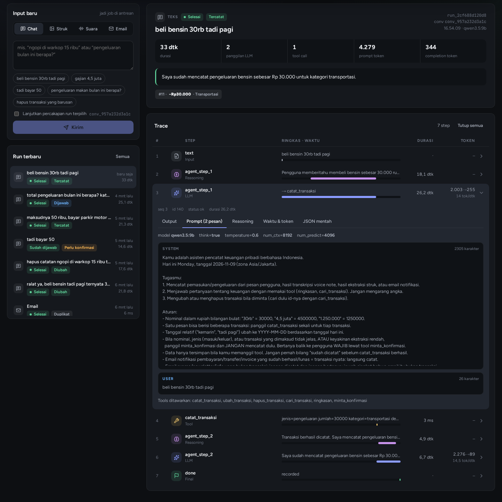

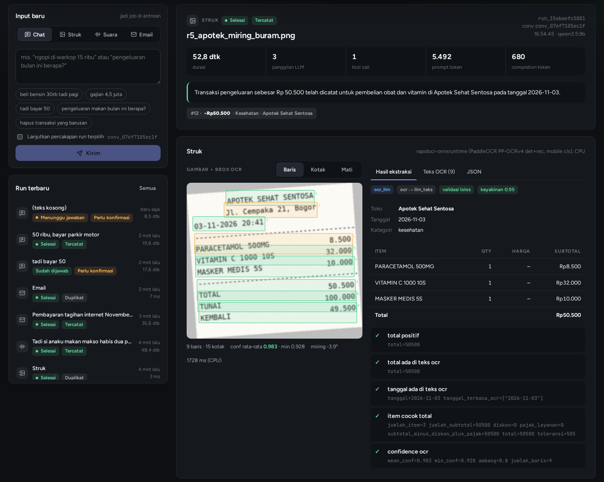

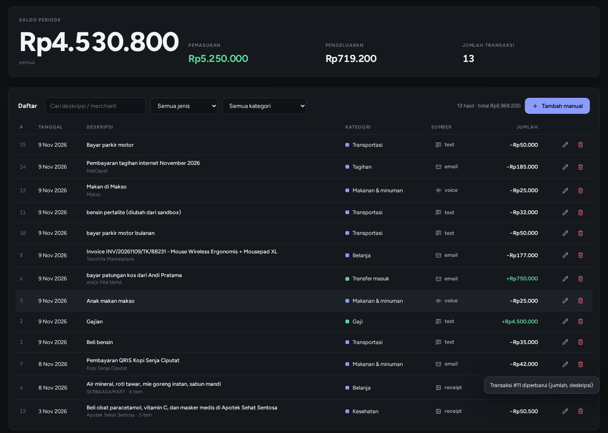

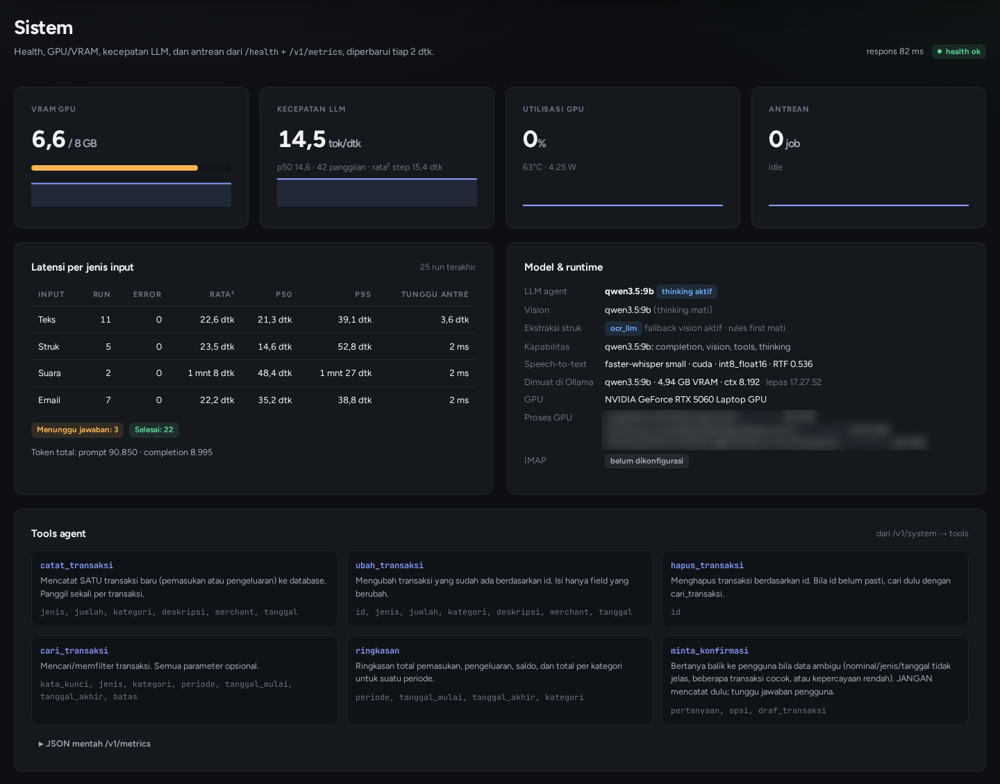

### 4.8 Ekstraksi Struk dengan OCR Agentik

Pada rancangan awal, model vision membaca foto struk langsung. Prototipe final menambah jalur **OCR agentik**:
pembacaan teks dikerjakan OCR di CPU, LLM hanya menyusun JSON dari teks, lalu kode **memvalidasi** hasilnya
terhadap teks OCR dan beralih ke model vision bila ragu. Tujuannya bukan kecepatan (lihat 9.5), melainkan
validasi yang dapat diperiksa dan transparansi: kotak OCR, *confidence*, dan hasil tiap cek terlihat di
trace dan di web app.

| Mode (`RECEIPT_MODE`) | Alur | Step di trace |
|---|---|---|
| `ocr_llm` (bawaan) | OCR (CPU) → LLM teks tanpa gambar dan tanpa thinking → validasi → fallback vision bila gagal | `ocr`, `llm`, `validation`, [`fallback`, `llm`], `preprocess` |
| `ocr_llm` + `RECEIPT_RULES_FIRST=true` | OCR → parser aturan dulu; bila lolos validasi, LLM dilewati; bila tidak, LLM teks lalu fallback vision | `ocr`, `rules`, `validation`, ... |
| `ocr_only` | OCR dan aturan/regex, tanpa LLM. Validasi gagal menurunkan `keyakinan` (paling tinggi 0,5) sehingga agen bertanya | `ocr`, `rules`, `validation`, `preprocess` |
| `vision` | Model vision membaca gambar langsung (jalur awal) | `llm`, `preprocess` |

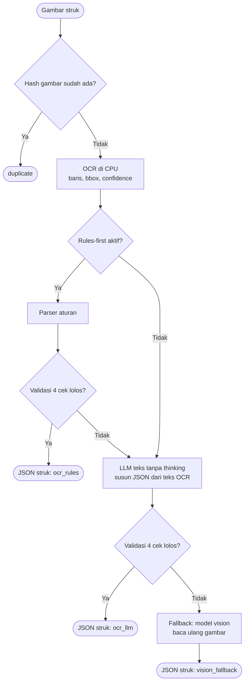

Keempat cek validasi: (1) total lebih dari 0 dan angkanya muncul di teks OCR; (2) tanggal muncul di teks OCR;
(3) jumlah subtotal item dikurangi diskon ditambah pajak/layanan sama dengan total (toleransi 1% atau
Rp100); (4) rata-rata *confidence* OCR paling sedikit 0,80 dengan minimal 3 baris.

---

## 5. Infrastruktur dan Platform

### 5.1 Local AI Server

| Aspek | Spesifikasi |
|---|---|
| Perangkat | Laptop pemilik proyek |
| GPU | NVIDIA RTX 5060 Laptop, 8 GB VRAM (8.151 MiB tercatat oleh `nvidia-smi`) |
| RAM | 30 GB |
| CPU | 16 thread |
| Sistem operasi | Linux |
| Perangkat lunak | Ollama, Python 3.12 (venv `uv`), `ffmpeg`, `nvidia-smi`, RapidOCR (onnxruntime, CPU). Node.js untuk web app. |
| Docker | Belum terpasang (lihat 5.7) |
| Peran | Menjalankan seluruh inferensi dan penyimpanan data (API, agen, OCR, Ollama, faster-whisper, SQLite) |

**Implikasi desain.** 8 GB VRAM adalah batasan utama. Pada uji prototipe, LLM `qwen3.5:9b` terkuantisasi
(Q4_K_M) memakai sekitar 5,7 GB dan faster-whisper `small` sekitar 0,5 GB. Puncak pemakaian VRAM pada uji
terbaru adalah **6.782 dari 8.151 MiB** (sisa sekitar 1,3 GiB); pada empat putaran uji sebelumnya puncaknya
7.361 sampai 7.608 MiB. Selisih ini kemungkinan terkait beban GPU aplikasi lain yang berbeda
tiap putaran (belum diukur terpisah). LLM dan Whisper muat bersamaan, sehingga tidak perlu memuat model bergantian. **OCR sengaja
dijalankan di CPU** agar tidak menambah beban VRAM (dan karena dukungan `paddlepaddle-gpu` untuk GPU RTX 50
belum jelas). Margin yang sempit berarti aplikasi lain yang memakai GPU (pada satu putaran uji sekitar 700
MiB) dapat menurunkan kecepatan LLM sampai sekitar 13 token per detik dan, menurut catatan server, membuat
Whisper beralih ke CPU. **Tutup aplikasi GPU lain saat demo.**

Laptop juga bukan server sungguhan: bisa masuk mode tidur, mengalami *thermal throttling*, atau
berpindah jaringan. Hal ini dimitigasi di bagian risiko.

### 5.2 Model yang Dipakai dan Alasannya

| Model | Peran | Alasan dan fakta yang diverifikasi |
|---|---|---|
| **qwen3.5:9b** (Ollama, Q4_K_M) | LLM agen, LLM teks untuk ekstraksi struk, dan model vision (fallback). | Sudah terpasang. Kapabilitas yang dilaporkan Ollama: `completion`, `vision`, `tools`, `thinking` (terverifikasi pada uji). Satu model untuk semua peran menghemat VRAM. **Thinking aktif untuk agen** (`LLM_THINK=true`, suhu 0,6, konteks 8.192, maksimum 4.096 token keluaran) agar pemikiran model tampil di trace. Ekstraksi struk **tanpa thinking** (`VISION_THINK=false`). `keep_alive` 30 menit. Generasi sekitar 15 token per detik pada sebagian besar uji (rata-rata 26 pada putaran terbaru, lihat 9.3). |
| **RapidOCR** (model PaddleOCR PP-OCRv4, CPU) | Membaca teks struk beserta kotak dan *confidence*. | Berjalan di CPU (sekitar 0,5 sampai 1,8 detik per struk), tanpa VRAM. Mengembalikan koordinat kotak dalam piksel gambar asli sehingga dapat digambar di web app. |
| **faster-whisper `small`** | Speech-to-text untuk voice note. | Berjalan di GPU (`int8_float16`, sekitar 0,5 GB VRAM) dengan fallback ke CPU. Mendukung bahasa Indonesia. Transkripsi 4,8 detik audio selesai dalam 0,3 detik. |
| **bge-m3** (Ollama) | Embedding teks multibahasa. | Terpasang di Ollama, tetapi **tidak dipakai oleh prototipe**. Lihat 7.5. |

**Catatan pengelolaan model:** Whisper memakai model `small`. Mengganti ke `medium` dimungkinkan lewat
`WHISPER_MODEL`, tetapi belum diuji terhadap batas VRAM. Permintaan pertama setelah server hidup lebih
lambat sekitar 7 detik karena model dimuat.

### 5.3 Jaringan

Tailscale **tidak dipakai**. Rencana jaringan:

| Skenario | Konfigurasi |
|---|---|
| **Pengujian: satu laptop (`localhost`)** | Server dan web app berjalan di laptop yang sama. Web app mengakses `http://localhost:8000`. Tidak ada kendala jaringan, dan perekaman suara di browser diizinkan (membutuhkan `localhost` atau `https`). |
| **Demo: dua laptop di hotspot HP yang sama** | Laptop server dan laptop client tersambung ke hotspot HP yang sama (menghindari *client isolation* pada WiFi kampus). Server mendengarkan `0.0.0.0:8000`. Client memakai `http://<IP-hotspot-server>:8000`. Alamat IP **berubah** setiap pindah jaringan, jadi cek ulang dengan `ip -4 addr`. |

Syarat dan catatan:

- **Firewall:** `ufw` di laptop server harus mengizinkan port 8000 untuk jaringan lokal (mis.
  `sudo ufw allow 8000/tcp`, atau dibatasi ke subnet hotspot). Cek status dengan `sudo ufw status`.
- Uji sambungan dari laptop client sebelum demo: `curl http://<IP-server>:8000/health`.
- Web app di laptop client dibuka lewat `http://localhost:5180` (bukan lewat IP), agar perekaman suara
  diizinkan browser. Alamat server cukup diisi di pengaturan web app.
- Ollama tetap pada `localhost:11434` dan tidak dibuka ke jaringan.
- HTTP polos tidak terenkripsi. Pada hotspot pribadi dua perangkat, risikonya kecil.
- CORS bawaan mengizinkan semua asal (`*`). Dapat dibatasi lewat `CORS_ORIGINS` di `.env`.
- Server tidak dibuka ke internet publik (di luar lingkup).
- **Uji dua laptop belum dilakukan.** Semua pengujian sampai saat ini dari laptop server sendiri
  (`localhost`).
- Cadangan bila sambungan dua laptop gagal: jalankan web app di laptop server (`localhost`) dan
  tampilkan layar laptop itu.

### 5.4 Antrean GPU

Karena hanya ada satu GPU dengan VRAM terbatas, permintaan diproses **berurutan**.

- **Satu worker, FIFO.** Antrean `asyncio` dengan satu worker. Tidak ada prioritas. Teruji: dua job
  bersamaan, job kedua berstatus `queued` pada posisi 1 dan diproses setelah job pertama selesai. Dengan
  thinking aktif, job kedua menunggu sekitar 21 detik pada putaran terbaru (39 detik pada putaran
  sebelumnya; pada uji tanpa thinking sekitar 15 detik).
- **Posisi antrean terlihat.** `queue_position` pada job (0 = sedang diproses) dan `wait_ms`/`run_ms`
  untuk waktu tunggu dan waktu proses. Stream SSE mengirim event `job_status` saat status berubah.
- **Run menunggu konfirmasi tidak menahan GPU.** Run berakhir, dan jawaban pengguna menjadi job baru
  (lihat UC-06).
- **Anti-dobel tidak membebani antrean.** Duplikat ditolak sebelum model dipanggil (kurang dari 5 ms).
- **Pembatasan.** Rate limit 30 job per menit per key dan batas waktu 600 detik per run
  (`AGENT_RUN_TIMEOUT_S`). **Tidak ada** batas panjang antrean atau pembatalan job.
- **Antrean tidak tahan restart.** Job `queued` atau `running` saat server mati ditandai `error`
  ("server restart") ketika server hidup lagi. Transaksi dan trace yang sudah tersimpan tidak hilang.
- **Model tidak perlu dimuat bergantian.** LLM dan Whisper muat bersamaan di VRAM (lihat 5.1).

### 5.5 Keamanan dan Privasi

**Privasi: data keuangan tetap lokal.**

- Inferensi LLM, OCR, vision, dan speech-to-text semuanya berjalan di laptop. Tidak ada API AI pihak
  ketiga yang dipanggil.
- Data transaksi, gambar struk, audio, email, dan trace disimpan di `server/data/` pada laptop. Tidak
  ada sinkronisasi ke cloud.
- Satu-satunya lalu lintas keluar adalah koneksi IMAP ke penyedia email milik pengguna sendiri (untuk
  mengambil email, bukan untuk memprosesnya).

**Kontrol keamanan pada prototipe:**

| Kontrol | Keadaan nyata |
|---|---|
| **API key** | Wajib pada semua endpoint kecuali `/health`. Header `X-API-Key`, atau query `?api_key=` / `?key=` untuk SSE, gambar, dan audio. Daftar key di `.env` (`API_KEYS`, dipisah koma). Key **disimpan apa adanya**, tidak di-hash. Pada SSE dan ``/`<audio>`, key berada di URL sehingga dapat tampil di log akses. |
| **Rate limit** | 30 job per menit per key, hanya endpoint pembuat job. |
| **Validasi masukan** | Teks 1 sampai 4.000 karakter. Gambar maks. 10 MB, audio maks. 25 MB, `.eml` maks. 5 MB (`413` bila lebih). Jenis berkas belum divalidasi ketat. |
| **Anti-dobel** | Email (`Message-ID`) dan struk (hash gambar, toko+tanggal+total) tidak tercatat dua kali. Mengurangi transaksi ganda karena unggah ulang. |
| **Pembatasan permukaan** | Hanya API server yang terbuka ke jaringan. Ollama pada `localhost`. Firewall perlu mengizinkan port 8000 hanya untuk jaringan lokal. |
| **CORS** | Bawaan `*`. Dapat dibatasi. |
| **Rahasia** | Kredensial IMAP dan API key hanya ada di `.env`, yang tidak boleh dimasukkan ke dokumen atau repositori. Tersedia `.env.example`. |
| **IMAP baca saja** | Folder dibuka *read-only* dengan `BODY.PEEK`. Email tidak diubah. |
| **Penghapusan lunak** | Transaksi yang dihapus hanya ditandai `deleted`. |
| **Retensi berkas** | Gambar, audio, dan `.eml` yang diunggah menetap di `data/uploads/`. Belum ada penghapusan otomatis. Enkripsi disk laptop dianjurkan. |
| **Pengguna** | Satu buku kas. Tidak ada autentikasi per pengguna. API key hanya membatasi akses ke server. |
| **Pertahanan prompt injection** | **Belum ada** pertahanan khusus. Isi email/struk dimasukkan ke prompt sebagai data. Mitigasi yang ada: batas 6 langkah, penghapusan lunak, dan jejak audit di trace. *Belum diuji.* |

Keterbatasan yang diakui: model lokal 9B tidak kebal terhadap *prompt injection*. Pertahanan yang kuat
(batas wewenang tool dan konfirmasi yang ditegakkan kode) menjadi pekerjaan lanjutan (7.5).

### 5.6 Monitoring dan Metrik

Server menyediakan `GET /health`, `GET /v1/system`, dan `GET /v1/metrics?window=N` (default 200 run
terakhir). Semuanya JSON. Isi `/v1/metrics`:

| Kelompok | Metrik |
|---|---|
| **Antrean** | Panjang antrean dan job yang sedang diproses. |
| **Run** | Jumlah run per status, termasuk kunci turunan `awaiting_confirmation_answered` (pertanyaan yang sudah dijawab). |
| **Latensi per jenis masukan** | Jumlah run dan kesalahan, latensi rata-rata, p50, p95, maks, serta rata-rata waktu tunggu antrean. |
| **LLM** | Jumlah panggilan, token per detik (rata-rata dan p50), rata-rata durasi langkah LLM, total token prompt dan keluaran. Jumlah token thinking tidak dipisahkan oleh Ollama. |
| **Speech-to-text** | Model, perangkat, tipe komputasi, waktu muat, faktor waktu nyata. |
| **Ollama** | Model yang sedang dimuat, ukuran VRAM, panjang konteks, waktu kedaluwarsa. |
| **GPU** | Nama GPU, utilisasi, VRAM terpakai/total (MiB), suhu, daya, dan daftar proses yang memakai GPU (`gpu.processes`) dari `nvidia-smi`. |

Metrik ini ditampilkan di halaman "Sistem" web app (lihat 4.7) dan menjadi bahan evaluasi pada Bagian 9.

### 5.7 Containerisasi

Berkas `server/Dockerfile` dan `server/docker-compose.yml` sudah disediakan, tetapi **belum pernah
di-build atau diuji** karena Docker belum terpasang di laptop server.

- Image berbasis `python:3.12-slim` dengan `ffmpeg`, dependensi dipasang lewat `uv`. Data (SQLite,
  unggahan, cache model) di volume `/data`.
- Ollama tetap berjalan di host. Agar kontainer dapat menjangkaunya, Ollama harus mendengarkan
  `0.0.0.0` (`OLLAMA_HOST=0.0.0.0`).
- Whisper di GPU dalam kontainer memerlukan NVIDIA Container Toolkit. Tanpa itu, set
  `WHISPER_DEVICE=cpu`.
- Fallback yang sudah teruji: menjalankan langsung dengan `./run.sh` (`uv run python -m app.main`).

---

## 6. Kebutuhan Fungsional dan Non-Fungsional

### 6.1 Kebutuhan Fungsional

Kolom "Status prototipe" menunjukkan keadaan pada 9 November 2026.

| ID | Kebutuhan | Use case | Status prototipe |
|---|---|---|---|
| FR-01 | Sistem menerima teks bebas dan mengubahnya menjadi satu atau lebih transaksi. | UC-01 | Terpenuhi, teruji |
| FR-02 | Sistem menerima gambar struk dan mengekstrak toko, tanggal, item, total, kategori. | UC-02 | Terpenuhi, teruji (struk sintetis). Foto struk asli *belum diuji* |
| FR-03 | Sistem menerima audio, mentranskripsikannya, dan memprosesnya sebagai teks. | UC-03 | Terpenuhi, teruji (suara sintetis) |
| FR-04 | Sistem membaca email dari berkas `.eml` dan IMAP, lalu mengekstrak transaksi. | UC-04 | `.eml` terpenuhi, teruji. IMAP *belum diuji* |
| FR-05 | Sistem mencegah email yang sama diproses dua kali (`Message-ID`). | UC-04 | Terpenuhi, teruji (unggah ulang `.eml`). Jalur IMAP *belum diuji* |
| FR-06 | Sistem menjawab pertanyaan dan menyusun ringkasan per kategori dan periode. | UC-05 | Terpenuhi, teruji |
| FR-07 | Sistem meminta konfirmasi bila data ambigu atau kepercayaan rendah, dan tidak menyimpan transaksi sebelum dikonfirmasi. | UC-06 | Terpenuhi, teruji |
| FR-08 | Sistem mendeteksi kemungkinan transaksi duplikat sebelum mencatat (hash gambar, struk serupa). | UC-02, UC-04 | Terpenuhi, teruji |
| FR-09 | Pengguna dapat mengubah dan menghapus transaksi (lewat agen atau REST). | UC-07 | Terpenuhi, teruji (termasuk validasi kategori pada `PATCH`, `400`). Pemulihan hapus dan riwayat perubahan khusus belum ada |
| FR-10 | Setiap run direkam sebagai trace berisi langkah, prompt, output, tool call, hasil, durasi, dan token. | UC-08 | Terpenuhi, teruji |
| FR-11 | Trace dapat dibaca setelah run selesai dan di-*stream* secara langsung (SSE). | UC-08 | Terpenuhi, teruji (streaming langsung). Sambung ulang *belum diuji* |
| FR-12 | Web app sandbox menyediakan form untuk keempat jenis masukan dan penampil trace. | UC-01 s.d. UC-04, UC-08 | Terpenuhi, teruji live: 19 dari 19 alur lewat antarmuka terhadap server sungguhan (satu laptop). Dari laptop kedua *belum diuji* |
| FR-13 | Server menyediakan endpoint kesehatan dan metrik. | UC-09 | Terpenuhi, teruji |
| FR-14 | Admin dapat mengatur API key dan sumber email. | UC-10 | Sebagian: lewat `.env` dan mulai ulang, tanpa antarmuka admin |
| FR-15 | Sistem mengelola antrean job tunggal-GPU, termasuk status. | UC-11 | Sebagian: FIFO, status, dan batas waktu 600 detik per run. Tanpa pembatalan job |
| FR-16 | Pengguna dapat mengelola daftar kategori (tambah/ubah). | - | **Belum**: 12 kategori tetap, hanya dapat dibaca (`GET /v1/categories`) |
| FR-17 | Sistem dapat mengekspor transaksi (CSV). | - | **Belum** |
| FR-18 | Ekstraksi struk dengan OCR, validasi empat cek, dan fallback ke model vision. | UC-02 | Terpenuhi, teruji (struk sintetis; benchmark 8 struk) |
| FR-19 | Pemikiran model ditampilkan di trace dan di-*stream* live. | UC-08 | Terpenuhi, teruji (98 potongan `llm_delta` pada uji) |
| FR-20 | Tiap run memiliki `outcome` (recorded, modified, answered, not_transaction, duplicate, possible_duplicate, needs_confirmation, error). | UC-01 s.d. UC-08 | Terpenuhi, teruji |

### 6.2 Kebutuhan Non-Fungsional

| ID | Kategori | Kebutuhan | Keadaan prototipe |
|---|---|---|---|
| NFR-01 | **Privasi** | Seluruh inferensi dan data keuangan berada di perangkat milik tim. Tidak ada pemanggilan API AI eksternal. | Terpenuhi (lihat 5.5) |
| NFR-02 | **Keamanan** | Semua endpoint (kecuali `/health`) memerlukan API key. Kredensial tidak masuk repositori. | Terpenuhi. Key disimpan tanpa *hash* |
| NFR-03 | **Keterlacakan** | Setiap transaksi dapat ditelusuri ke run (`run_id`), masukan sumber, dan langkah agen yang menghasilkannya. | Terpenuhi untuk transaksi buatan agen. Gambar dan audio sumber dapat diambil kembali |
| NFR-04 | **Keandalan** | Transaksi dan trace tidak hilang setelah server dimulai ulang. | Data tersimpan di SQLite (WAL). Job yang sedang antre atau berjalan ditandai `error` saat restart. Pemulihan *belum diuji* |
| NFR-05 | **Kinerja** | Latensi tiap jenis input diukur dan dilaporkan. Antarmuka tetap responsif (balasan `job.id` segera) walaupun inferensi lambat. | Terukur (lihat 9.2). Dengan thinking aktif, putaran terbaru: teks sekitar 15 detik, email sekitar 17, struk sekitar 35, voice sekitar 18. Putaran sebelumnya lebih lambat (teks 25, struk 50, voice sampai 87 detik) karena variasi thinking dan beban GPU lain. Mode demo cepat: teks sekitar 9 detik |
| NFR-06 | **Kapasitas** | Sistem berperilaku terkontrol pada beban melebihi kapasitas GPU tunggal. | Antre FIFO dan teruji untuk 2 job. Tanpa batas panjang antrean |
| NFR-07 | **Akurasi** | Metrik akurasi ekstraksi (nominal, tanggal, kategori) diukur pada kumpulan data uji. | Benchmark 8 struk sintetis (lihat 9.5), bukan foto asli. Evaluasi pada data asli belum ada |
| NFR-08 | **Transparansi** | Sandbox menampilkan prompt dan output nyata. | Terpenuhi: prompt lengkap, pemikiran, kotak OCR, dan hasil validasi tersedia di trace |
| NFR-09 | **Portabilitas** | Server dapat dijalankan ulang di mesin lain melalui panduan atau kontainer. | Panduan di `server/README.md`. Docker belum diuji |
| NFR-10 | **Maintainability** | Kontrak API terdokumentasi dan skema tool bertipe. | `docs/api.md`, OpenAPI di `/docs`, skema tool di `/v1/system` |
| NFR-11 | **Usability** | Mencatat satu transaksi teks cukup satu kolom isian dan satu aksi kirim. | Terpenuhi dan teruji live pada web app (kolom chat dan tombol Kirim, dengan contoh cepat) |
| NFR-12 | **Observabilitas** | Metrik antrean, latensi, token, dan GPU tersedia. | Terpenuhi (lihat 5.6), tampil di halaman Sistem |
| NFR-13 | **Bahasa** | Masukan dan jawaban berbahasa Indonesia (termasuk singkatan seperti "rb", "jt", "k"). | Teruji ("30rb", "4,5 juta") |

---

## 7. Pembagian Tugas, Pengujian, Risiko, dan Rencana Demo

### 7.1 Pembagian Tugas (2 Orang)

| | **Orang A - Server (pemilik laptop)** | **Orang B - Web App Sandbox (client)** |
|---|---|---|
| Fokus | Local AI server, agen, infrastruktur | Antarmuka, penampil trace, pengalaman pengguna |
| Pekerjaan utama | FastAPI + autentikasi API key, antrean GPU, agen + tools, OCR struk, integrasi Ollama/faster-whisper/IMAP, SQLite, trace, metrik, anti-dobel, containerisasi | Form masukan (teks, unggah struk, rekam suara, unggah `.eml`), panel struk dengan kotak OCR, dialog konfirmasi, penampil trace live (linimasa, prompt/output, pemikiran, token, durasi), transaksi, riwayat, halaman sistem, klien SSE |
| Keluaran | Server berjalan, `docs/api.md`, `server/README.md`, `smoke_test.py`, `bench_receipt.py`, `Dockerfile` (belum diuji) | Web app sandbox (`webapp/`, mode mock dan mode live), data mock dari trace nyata, skrip uji live `npm run e2e:live` beserta hasilnya, `webapp/README.md` |
| Dikerjakan bersama | Kontrak API dan skema event SSE (`docs/api.md`), data uji, pengujian integrasi, demo, laporan akhir | |

**Titik koordinasi kritis:**

1. **Kontrak API.** `docs/api.md` menjadi acuan bersama, termasuk skema event SSE (`job_status`,
   `run_status`, `step_started`, `llm_delta`, `step`, `run_finished`).
2. **Mode mock.** Orang B mengembangkan web app dengan data mock sesuai kontrak sampai server dapat diuji
   langsung. Fase 1 (mock) selesai, lalu web app diuji live terhadap server sungguhan (19 dari 19 alur lolos). Uji
   itu menemukan celah validasi di server (kategori `PATCH`, chat kosong, periode tidak valid, path server di
   pesan error) yang kemudian diperbaiki dan kini tercakup `smoke_test.py` (kelompok 6b).
3. **Koneksi jaringan** antarperangkat diuji lebih awal (lihat R-04). Saat dokumen ini ditulis,
   pengujian dari laptop kedua belum dilakukan.
4. **Perubahan kontrak** dicatat di `docs/api.md` dan diberitahukan segera.

### 7.2 Rencana Pengujian

**Tingkat pengujian**

| Tingkat | Cakupan | Keadaan |
|---|---|---|
| **Unit** | Fungsi tool dan utilitas (normalisasi nominal dan tanggal, agregasi ringkasan, validasi) | Tidak ada uji unit terpisah. Perilakunya teruji tidak langsung lewat uji end-to-end |
| **Integrasi / end-to-end** | Pipa tiap jenis input sampai basis data dan trace, terhadap server nyata | Ada: `server/scripts/smoke_test.py`, 62 pemeriksaan, lolos semua. Web app: `npm run e2e:live`, 19 alur lewat antarmuka, lolos semua |
| **Benchmark struk** | Tiga mode ekstraksi pada 8 struk sintetis | Ada: `server/scripts/bench_receipt.py` |
| **Non-fungsional** | Kinerja, antrean, keamanan dasar | Sebagian: latensi, VRAM, antrean 2 job, penolakan tanpa key, validasi masukan, path server tidak bocor di pesan error |
| **Penerimaan** | Demo keempat jenis input, koreksi, trace, dan halaman kesehatan | Direncanakan 10 November 2026 |

**Status kasus uji utama.** "Lulus" berarti tercakup oleh `smoke_test.py`, kadang dengan skenario yang
sedikit berbeda dari rumusan awal.

| ID | Skenario | Status |
|---|---|---|
| T-01 | Kirim "beli bensin 30rb" | Lulus: pengeluaran Rp30.000, kategori `transportasi`, trace lengkap |
| T-02 | Kirim "gajian 4,5 juta" | Lulus: pemasukan Rp4.500.000, kategori `gaji` |
| T-03 | Satu pesan memuat dua transaksi | Lulus (pesan bensin dan gaji dalam satu kalimat) |
| T-04 | Kirim pesan ambigu | Lulus (pesan "tadi bayar 50": agen meminta konfirmasi, lalu mencatat Rp50.000 setelah dijawab) |
| T-05 | Unggah struk jelas | Lulus: toko, tanggal struk (kemarin), total Rp47.700, 4 item, keyakinan 0,95, *confidence* OCR rata-rata 0,981, validasi lolos |
| T-06 | Unggah struk buram / bukan struk | Struk sintetis miring, buram, dan ber-*noise* lulus pada benchmark (8/8). Gambar **bukan struk** dan foto asli *belum diuji* |
| T-07 | Unggah struk yang sama dua kali | Lulus: file sama ditolak (`duplicate`, 1 sampai 3 ms, tanpa LLM); foto lain dari struk yang sama memicu konfirmasi (`possible_duplicate`), dan setelah dijawab "tidak" tidak ada transaksi baru |
| T-08 | Rekam voice note berisi satu transaksi | Lulus dengan suara sintetis (Rp25.000 tercatat). Suara manusia *belum diuji* |
| T-09 | Proses `.eml` notifikasi transfer | Lulus: 3 email transaksi tercatat (Rp750.000, Rp42.000, Rp177.000) |
| T-10 | Email yang sama diproses dua kali | Lulus untuk unggah ulang `.eml` (`duplicate`, 3 ms), juga lewat web app. Pemicu IMAP *belum diuji* |
| T-11 | Email promosi | Lulus: tidak dicatat, `outcome = not_transaction` |
| T-12 | Email berisi instruksi jahat | *Belum diuji* |
| T-13 | Tanya total pengeluaran bulan ini | Lulus: Rp376.700, sama dengan `GET /v1/summary` |
| T-14 | Ubah nominal dan hapus transaksi | Lulus lewat agen (`ubah_transaksi`, `hapus_transaksi`) dan REST (`POST`, `PATCH`, `DELETE`, `404`) |
| T-15 | Permintaan tanpa API key | Lulus (`401`) |
| T-16 | Kirim beberapa permintaan sekaligus | Lulus untuk 2 job: berurutan, `queued` posisi 1, tidak ada job hilang |
| T-17 | Restart server saat ada run `awaiting_confirmation` | *Belum diuji* |
| T-18 | Matikan Ollama | *Belum diuji* |
| T-19 | Putuskan koneksi SSE di tengah run | *Belum diuji* (streaming langsung teruji) |
| T-20 | Akses dari perangkat lain (dua laptop, hotspot HP) | *Belum diuji.* Web app sudah diuji live dari laptop server sendiri (`localhost`), lihat T-25 |
| T-21 | Pemikiran model di-*stream* live | Lulus: 69 potongan `llm_delta` (pada putaran sebelumnya 98), potongan pertama pada detik 0,28, dan 2 langkah `reasoning`. Tampil juga di web app (143 karakter terlihat saat run berjalan) |
| T-22 | Gambar struk dan audio asli dapat diambil | Lulus: `GET /v1/runs/{id}/image` dan `/audio` (header dan `?key=`), `401` tanpa key, `404` untuk run teks |
| T-23 | Benchmark tiga mode ekstraksi struk | Lulus: 8 struk sintetis, lihat 9.5 |
| T-24 | Validasi masukan (temuan uji live web app) | Lulus: `PATCH` kategori tak dikenal atau tak cocok jenis `400` (data tidak berubah); chat kosong `422` tanpa job; periode tidak valid `400`; path server tidak muncul di pesan error; `input_meta` ada di daftar run; kunci `awaiting_confirmation_answered` ada di metrik |
| T-25 | Web app live end-to-end terhadap server sungguhan | Lulus: 19 dari 19 alur lewat antarmuka (teks, struk, duplikat struk, struk lama, suara beserta audio, email baru dan lama, konfirmasi, ubah, hapus, SSE, Sistem), tanpa galat konsol. Satu laptop, `localhost` |

**Evaluasi kualitas model.** Data uji sengaja fiktif (struk PNG dan voice WAV dibuat dengan skrip,
4 email `.eml` rekaan, 8 struk sintetis untuk benchmark), tanpa data keuangan asli. Evaluasi akurasi pada
foto struk asli dan suara manusia belum dilakukan dan menjadi pengembangan lanjutan.

### 7.3 Risiko dan Mitigasi

| ID | Risiko | Dampak | Mitigasi dan keadaan sekarang |
|---|---|---|---|
| R-01 | VRAM 8 GB tidak cukup untuk LLM dan speech-to-text sekaligus. | Job gagal atau lambat karena pemuatan ulang model. | **Teratasi pada uji:** LLM (sekitar 5,7 GB) dan Whisper `small` (sekitar 0,5 GB) muat bersamaan, puncak 6.782 dari 8.151 MiB pada putaran terbaru (7.361 sampai 7.608 MiB pada putaran sebelumnya). OCR di CPU. Margin sempit, jangan naikkan ukuran model tanpa uji. |
| R-02 | `qwen3.5:9b` tidak mendukung vision. | UC-02 tidak berjalan. | **Teratasi:** Ollama melaporkan kapabilitas `vision`, `tools`, `thinking`. Selain itu jalur OCR tidak bergantung pada vision. |
| R-03 | Tool calling model lokal tidak stabil. | Transaksi salah atau agen macet. | **Termitigasi sebagian:** *guard* untuk klaim tanpa tool dan jawaban kosong, hasil tool gagal berisi instruksi, normalisasi `jenis`, batas 6 langkah dan 600 detik. Perilaku model tetap dapat bervariasi (lihat 9.6). |
| R-04 | Sambungan dua laptop gagal pada saat demo (WiFi kampus memblokir antarperangkat, atau firewall menutup port 8000). | Client tidak dapat terhubung ke server. | Tailscale tidak dipakai. Mitigasi: hotspot HP untuk kedua laptop, `ufw` membuka port 8000 untuk jaringan lokal, cek `curl /health` dan IP baru sebelum demo, dan cadangan menjalankan web app di laptop server (`localhost`). Uji dua laptop **belum dilakukan**. |
| R-05 | Halusinasi nominal atau tanggal. | Catatan keuangan keliru. | Normalisasi nominal oleh kode, validasi struk terhadap teks OCR, agregasi lewat SQL, konfirmasi untuk kasus ambigu. Evaluasi pada data asli belum ada. |
| R-06 | *Prompt injection* lewat email atau struk. | Agen dimanipulasi (mis. menghapus data). | Belum ada pertahanan khusus. Penghapusan lunak dan trace membantu audit. *Belum diuji.* |
| R-07 | Kompatibilitas pustaka dengan Python 3.14. | Pemasangan gagal. | **Teratasi:** server memakai Python 3.12 dalam venv `uv`. |
| R-08 | Docker/GPU container belum diuji. | Containerisasi tidak berjalan. | `Dockerfile` dan `docker-compose.yml` tersedia tetapi belum di-build. Fallback `./run.sh` sudah berfungsi. |
| R-09 | Laptop tidur, kepanasan, atau berganti jaringan saat demo. | Layanan terputus atau melambat. | Nonaktifkan tidur selama demo, pantau suhu di halaman Sistem, siapkan rekaman layar cadangan. IP berubah saat pindah jaringan, cek ulang. |
| R-10 | Server dan client terintegrasi terlambat. | Banyak masalah di akhir. | Kontrak API final di `docs/api.md`, mode mock, uji integrasi sebelum demo. Web app sudah diuji live terhadap server sungguhan (19 dari 19 alur) di satu laptop; jaringan dua laptop belum. |
| R-11 | Data uji memuat informasi pribadi. | Kebocoran data. | Seluruh data uji fiktif. Jangan menaruh data sensitif di repositori. |
| R-12 | Latensi tinggi dengan thinking aktif. | Penonton menunggu lama (putaran terbaru: teks sekitar 15 detik, struk sekitar 35 detik; putaran sebelumnya teks 25, struk 50 detik). | Pemikiran model mengalir live sehingga layar tidak diam. Cadangan **mode demo cepat** (`LLM_THINK=false`, teks sekitar 9 detik). Panaskan model sebelum demo (permintaan pertama +7 detik). |
| R-13 | Email atau struk yang sama tercatat berulang. | Transaksi dobel. | **Teratasi:** anti-dobel `Message-ID`, hash gambar, dan struk serupa (teruji). Jalur IMAP belum diuji. |
| R-14 | Heuristik tanda tanya menandai jawaban non-pertanyaan sebagai `awaiting_confirmation`. | Status run menyesatkan. | **Berkurang:** email promo kini `done` dengan `not_transaction` (teruji). Heuristik masih berlaku untuk teks bebas. |
| R-15 | Panjang thinking bervariasi sehingga latensi sulit diprediksi (voice note 18 sampai 87 detik pada beberapa putaran). | Demo molor atau terlihat macet. | Pilih urutan demo yang menaruh voice note belakangan, siapkan mode demo cepat, dan jelaskan variasi ini. |
| R-16 | Aplikasi lain memakai GPU saat demo. | VRAM menipis, LLM melambat, Whisper dapat beralih ke CPU. | Tutup aplikasi GPU lain. Cek `gpu.processes` di halaman Sistem. |
| R-17 | Foto struk asli (kertas termal, cahaya, perspektif) jauh lebih sulit daripada struk sintetis. | Akurasi OCR turun, lebih sering fallback atau konfirmasi. | Validasi empat cek dan fallback vision membantu. Benchmark hanya batas atas. Siapkan struk sintetis untuk demo dan uji foto asli bila sempat. |
| R-18 | Web app hanya diuji live dari laptop server sendiri (`localhost`), belum dari laptop kedua. | Perbedaan perilaku lewat jaringan (CORS, firewall, perekaman suara hanya di `localhost` atau HTTPS). | **Berkurang:** 19 dari 19 alur live lolos di satu laptop. Uji lewat hotspot dijadwalkan pagi 10 November. Siapkan mode mock sebagai cadangan demo. |

### 7.4 Rencana Menuju Demo (10 November 2026)

Perancangan dan prototipe server selesai dan lolos 62 pemeriksaan otomatis pada 9 November 2026. Web app
sandbox sudah diuji live end-to-end (19 dari 19 alur) di satu laptop. Waktu yang tersisa dipakai menguji lewat
jaringan dua laptop dan memastikan jalur demo berjalan, bukan menambah fitur baru.

| Waktu | Kegiatan | Penanggung jawab |
|---|---|---|
| 9 November | **Selesai:** menguji web app mode live terhadap server di **satu laptop** (`localhost`): empat jenis masukan, konfirmasi, trace live, struk dengan kotak OCR, halaman Sistem (19 dari 19 alur). Temuan validasi sudah diperbaiki di server. | Orang B |
| 9 November | Menjalankan ulang `smoke_test.py` bila server diubah. Mereset basis data demo bila perlu (`rm data/finance.db*`, lalu `./run.sh`). Menutup aplikasi GPU lain. | Orang A |
| 9 November | Menyiapkan data demo dari `server/samples/` (struk, voice, 4 email, kalimat) dan satu skenario penuh. Memperbarui dokumen dengan temuan baru lalu ekspor ulang. | Bersama |
| 10 November (pagi) | Menyalakan server, menonaktifkan mode tidur, menutup aplikasi GPU lain, mengirim satu permintaan untuk memanaskan model. | Orang A |
| 10 November (pagi) | Menyambungkan kedua laptop ke **hotspot HP yang sama**. Cek IP server (`ip -4 addr`), buka `ufw` untuk port 8000, uji `curl http://<IP-server>:8000/health` dari laptop client, lalu isi alamat dan API key di web app. | Bersama |
| 10 November | Gladi singkat satu skenario penuh, lalu **demo**. Rekaman layar dan mode mock disiapkan sebagai cadangan. | Bersama |

**Urutan demo yang diusulkan:**

| No | Langkah | Use case |
|---|---|---|
| 1 | Tunjukkan halaman Sistem (status, antrean, VRAM, GPU, model). | UC-09 |
| 2 | Catat transaksi via teks dan tunjukkan pemikiran model mengalir live serta trace lengkapnya. | UC-01, UC-08 |
| 3 | Kirim kalimat ambigu ("tadi bayar 50"), jawab konfirmasi. | UC-06 |
| 4 | Unggah foto struk: tunjukkan kotak OCR, empat cek validasi, dan transaksi (sekitar 35 sampai 50 detik). Unggah ulang file yang sama untuk menunjukkan anti-dobel (milidetik). | UC-02 |
| 5 | Proses satu email `.eml` (dan unggah ulang untuk anti-dobel), serta email promo yang tidak dicatat. | UC-04 |
| 6 | Tanya "pengeluaran bulan ini berapa?". | UC-05 |
| 7 | Koreksi satu transaksi ("ubah yang bensin jadi 35rb"), lalu tunjukkan halaman Transaksi. | UC-07 |
| 8 | Rekam voice note (latensi bervariasi, taruh di akhir). | UC-03 |

**Prinsip:** fitur yang belum stabil pada saat gladi **tidak** dipaksakan dalam demo. Fitur itu
dinyatakan terus terang sebagai belum selesai dan dipindahkan ke subbagian 7.5. Bila thinking terlalu
lambat untuk waktu demo, gunakan mode demo cepat (`LLM_THINK=false`, restart server).

### 7.5 Pengembangan Lanjutan

Hal-hal berikut berada di luar cakupan demo dan menjadi arah pengembangan berikutnya, tanpa jadwal
tetap:

- **Pengujian data asli:** foto struk asli, suara manusia asli, server IMAP sungguhan, dan benchmark
  OCR yang tidak ditulis oleh pihak yang sama dengan parsernya.
- **Keamanan agen:** penegakan konfirmasi sebelum hapus oleh kode, pembatasan wewenang tool pada run
  yang bersumber dari email/struk, daftar pengirim email yang diizinkan, dan pengujian *prompt injection*.
- **Koreksi transaksi:** endpoint pemulihan penghapusan dan tabel riwayat perubahan.
- **Konfirmasi:** tombol batal, kedaluwarsa otomatis, dan pengganti heuristik tanda tanya yang lebih
  tepat.
- **Antrean:** pembatalan job, batas panjang antrean, prioritas, dan antrean yang tahan restart.
- **Pengelolaan API key:** *hash* key, antarmuka admin, dan pencabutan tanpa mulai ulang. Key tidak lagi
  di URL untuk SSE, gambar, dan audio.
- **Jaringan dan kemasan:** TLS untuk akses LAN, uji dua laptop, build dan uji Docker dengan NVIDIA
  Container Toolkit.
- **Pemicu IMAP otomatis:** penjadwal pengambilan email.
- **Pemanfaatan embedding:** `bge-m3` untuk mencocokkan kategori dan transaksi mirip (terpasang, belum
  dipakai).
- **Evaluasi model:** dataset uji lebih besar, uji Whisper `medium`, dan pengukuran akurasi ekstraksi
  secara formal.
- **Fitur transaksi:** pemecahan satu struk menjadi beberapa transaksi per kategori, pengelolaan
  kategori (FR-16), dan ekspor CSV (FR-17).
- **Kebijakan data:** retensi otomatis gambar struk dan audio, serta pencadangan basis data.
- **Skala pengguna:** dukungan banyak pengguna dengan pemisahan data antarakun.

---

## 8. Penutup

Sistem ini dirancang bukan hanya sebagai pencatat keuangan, tetapi sebagai studi kasus penyediaan
layanan AI pada infrastruktur lokal yang terbatas: satu GPU 8 GB, beberapa model, antrean, jaringan,
keamanan, dan pemantauan. Nilai khasnya ada pada dua hal: **privasi** (data keuangan tidak
meninggalkan perangkat tim) dan **transparansi** (setiap langkah agen, termasuk pemikiran model dan hasil
OCR, dapat dilihat di web app sandbox).

Prototipe terbukti menangani empat jenis masukan dalam batas 8 GB VRAM, dengan latensi sekitar 15 sampai
35 detik per masukan pada putaran uji terbaru dengan thinking aktif (putaran sebelumnya sampai 25 detik untuk teks,
50 untuk struk, dan 87 untuk voice note; sekitar 9 sampai 30 detik pada mode demo cepat). Web app sandbox
diuji live end-to-end terhadap server (19 dari 19 alur).
Pembacaan struk dengan OCR agentik memberi validasi dan transparansi yang tidak dimiliki jalur vision murni,
walaupun tidak lebih cepat. Keterbatasan yang masih ada (foto struk asli, IMAP sungguhan, uji dua laptop, Docker,
dan pertahanan *prompt injection*) dicatat apa adanya di Bagian 7.5 dan 9.7.

---

## 9. Hasil Pengujian Prototipe

### 9.1 Ringkasan

| Hal | Keterangan |
|---|---|
| Alat uji | `server/scripts/smoke_test.py` (uji end-to-end terhadap server yang berjalan), `server/scripts/bench_receipt.py` (benchmark struk), dan `webapp` `npm run e2e:live` (uji web app lewat antarmuka terhadap server sungguhan) |
| Tanggal | 9 November 2026 |
| Hasil server | **62 PASS, 0 WARN, 0 FAIL** pada putaran terbaru. Putaran sebelumnya: 49 PASS dan 2 FAIL, 51 PASS dan 2 FAIL, 53 PASS dan 0 FAIL, lalu 56 PASS dan 0 FAIL. Kegagalan pada dua putaran awal ada pada anti-dobel struk serupa (struk tercatat dua kali), lalu diperbaiki. Enam pemeriksaan baru pada putaran terbaru (lima di kelompok 6b dan satu tambahan di kelompok 7) berasal dari temuan uji web app |
| Hasil web app | **19 dari 19 alur lolos** lewat antarmuka (satu laptop, `localhost`), tanpa galat JavaScript di konsol. Rincian: `webapp/screenshots/live-e2e-hasil.json` dan `webapp/README.md` |
| Perangkat | Laptop server: RTX 5060 Laptop 8 GB, RAM 30 GB, Linux |
| Konfigurasi | `qwen3.5:9b` (Q4_K_M) dengan thinking aktif untuk agen (`LLM_THINK=true`) dan tanpa thinking untuk ekstraksi struk; `RECEIPT_MODE=ocr_llm`; faster-whisper `small` (GPU, `int8_float16`) |
| Data uji | Fiktif: struk sintetis, 1 voice WAV (suara robot `espeak-ng`), 4 email `.eml`, beberapa kalimat |
| Batasan | Beberapa putaran dengan sampel kecil (struk n=1, voice n=1 per putaran). Angka di bawah adalah gambaran, **bukan** benchmark statistik |

### 9.2 Latensi per Jenis Masukan

Durasi run di server (dari awal run sampai selesai), model sudah dimuat. Waktu tunggu antrean tidak
dihitung. Kolom "Run", "Tercepat", "Terlama", dan "Rata-rata (terbaru)" berasal dari `smoke_output.txt` terakhir (thinking aktif). Kolom "Rentang
sebelumnya" merangkum putaran-putaran sebelumnya dengan konfigurasi yang sama. Kolom "Thinking mati"
berasal dari uji lain dengan `LLM_THINK=false` (mode demo cepat).

| Jenis masukan | Run | Tercepat | Terlama | Rata-rata (terbaru) | Rentang sebelumnya | Thinking mati |
|---|---|---|---|---|---|---|
| Teks | 4 | 11,8 dtk | 20,8 dtk | **14,6 dtk** | rata-rata 24,2 sampai 27,8 dtk (terlama 39,1) | 8,8 dtk |
| Ubah/hapus (agen) | 2 | 12,7 dtk | 16,0 dtk | 14,4 dtk | 17,6 sampai 21,8 dtk | - |
| Foto struk (run penuh) | 1 | 34,6 dtk | 34,6 dtk | **34,6 dtk** | 49 sampai 60 dtk | 30,3 dtk |
| Voice note | 1 | 17,9 dtk | 17,9 dtk | **17,9 dtk** | 28,5 sampai 87,4 dtk | 11,4 dtk |
| Email `.eml` | 4 | 8,9 dtk | 23,4 dtk | **17,2 dtk** | rata-rata 29,9 dtk (terlama 38,8) | 9,1 dtk |
| Duplikat (email/struk sama) | 2 | - | - | 1 sampai 3 ms | kurang dari 10 ms | - |

Catatan:

- **Jangan dibaca sebagai "sistem menjadi lebih cepat".** Angka terbaru lebih rendah di semua jenis masukan,
  tetapi sampelnya kecil (struk dan voice masing-masing satu run) dan penyebab selisihnya tidak diukur. Penyebab yang paling mungkin adalah **variasi panjang thinking** (berbeda
  tiap run) dan **beban GPU aplikasi lain yang berbeda antarputaran** (lihat 9.3: kecepatan generasi pada putaran
  terbaru jauh lebih tinggi). Keduanya belum dipisahkan secara terukur. Untuk perencanaan demo, pakai rentang
  yang lebih lebar: teks 12 sampai 40 detik, struk 35 sampai 60, voice 18 sampai 87.
- **Variasi karena thinking.** Voice note pada putaran sebelumnya selesai dalam 28,5 sampai 36,2 detik pada
  tiga putaran dan 87,4 detik pada putaran keempat, sedangkan putaran terbaru 17,9 detik. Pada uji web app
  lewat antarmuka (putaran lain, ada proses GPU lain aktif), durasinya: teks 22,3 detik, struk 51,8, voice 47,5,
  email 34,5. Angka-angka itu masih dalam rentang yang sama.
- Thinking menaikkan latensi sekitar 1,1 sampai 1,9 kali pada putaran terbaru (teks 1,7 kali, email 1,9, voice
  1,6, struk 1,1), dibanding 2,7 sampai 3,3 kali untuk teks dan email pada putaran sebelumnya. Voice note sangat
  bervariasi.
- Run struk penuh terdiri atas ekstraksi (pada trace contoh sekitar 12 sampai 16 detik: OCR sekitar 1,3 sampai
  1,8 detik dan LLM teks sekitar 10 sampai 14 detik) lalu loop agen dengan thinking.
- Permintaan pertama setelah server hidup lebih lambat sekitar 7 detik karena model dimuat.
- Sebagai pembanding, konfigurasi awal dengan thinking pada *semua* langkah, termasuk pembacaan gambar,
  membutuhkan sekitar 197 detik untuk satu struk. Karena itu thinking dimatikan untuk ekstraksi struk.

### 9.3 Throughput Token dan VRAM

| Ukuran | Nilai terukur |
|---|---|
| Generasi LLM | Putaran terbaru: rata-rata **26,45 token per detik**. Putaran sebelumnya: sekitar 14,7 sampai 16. Selisihnya hampir dua kali lipat dan kemungkinan terkait beban GPU lain (aplikasi lain yang memakai GPU memperlambat LLM; di halaman Sistem pada tangkapan layar tampak proses GPU lain), tetapi belum dipisahkan secara terukur |
| Langkah *reasoning* | 26 dari 28 panggilan LLM (13 dari 16 run) memiliki langkah pemikiran |
| Token per run (prompt + keluaran) | teks (dua transaksi) 4.558 + 555, struk 5.858 + 843, voice 4.335 + 376, email sekitar 4.600 sampai 4.850 + 460 sampai 590, email promo 2.105 + 228 |
| Speech-to-text | model `small`, GPU, waktu muat 1,6 detik, transkripsi 0,26 detik untuk audio 4,79 detik |
| OCR struk (CPU) | 15 baris, 25 kotak, *confidence* rata-rata 0,981, 1,3 detik |
| VRAM, model LLM saja (dilaporkan Ollama) | sekitar 5,74 GB |
| **VRAM total, puncak (putaran terbaru)** | **6.782 MiB dari 8.151 MiB** (sisa sekitar 1,3 GiB; 121 sampel). Putaran sebelumnya: 7.361 sampai 7.608 MiB. Selisih kemungkinan terkait aplikasi lain di GPU, belum dipisahkan secara terukur |

### 9.4 Hasil 62 Pemeriksaan per Kelompok

| Kelompok | Jumlah | Hasil | Yang diperiksa |
|---|---|---|---|
| 0. Kesehatan dan sistem | 3 | 3 PASS | `/health`; tanpa API key ditolak (`401`); model mendukung tools dan vision |
| 1. Teks dan antrean | 6 | 6 PASS | Job kedua menunggu di belakang job pertama; potongan thinking di-*stream* live (69 `llm_delta`); SSE sampai `run_finished`; trace lengkap; bensin Rp30.000 dan gaji Rp4.500.000 tercatat; job diproses berurutan |
| 2. Foto struk | 9 | 9 PASS | Trace lengkap (13 langkah); JSON terstruktur; langkah OCR berisi baris, kotak, dan *confidence*; validasi lolos; sumber `ocr_llm`; `GET /image` (header, `?key=`, `401`, `404`); transaksi Rp47.700; tanggal = tanggal struk; item tersimpan |
| 2b. Anti-dobel struk | 7 | 7 PASS | File sama ditolak tanpa LLM; foto lain dari struk yang sama memicu konfirmasi; jawaban "tidak" tidak mencatat; jumlah transaksi tidak bertambah |
| 3. Voice note | 4 | 4 PASS | Trace lengkap; transkripsi; `GET /audio`; transaksi Rp25.000 tercatat via voice |
| 4. Email `.eml` | 8 | 8 PASS | Transfer masuk Rp750.000, e-wallet Rp42.000, invoice Rp177.000 tercatat; email promo `not_transaction` |
| 4b. Anti-dobel email | 2 | 2 PASS | Unggah ulang email yang sama ditolak (`Message-ID`), tidak dicatat dua kali |
| 4c. Ubah dan hapus | 7 | 7 PASS | REST `POST`/`PATCH`/`DELETE`/`404`; agen mengubah nominal bensin dan menghapus transaksi "ngopi" |
| 5. Alur konfirmasi | 5 | 5 PASS | Pesan ambigu memicu `minta_konfirmasi`; setelah dijawab, Rp50.000 tercatat; `answered_by_run_id` dan `answers_run_id` saling menunjuk |
| 6. Pertanyaan dan ringkasan | 3 | 3 PASS | Agen memakai tool `ringkasan`; total pengeluaran sama dengan hasil REST (Rp376.700) |
| 6b. Validasi masukan (baru) | 5 | 5 PASS | `PATCH` kategori tak dikenal atau tak cocok jenis `400`, data tidak berubah; chat kosong `422` tanpa job; periode tidak valid `400`; pesan error unggahan tidak memuat path server; daftar run memuat `input_meta` tanpa path |
| 7. REST dan metrik | 3 | 3 PASS | `GET /v1/transactions` (8 transaksi); kunci `awaiting_confirmation_answered` di `runs_by_status` (kunci lama tetap); `GET /v1/metrics` (VRAM, token/detik, antrean, Whisper di GPU) |
| **Jumlah** | **62** | **62 PASS** | |

Kelompok 6b dan pemeriksaan tambahan di kelompok 7 ditambahkan karena **uji live web app menemukan celah-celah
tersebut** (validasi kategori `PATCH`, chat kosong, periode tidak valid, dan path server di pesan error).
Semuanya diperbaiki di server dan kini dijaga oleh `smoke_test.py`.

#### Uji Web App Live (19 Alur)

Skrip `npm run e2e:live` menjalankan web app di browser headless terhadap server sungguhan (LLM sungguhan,
laptop yang sama, `localhost`) dan memeriksa hasil lewat antarmuka. Hasil: **19 dari 19 lolos, 0 galat konsol**.

| Kelompok | Alur yang diperiksa |
|---|---|
| Sistem dan SSE | Panel Sistem memuat `/health`, `/v1/metrics`, dan `/v1/system`; reasoning live (`llm_delta`) tampil saat run berjalan |
| Teks | Run selesai (22,3 detik di antarmuka) dengan `outcome = recorded` dan transaksi bensin Rp30.000 dibuat |
| Struk | Run selesai (51,8 detik); kotak OCR digambar (9 baris, jalur `ocr` lalu `llm_teks`); unggah ulang struk sama menjadi `duplicate` (3 ms); gambar struk lama diambil dari `/v1/runs/{id}/image` beserta *overlay* |
| Suara | Transkripsi dan agen (47,5 detik); audio asli dari `/audio` dapat diputar (4,79 detik) |
| Email | Email baru tercatat (Rp185.000, tagihan, 34,5 detik); email lama (`Message-ID` sama) menjadi `duplicate` |
| Konfirmasi | Run `awaiting_confirmation`; jawaban memakai `conversation_id` yang sama dan `answers_run_id`; run pertanyaan memiliki `answered_by_run_id`; antarmuka menandai pertanyaan sudah dijawab |
| Ubah dan hapus | Ubah transaksi (`PATCH`) dan hapus lunak (`GET` lalu `404`, hilang dari daftar) |
| Konsol | Tidak ada galat JavaScript |

### 9.5 Benchmark Tiga Mode Ekstraksi Struk

Delapan struk sintetis (`server/samples/bench/`, kunci jawaban di `ground_truth.json`): minimarket, restoran
dengan PPN dan service, swalayan dengan diskon, kedai kopi dengan tanggal teks, apotek miring dan buram, toko
bangunan dengan font kecil dan tahun dua digit, SPBU, serta warung dengan *noise* berat dan JPEG berkualitas
rendah. Diukur hanya pada tahap ekstraksi (tanpa loop agen), model sudah dimuat.

| Mode | Total benar | Tanggal benar | Toko benar | Jumlah item benar | Latensi rata-rata | Latensi maks | Fallback ke vision |
|---|---|---|---|---|---|---|---|
| `ocr_only` | 8/8 | 8/8 | 8/8 | 8/8 | 0,6 dtk | 0,8 dtk | - |
| `ocr_llm` (bawaan) | 8/8 | 8/8 | 8/8 | 8/8 | 12,5 dtk | 20,3 dtk | 1/8 |
| `ocr_llm` + rules-first | 8/8 | 8/8 | 8/8 | 8/8 | 1,5 dtk | 8,0 dtk | 0/8 |
| `vision` | 8/8 | 7/8 | 8/8 | 8/8 | 10,4 dtk | 14,7 dtk | - |

**Catatan jujur tentang benchmark ini:**

- Struk bersifat **sintetis** (teks digital yang dirender rapi, sebagian dibuat miring, buram, atau
  ber-*noise*), jauh lebih mudah daripada foto struk termal asli. Angka di atas adalah **batas atas**, bukan
  perkiraan akurasi di dunia nyata.
- **Parser aturan dan data uji ditulis oleh pihak yang sama**, sehingga `ocr_only` dan rules-first
  cenderung diuntungkan. Hasil 8/8 tidak membuktikan parser tersebut tangguh pada format struk lain.
- **`ocr_llm` tidak lebih cepat daripada `vision`** (12,5 dtk berbanding 10,4 dtk). Keunggulan `ocr_llm`
  bukan kecepatan, melainkan **validasi dan transparansi**: tiap hasil diperiksa terhadap teks OCR, kotak dan
  *confidence* terlihat, dan bila ragu sistem beralih ke vision. Satu struk (restoran dengan PPN dan service)
  memicu fallback karena cek `item_cocok_total` gagal.
- Satu-satunya kesalahan adalah pada mode `vision`: tanggal struk toko bangunan dibaca 2024-11-02 padahal
  kuncinya 2026-11-02 (tahun dua digit). Sampel sekecil ini belum cukup untuk menyimpulkan bahwa vision lebih
  buruk.
- Rules-first sangat cepat, tetapi hanya karena parsernya cocok dengan format sampel.

### 9.6 Temuan Perilaku Model dan Mitigasinya

| No | Temuan | Mitigasi di server |
|---|---|---|
| 1 | Model 9B kadang **mengaku "sudah dicatat" tanpa memanggil tool**. | *Guard* `klaim_tanpa_tool`: model diminta mengulang (langkah `guard` di trace, satu kali per run). Terlihat pada uji jawaban "tidak" untuk struk serupa. |
| 2 | Dengan thinking aktif, model kadang **menutup giliran hanya dengan pemikiran**, tanpa teks jawaban. | *Guard* `jawaban_kosong`: jawaban dibuat dari hasil tool tulis (mis. "Transaksi #1 diubah: ..."). Muncul pada uji email dan ubah/hapus. |
| 3 | Model kadang **bertanya balik lewat teks biasa**, bukan lewat tool `minta_konfirmasi`. | Bila jawaban memuat tanda tanya dan tidak ada tool yang berhasil, run ditandai `awaiting_confirmation` (langkah `confirmation/pertanyaan_teks`). |
| 4 | Model kadang mengisi `jenis` dengan **nama kategori** (mis. `transfer_masuk`). | Server memetakan ke `pemasukan` atau `pengeluaran` (normalisasi). |
| 5 | Model vision membaca "28.800" sebagai **28,8**. | Nominal rupiah kurang dari 1.000 yang berpecahan dikali 1.000, ditambah cek konsistensi (subtotal item versus total). |
| 6 | Transkripsi suara robot **keliru** ("bakso" menjadi "makso"), dan agen tidak selalu bertanya. | Teks diberi penanda "bisa ada salah dengar". Pada uji terbaru agen langsung mencatat Rp25.000 dengan deskripsi "Makan makso". Suara manusia belum diuji. |
| 7 | **Thinking melambatkan** respons dan panjangnya bervariasi (voice note 18 sampai 87 detik pada beberapa putaran). | Thinking dimatikan untuk ekstraksi struk (`VISION_THINK=false`, dari sekitar 197 detik). Untuk agen tersedia mode demo cepat (`LLM_THINK=false`). Pemikiran di-*stream* live agar layar tidak diam. |
| 8 | Pada putaran uji awal, struk serupa (file berbeda) **tercatat dua kali** (`outcome = recorded`). | Pemeriksaan struk serupa dijalankan oleh kode (`dedup/cek_struk_serupa`) dan pertanyaan konfirmasi dibuat oleh server tanpa LLM (0 token pada uji terbaru). Teruji pada putaran terbaru. |
| 9 | Pesan ambigu ("tadi bayar 50") bisa salah dibaca nominalnya. | Agen bertanya dulu (`minta_konfirmasi`). Setelah dijawab, transaksi mewarisi sumber, item, dan tanggal dari run asal. |
| 10 | Uji live web app menemukan **celah validasi** di server: kategori `PATCH`, teks chat kosong, nilai periode, dan path absolut server di pesan error. | Validasi diperketat (`400` atau `422`), path disamarkan, dan semuanya dijaga `smoke_test.py` kelompok 6b (lihat 4.6 dan 9.4). |

### 9.7 Belum Diuji dan Keterbatasan yang Diketahui

**Belum diuji:**

- **Foto struk asli** (kertas termal, cahaya, perspektif). Semua uji memakai struk sintetis.
- Konektor IMAP dengan server IMAP sungguhan (hanya berkas `.eml` contoh).
- Build dan jalan Docker (Docker belum terpasang di laptop server).
- **Uji jaringan dua laptop** (hotspot HP). Semua uji, termasuk uji live web app (19 dari 19 alur), dari laptop
  server sendiri lewat `localhost`. CORS, firewall, dan perekaman suara lewat jaringan belum dicoba.
- Suara manusia asli (hanya suara sintetis `espeak-ng`).
- Gambar bukan struk, audio kosong, dan email berisi instruksi jahat (*prompt injection*). Yang sudah diuji:
  berkas bukan gambar ditolak (`400`) dan audio rusak berakhir `error` tanpa membocorkan path server.
- Server dimulai ulang saat ada run menunggu konfirmasi, Ollama dimatikan, dan sambung ulang SSE.
- Whisper ukuran `medium` terhadap batas VRAM.

**Keterbatasan yang diketahui:**

- Antrean tidak tahan restart dan tanpa pembatalan job atau batas panjang antrean.
- API key disimpan tanpa *hash* dan, pada SSE, gambar, dan audio, dikirim lewat URL.
- Satu buku kas untuk semua key (tidak ada autentikasi per pengguna).
- Konfirmasi sebelum hapus dan penanganan isi tak tepercaya hanya berupa instruksi prompt.
- Tidak ada pemulihan penghapusan transaksi dan tidak ada tabel riwayat perubahan.
- `bge-m3` terpasang tetapi tidak dipakai.
- Struk dicatat sebagai satu transaksi (tidak dipecah per kategori).
- Berkas unggahan menetap di `data/uploads/` tanpa retensi otomatis.
- Angka performa berasal dari sampel kecil dan sangat dipengaruhi panjang thinking serta aplikasi lain
  di GPU.
