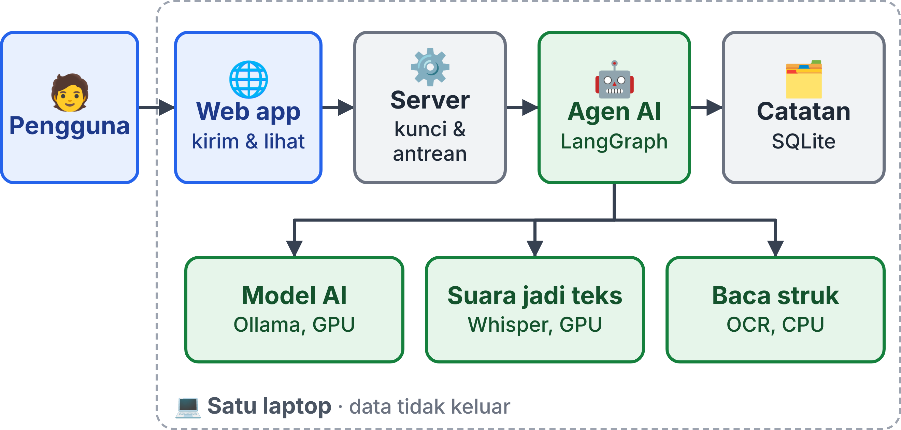
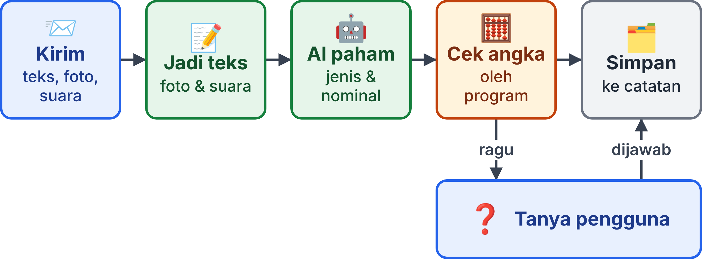

<!-- build: compact -->
# Agen AI Pencatat Keuangan Pribadi Berbasis Local AI Server

Dokumen use case, versi ringkas · Infrastruktur dan Platform Cerdas · Teuku Laksamana Andrian Rahman dan Axel David · Versi 1.0, 9 November 2026.

## 1. Ringkasan

**Masalah.** Mencatat keuangan secara manual merepotkan. Aplikasi AI di cloud bisa membantu, tetapi foto
struk dan rekaman suara harus dikirim ke pihak lain.

**Solusi.** Agen AI (program AI yang bisa memakai "alat", misalnya alat penyimpan transaksi) mencatat pemasukan
dan pengeluaran dari **teks, foto struk, dan suara**. Semuanya berjalan di **satu laptop** milik tim, sehingga
data keuangan tidak keluar. Web app menampilkan setiap langkah kerja AI, jadi prosesnya bisa diperiksa.

## 2. Fungsi Sistem

| Fungsi | Siapa | Contoh |
|---|---|---|
| Catat dari teks | Pengguna | "beli bensin 30rb" dicatat sebagai pengeluaran Rp30.000, kategori transportasi |
| Catat dari foto struk | Pengguna | Toko, tanggal, daftar barang, dan total dibaca dari foto |
| Catat dari suara | Pengguna | Rekaman "tadi beli kopi dua puluh ribu" |
| Tanya dan ringkasan | Pengguna | "pengeluaran bulan ini berapa?" |
| Jawab konfirmasi | Pengguna | AI bertanya dulu bila data kurang jelas |
| Ubah atau hapus catatan | Pengguna | "yang bensin tadi harusnya 35rb" |
| Lihat langkah kerja AI | Pengguna, Admin | Pemikiran AI, alat yang dipanggil, dan waktunya |
| Pantau server, atur kunci akses | Admin | Pemakaian GPU, antrean, API key |

Admin adalah pemilik laptop; satu orang boleh merangkap Pengguna dan Admin.

## 3. Arsitektur Sistem

| Bagian | Tugas | Teknologi |
|---|---|---|
| Web app | Tempat pengguna mengirim catatan dan melihat hasil serta langkah kerja AI | React, dibuka di browser |
| Server | Memeriksa API key (kunci akses), lalu mengantrekan permintaan satu per satu | FastAPI |
| Agen AI | Memahami masukan, memilih alat (catat, ubah, hapus, cari, ringkasan, tanya pengguna) | LangGraph |
| Model AI | Memahami bahasa dan membaca gambar | `qwen3.5:9b` lewat Ollama, di GPU |
| Suara jadi teks | Mengubah rekaman suara menjadi teks | Whisper, di GPU |
| Baca struk | Membaca teks dari foto struk (OCR) | RapidOCR, di CPU |
| Catatan | Menyimpan transaksi dan langkah kerja AI | SQLite |

## 4. Cara Kerja: Alur Mencatat

1. **Kirim.** Pengguna mengirim kalimat, foto struk, atau rekaman suara lewat web app.
2. **Jadi teks.** Foto struk dibaca dengan OCR (pembacaan teks dari gambar), suara diubah dengan
   Whisper. Teks biasa langsung lanjut.
3. **AI paham.** Agen menentukan jenis (pemasukan/pengeluaran), nominal, tanggal, dan kategori. Contoh: "30rb" menjadi 30.000.
4. **Cek angka.** Program (bukan AI) memeriksa hasilnya: total harus tertulis di struk, tanggal harus ada, dan jumlah
   harga barang harus sama dengan total. Bila gagal, AI membaca ulang foto secara langsung.
5. **Ragu? Tanya dulu.** Contoh: "tadi bayar 50" dijawab AI dengan "Rp50 atau Rp50.000?". Transaksi baru disimpan
   setelah pengguna menjawab.
6. **Simpan.** Transaksi masuk ke catatan. Jawaban dan langkah kerja AI langsung tampil di web app.

Aturan tambahan:

- **Anti-dobel:** struk yang sama tidak dicatat dua kali; program menolaknya sebelum AI dipanggil.
- **Tanya ringkasan:** angka total dihitung oleh basis data, AI hanya merangkainya menjadi kalimat.

## 5. Infrastruktur dan Keamanan

- **Satu laptop:** GPU RTX 5060 Laptop 8 GB, RAM 30 GB, Linux. Web app dan server saling terhubung lewat
  `localhost` (alamat di dalam laptop sendiri). Tidak ada port yang dibuka ke jaringan.
- **Memori GPU 8 GB:** cukup untuk model AI (sekitar 5,7 GB) dan Whisper (sekitar 0,5 GB) sekaligus. OCR memakai CPU
  agar memori GPU tetap cukup.
- **Antrean:** GPU hanya satu, jadi permintaan dikerjakan bergiliran. Saat AI menunggu jawaban konfirmasi, GPU bebas
  untuk permintaan lain.
- **API key** (kunci akses, semacam kata sandi untuk aplikasi) wajib untuk semua permintaan. Kunci hanya disimpan di
  berkas konfigurasi server.
- **Privasi:** data, foto, dan suara tetap di laptop. Tidak ada layanan AI cloud.
- **Opsi lanjutan (belum diuji):** teman sekelas bisa mencoba lewat link `https` dengan Cloudflare Tunnel, tanpa membuka port.

## 6. Framework Agent: LangGraph

Agen sudah memakai **LangGraph** sebagai mesin bawaan. Loop agen buatan sendiri dari versi pertama tetap bisa dipilih
lewat `AGENT_ENGINE=custom`. Alasan memilih LangGraph:

- Alur sistem ini memang berbentuk graf langkah: pilih jalur masukan, baca, cek angka, baca ulang, agen, konfirmasi.
- Fitur *interrupt* cocok untuk "tanya pengguna dulu" sebelum menyimpan.
- Status percakapan tersimpan (*checkpoint*) ke SQLite, termasuk saat menunggu jawaban.
- Setiap langkah menghasilkan event yang bisa ditampilkan di web app. Semua tetap berjalan lokal dengan Ollama.

| Pilihan lain | Catatan |
|---|---|
| LangChain | Kumpulan komponen (model, alat, pemuat dokumen); agen versi barunya berjalan di atas LangGraph |
| Google ADK | Punya session dan tampilan trace bawaan, tetapi dirancang untuk Gemini; model lokal lewat LiteLLM perlu dicoba dulu |

Alat pemantau berbasis cloud (mis. LangSmith) tidak dipakai, karena mengirim data keluar laptop.

## 7. Pembagian Tugas Tim

- **Orang A (server dan AI):** server, kunci akses, antrean GPU, agen dan alatnya, pembaca struk, suara jadi teks, basis data, dan migrasi ke LangGraph.
- **Orang B (web app):** form masukan (teks, foto struk, suara), tampilan langkah kerja AI, kotak konfirmasi, serta halaman transaksi dan sistem.
