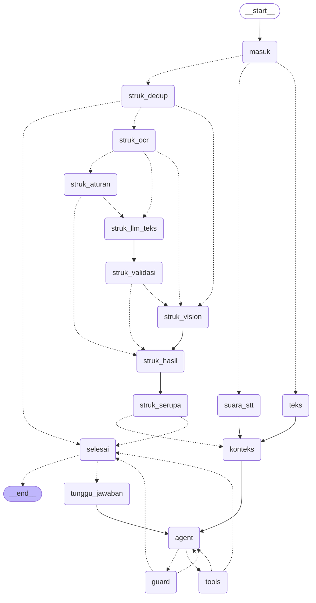

# AI Finance Agent Server (prototipe)

Local AI server untuk proyek Infrastruktur & Platform Cerdas: agent pencatat pemasukan dan pengeluaran dengan tiga
jalur input aktif (teks, foto struk, voice note; jalur email dinonaktifkan, lihat [Email](#email-dinonaktifkan)), trace
lengkap tiap run (REST + SSE), antrean job satu GPU, dan endpoint metrik. Kontrak API untuk web app sandbox ada di [`../docs/api.md`](../docs/api.md).

| Komponen | Pilihan |
|---|---|
| API | FastAPI + Uvicorn, Python 3.12 (venv `server/.venv` via uv) |
| Orkestrasi agent | **LangGraph** 1.2 (`AGENT_ENGINE=langgraph`) atau loop custom awal (`AGENT_ENGINE=custom`), lihat [Mesin agent](#mesin-agent-agent_engine) |
| LLM agent + tool calling | Ollama `qwen3.5:9b` (Q4_K_M, kapabilitas: tools, vision, thinking). **Thinking aktif** (`LLM_THINK=true`), sehingga reasoning masuk trace sebagai step `reasoning` dan di-stream live via SSE (`llm_delta`) |
| Vision (struk) | Model yang sama (`qwen3.5:9b`) dengan output JSON schema (`format`) |
| Speech-to-text | faster-whisper `small` di GPU (int8_float16, ~0,5 GB VRAM), fallback otomatis ke CPU |
| Email | **Nonaktif** (`EMAIL_ENABLED=false`). Kode parser `.eml` + IMAP tetap ada |
| Database | SQLite (`data/finance.db`): transaksi, job, run, step trace |

## Menjalankan

Prasyarat: Ollama aktif dengan `qwen3.5:9b`, `uv`, `ffmpeg`.

```bash
cd server
uv sync                      # membuat .venv dan memasang dependensi (sekali saja)
cp .env.example .env         # lalu ganti API_KEYS dengan key acak (sudah dibuat otomatis di laptop ini)
./run.sh                     # = uv run python -m app.main  → http://0.0.0.0:8000
```

- Docs interaktif: `http://localhost:8000/docs`
- Data contoh: `uv run python scripts/make_samples.py` (struk PNG, voice WAV via espeak-ng lokal, 4 file .eml fiktif)
- Uji end-to-end (server harus sudah jalan): `uv run python scripts/smoke_test.py`
- Hentikan: `Ctrl+C`, atau `kill $(cat data/server.pid)` bila dijalankan di latar

Request pertama setelah server hidup lebih lambat karena model LLM dan Whisper baru dimuat (beberapa detik).

## Mesin agent (`AGENT_ENGINE`)

Ada dua mesin orkestrasi dengan kontrak API, trace, dan SSE yang sama (web app tidak perlu diubah):

| `.env` | Isi |
|---|---|
| `AGENT_ENGINE=langgraph` (**default**) | Graf LangGraph (`app/graph_agent.py`). Model dipanggil lewat `langchain-ollama` `ChatOllama` (tools + reasoning terpisah). Konfirmasi memakai `interrupt()` + checkpointer SQLite (`data/finance_langgraph.db`) |
| `AGENT_ENGINE=custom` | Loop agent awal (`app/agent.py`), tidak diubah |

**Kembali ke mesin lama (satu baris):**

```bash
# di server/.env
AGENT_ENGINE=custom
# lalu restart server (Ctrl+C, ./run.sh). Database transaksi/run sama, tidak perlu migrasi.
```

Run yang sedang menunggu konfirmasi tetap bisa dijawab setelah mesin diganti: bila thread graf tidak ada, riwayat
percakapan diambil dari database seperti mesin custom. Kolom aditif `runs.engine` mencatat mesin tiap run, dan
`GET /v1/agent/graph` mengembalikan diagram Mermaid graf + mesin aktif.

Graf LangGraph (node praproses per jenis input, agent ↔ tools, guard, selesai, interrupt konfirmasi):



- Batas langkah (`AGENT_MAX_STEPS`) dan timeout run (`AGENT_RUN_TIMEOUT_S`) sama untuk kedua mesin.
- Setiap step trace punya field aditif `node` (nama node graf; `null` untuk mesin custom).
- **Tanpa telemetri keluar.** Tracing LangSmith dipaksa mati di kode (`LANGSMITH_TRACING=false` + `tracing_context(enabled=False)`),
  jadi data keuangan tidak dikirim ke layanan cloud. Server hanya terhubung ke Ollama lokal.
- Paket: `langgraph` 1.2.20, `langgraph-checkpoint-sqlite` 3.1.3, `langchain-ollama` 1.1.0, `langchain-core` 1.7.6.

## Email dinonaktifkan

Keputusan pemilik: fitur email tidak dipakai. `EMAIL_ENABLED=false` (default) membuat `POST /v1/email` dan
`POST /v1/email/imap/fetch` menjawab `410 Gone` dengan pesan jelas, tanpa membuat job. Graf LangGraph tidak punya node
email. Kode parser `.eml`/IMAP tetap ada: set `EMAIL_ENABLED=true` lalu restart untuk mengembalikannya (run email kemudian
dijalankan mesin custom). Contoh curl email dan konektor IMAP di bawah hanya berlaku bila fitur ini dinyalakan lagi.

## Mode demo cepat

Default: agent **berpikir** (`LLM_THINK=true`, reasoning tampil live di sandbox, teks ±23 detik) dan ekstraksi struk
**tanpa** thinking (`VISION_THINK=false`). Bila demo butuh respons cepat (±9 detik untuk teks):

```bash
# di server/.env
LLM_THINK=false        # agent tidak berpikir: tidak ada step `reasoning`/event thinking, teks ±9 dtk, struk ±30 dtk
# lalu restart server (Ctrl+C, ./run.sh). Kembalikan ke true untuk menampilkan reasoning.
```

Reset database (semua transaksi, run/trace, dan file upload ikut terhapus):

```bash
# hentikan server dulu (Ctrl+C atau: kill $(cat data/server.pid))
rm -f data/finance.db data/finance.db-wal data/finance.db-shm   # hanya database
rm -rf data/uploads                                              # opsional: file struk/suara/email yang diunggah
./run.sh                                                         # tabel dibuat ulang otomatis saat start
```

## Ekstraksi struk (`RECEIPT_MODE`)

| `.env` | Alur | Rata-rata ekstraksi* |
|---|---|---|
| `RECEIPT_MODE=ocr_llm` (default) | OCR CPU (PaddleOCR PP-OCRv4 via RapidOCR) → LLM teks saja (tanpa thinking) → validasi → fallback vision bila gagal | 12,5 dtk |
| `ocr_llm` + `RECEIPT_RULES_FIRST=true` (**dipakai untuk demo**) | OCR → parser aturan; bila lolos validasi LLM dilewati, bila tidak lanjut LLM teks → vision | 1,5 dtk |
| `RECEIPT_MODE=ocr_only` | OCR + aturan/regex saja, tanpa LLM | 0,6 dtk |
| `RECEIPT_MODE=vision` | Model vision membaca gambar (jalur awal) | 10,4 dtk |

\*Benchmark 8 struk sintetis: `uv run python scripts/bench_receipt.py`, hasil di `data/bench_receipt.md`. Waktu di atas
hanya tahap membaca struk; agent pencatat (dengan thinking) menambah ±30–40 detik. OCR selalu di CPU (±0,5–1 detik),
sehingga tidak menambah beban VRAM. Trace menyimpan step `ocr` (teks per baris, bbox di koordinat gambar asli,
confidence), `validation`, dan `fallback`. Skemanya ada di `docs/api.md`.

## Akses dari laptop teman

**LAN yang sama.** Server sudah bind ke `0.0.0.0:8000`.
1. Cari IP laptop server: `ip -4 addr show | grep inet` (contoh saat ini: `10.31.104.83` di `wlp99s0`).
2. Dari laptop teman: `curl http://10.31.104.83:8000/health`.
3. Bila gagal, cek firewall di laptop server (`sudo ufw allow 8000/tcp` bila ufw aktif). WiFi kampus sering memakai
   *client isolation* sehingga perangkat tidak bisa saling akses. Dalam kasus itu pakai Tailscale.

**Tailscale (cadangan).** Pasang di kedua laptop (`curl -fsSL https://tailscale.com/install.sh | sh`, lalu `sudo tailscale up`),
login dengan akun yang sama (atau share device). Setelah itu pakai IP `100.x.y.z` dari `tailscale ip -4` di laptop server:
`http://100.x.y.z:8000`. Tailscale belum terpasang di laptop ini.

Web app sandbox mengirim header `X-API-Key`. Untuk `EventSource` (SSE) pakai `?api_key=...`. Atur `CORS_ORIGINS` di `.env`
ke origin web app (mis. `http://10.31.104.50:5173`) bila tidak ingin `*`.

## Contoh request (curl)

```bash
BASE=http://localhost:8000
KEY=$(grep ^API_KEYS .env | cut -d= -f2 | cut -d, -f1)

# 1) Teks (wait=true → tunggu hasil; tanpa wait → dapat job_id/run_id lalu pantau via SSE)
curl -s -X POST "$BASE/v1/chat?wait=true" -H "X-API-Key: $KEY" -H "Content-Type: application/json" \
  -d '{"text":"beli bensin 30rb tadi pagi, terus gajian 4,5 juta"}'

# 2) Foto struk
curl -s -X POST "$BASE/v1/receipt?wait=true" -H "X-API-Key: $KEY" -F file=@samples/struk_serba_ada.png

# 3) Voice note (wav/ogg/opus/m4a/mp3/webm)
curl -s -X POST "$BASE/v1/voice?wait=true" -H "X-API-Key: $KEY" -F file=@samples/voice_bakso.wav

# 4) Email .eml
curl -s -X POST "$BASE/v1/email?wait=true" -H "X-API-Key: $KEY" -F file=@samples/email_transfer_masuk.eml

# Jawab pertanyaan konfirmasi (pakai conversation_id dari run sebelumnya)
curl -s -X POST "$BASE/v1/chat?wait=true" -H "X-API-Key: $KEY" -H "Content-Type: application/json" \
  -d '{"text":"50 ribu, bayar parkir","conversation_id":"conv_xxx"}'

# Trace, stream live, antrean, transaksi, ringkasan, metrik
curl -s "$BASE/v1/runs?limit=5" -H "X-API-Key: $KEY"
curl -s "$BASE/v1/runs/RUN_ID" -H "X-API-Key: $KEY"
curl -N "$BASE/v1/runs/RUN_ID/stream?api_key=$KEY"        # SSE
curl -N "$BASE/v1/events?api_key=$KEY"                    # SSE global
curl -s "$BASE/v1/jobs" -H "X-API-Key: $KEY"
curl -s "$BASE/v1/transactions?periode=bulan_ini" -H "X-API-Key: $KEY"
curl -s "$BASE/v1/summary?periode=bulan_ini" -H "X-API-Key: $KEY"
curl -s "$BASE/v1/metrics" -H "X-API-Key: $KEY"
```

## Konektor IMAP (opsional)

Isi `IMAP_HOST`, `IMAP_USER`, `IMAP_PASSWORD` (untuk Gmail pakai *App Password*) di `.env`, restart server, lalu
`curl -X POST "$BASE/v1/email/imap/fetch" -H "X-API-Key: $KEY"`. Folder dibuka read-only dengan `BODY.PEEK`, jadi email
tidak ditandai terbaca. **Belum diuji dengan server IMAP sungguhan.** Pengujian hanya memakai file `.eml` contoh.

## Docker (bonus, BELUM DIUJI)

`Dockerfile` dan `docker-compose.yml` disertakan, tetapi Docker belum terpasang di laptop ini sehingga keduanya belum pernah
di-build. Ollama tetap berjalan di host. Agar container bisa menjangkaunya, Ollama harus listen di `0.0.0.0`
(`OLLAMA_HOST=0.0.0.0`). Whisper di GPU butuh NVIDIA Container Toolkit, tanpa itu set `WHISPER_DEVICE=cpu`.

## Struktur

```
server/
  app/main.py        rute FastAPI, auth API key, CORS, rate limit, SSE
  app/agent.py       mesin custom: praproses input + loop LLM/tool calling + guard
  app/graph_agent.py mesin LangGraph: graf node praproses/agent/tools/guard/selesai + interrupt konfirmasi
  app/lc_llm.py      pemanggil ChatOllama (bentuk hasil sama dengan llm.py), telemetri LangSmith dimatikan
  app/engine.py      pemilih mesin (AGENT_ENGINE)
  app/tools.py       definisi & implementasi tool (SQLite)
  app/trace.py       perekam step + event bus SSE
  app/jobqueue.py    antrean FIFO satu worker
  app/metrics.py     latency, token/s, antrean, nvidia-smi
  app/inputs/        receipt.py (pipeline struk 3 mode), ocr.py (RapidOCR CPU), receipt_rules.py (parser + validasi),
                     stt.py (whisper), email_in.py (.eml/IMAP)
  scripts/           make_samples.py, tts_espeak.py, smoke_test.py, bench_receipt.py
  samples/           data uji fiktif
  data/              SQLite, upload, log (tidak di-commit)
```

## Hasil uji (9 Nov 2026, `scripts/smoke_test.py`)

Konfigurasi final (`LLM_THINK=true`, `VISION_THINK=false`): **50 PASS / 0 FAIL**. Rata-rata durasi run:

| Input | Model | Final | Thinking semua (termasuk vision) | Thinking mati |
|---|---|---|---|---|
| Teks | qwen3.5:9b (tools + thinking) | 30 dtk (15–49) | 23 dtk | 9 dtk |
| Foto struk | qwen3.5:9b vision tanpa thinking (±23 dtk) lalu agent | **70 dtk** | 197 dtk | 30 dtk |
| Voice note | faster-whisper small (lalu agent) | 40 dtk | 29 dtk | 11 dtk |
| Email .eml | parser lalu agent | 36 dtk (13–52) | 29 dtk | 9 dtk |
| Duplikat (email/struk sama) | – (tanpa LLM) | < 5 ms | – | – |

Saat uji final, aplikasi lain (`deckcraft`, ±700 MiB) ikut memakai GPU. Akibatnya Whisper otomatis jatuh ke CPU
(1,6 detik untuk 5 detik audio) dan kecepatan LLM turun ke ±13 tok/detik (sebelumnya ±15–16). Tanpa aplikasi itu,
Whisper berjalan di GPU dan latensi kemungkinan lebih rendah. Puncak VRAM 7,7 GB dari 8,15 GB. **Tutup aplikasi GPU lain saat demo.**

## Hasil uji LangGraph vs custom (9 Nov 2026 malam, `scripts/smoke_test.py`)

Konfigurasi: `LLM_THINK=true`, `RECEIPT_MODE=ocr_llm` + `RECEIPT_RULES_FIRST=true`, `EMAIL_ENABLED=false`, server uji di
port 8001 dengan DB terpisah. **GPU sedang error (Xid 62, "GPU Reset Required" sejak 20:18), jadi qwen3.5:9b berjalan
100% di CPU (±9 tok/dtk) dan Whisper di CPU.** Latensi di bawah karena itu lebih lambat daripada tabel GPU di atas dan
VRAM tidak bisa diukur.

| | `langgraph` | `custom` |
|---|---|---|
| Smoke test | **55 PASS / 0 WARN / 1 FAIL** | 50 PASS / 1 WARN / 1 FAIL |
| FAIL | cek GPU/VRAM di `/v1/metrics` (GPU error, bukan mesin) | sama |
| WARN | – | input ambigu: model berhenti tanpa jawaban (guard `jawaban_kosong`), jadi alur konfirmasi tidak teruji di run ini |
| Teks (n=4) | 49,6 dtk (24–77) | 64,4 dtk (29–95) |
| Struk, rules-first (n=1) | 80,9 dtk (ekstraksi 1,2 dtk) | 100,1 dtk |
| Voice (n=1) | 53,7 dtk | 49,3 dtk |
| Ubah/hapus lewat agent (n=2) | 46,4 dtk | 48,9 dtk |
| RAM proses server (puncak) | 987 MiB | 950 MiB |

Selisih latensi berasal dari jumlah token yang dihasilkan model (acak, n kecil), bukan dari mesin: LangGraph hanya
menambah beberapa milidetik per node. Checks tambahan untuk LangGraph (semua PASS): `/v1/agent/graph`, field `node`
di semua step, `runs.engine`, 410 untuk email, dan jalur rules-first.

Jalur struk rules-first pada 8 struk `samples/bench/` (mesin langgraph): 7 struk lolos aturan
(`struk_ocr → struk_aturan → struk_hasil`, ekstraksi 0,4–0,8 dtk, LLM ekstraksi dilewati). `r7_spbu` gagal aturan lalu
jatuh ke `struk_llm_teks → struk_validasi → struk_vision` (fallback vision, 33 dtk). Kedelapan total benar.

Web app tanpa perubahan (`npm run e2e:live` dengan `SERVER=http://localhost:8001`) terhadap mesin langgraph: **16/16 PASS**
(percobaan kedua). Pada percobaan pertama 15/16: model berhenti tanpa jawaban untuk "tadi bayar 50", perilaku model yang
sama dengan WARN mesin custom di atas.

## Anti-dobel & outcome

- Email dengan Message-ID yang sama (upload `.eml` maupun IMAP) atau gambar struk dengan hash sama ditolak:
  `status=done`, `outcome=duplicate`, tanpa memanggil LLM.
- Foto lain dari struk yang sudah tercatat (toko + tanggal + total sama) memicu konfirmasi (`outcome=possible_duplicate`).
- Email promo/non-transaksi berakhir `status=done`, `outcome=not_transaction`.
- Lihat tabel `outcome` di `docs/api.md`.

## Catatan & keterbatasan

- Dengan thinking aktif, model kadang menutup giliran hanya dengan reasoning tanpa teks jawaban. Bila itu terjadi, jawaban
  dibuat otomatis dari hasil tool (step `guard/jawaban_kosong`).
- Model 9B kadang tidak memanggil tool padahal mengaku "sudah dicatat". Untuk itu ada *guard*: bila jawaban mengklaim
  pencatatan tanpa tool tulis yang berhasil, agent diminta mengulang (terlihat sebagai step `guard` di trace).
- Model juga kadang bertanya balik lewat teks biasa, bukan tool `minta_konfirmasi`. Bila jawaban berisi pertanyaan dan tidak
  ada tool yang berhasil, run tetap ditandai `awaiting_confirmation` (step `confirmation/pertanyaan_teks`).
- Audio uji dibuat dengan espeak-ng (suara robot), jadi transkripsinya tidak sempurna ("bakso" → "makso"). Suara manusia
  asli seharusnya lebih baik. Ganti `WHISPER_MODEL=medium` bila VRAM cukup (lihat laporan).
- Tidak ada autentikasi per pengguna (satu buku kas). API key hanya membatasi akses ke server.
